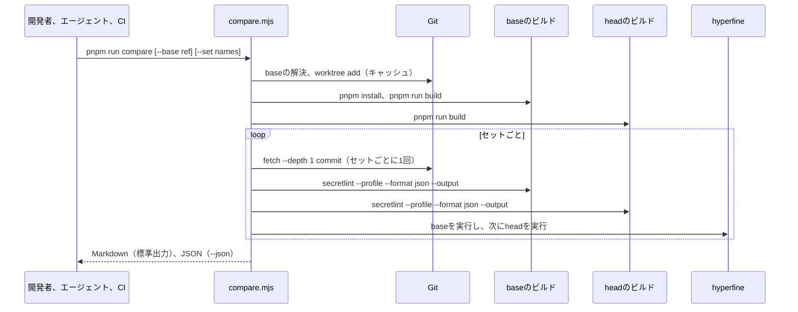

# 変更の比較の設計

[English](design.md)

## このドキュメントについて

この文書は、[Secretlint](../../product.ja.md)の[変更の比較](requirements.ja.md)を設計する。1つのスクリプトがbaseとheadをビルドし、ファイルのセットを用意し、両方のビルドを実行し、違いを書き出す方法と、プルリクエストのコードにシークレットも書き込み権限も渡さずにCIがスクリプトを実行する方法を扱う。

### 対象読者

比較スクリプト、そのCIのワークフロー、ファイルのセットを実装または変更する人とエージェント。

### 前提知識

- [性能プロファイル](../performance-profile/requirements.ja.md): `--profile --format json`のJSONの要約
- [結果の出力](../result-output/requirements.ja.md): `--format json`と`--output`
- GitHub Actions: `pull_request`イベント、`permissions`、ジョブサマリー（`GITHUB_STEP_SUMMARY`）、artifact

### このドキュメントで扱わないこと

- プロファイルの数値の意味。性能プロファイルが扱う。
- `benchmark.yml`の`master`のベンチマーク。変更しない。
- プルリクエストへのコメントと結果の履歴。Requirementsでスコープ外である。

## 実装方針

成果物は次のとおりである。

- `examples/benchmark/compare.mjs`: 比較スクリプト。privateなベンチマークのパッケージの中で、smallのセット（`targets/`）と検査の設定（`.secretlintrc.json`、canaryプリセット）の隣に置く。ルートの`package.json`は`"compare": "node examples/benchmark/compare.mjs"`を持つ。
- `examples/benchmark/compare-sets.json`: small以外のセット。セットごとにリポジトリのURLとコミットを持つ。
- `.github/workflows/compare.yml`: CIのワークフロー。
- `AGENTS.md`の1行。エージェントに`pnpm run compare`を実行させ、Markdownの出力をプルリクエストの説明に貼らせる。

スクリプトはNode.jsの組み込みモジュールだけを使う。そのため、パッケージをインストールしなくても新しくチェックアウトしたリポジトリで動き、同じファイルで任意の2つのコミットを比べられる。

スクリプトの主な流れは次のとおりである。

1. **ビルド。** headは作業ツリーである。スクリプトは、`--no-build`がなければ作業ツリーで`pnpm run build`を実行する。baseはコミットである。スクリプトは`--base`（既定は`origin/master`、リモートのブランチがなければ`master`）をコミットに解決し、キャッシュディレクトリに`git worktree add`でそのコミットのdetachedなworktreeを作る。そこで`pnpm install --frozen-lockfile`と`pnpm run build`を実行する。ビルド済みの同じコミットのworktreeは再利用する。
2. **セット。** smallのセットはheadの`examples/benchmark/targets`である。他のセットでは、スクリプトはキャッシュディレクトリにディレクトリを作り、`git init`、`git fetch --depth 1 <url> <commit>`、`git checkout FETCH_HEAD`を実行し、チェックアウトが終わったら目印のファイルを書く。目印のあるディレクトリは再利用するので、セットのダウンロードは1回で済む。`--set`はカンマ区切りでセットを選ぶ。既定はすべてのセットである。
3. **検査の実行。** スクリプトは、セットとビルドの組ごとに、セットのディレクトリでビルドのCLIを1回実行する。
   `node <build>/packages/secretlint/bin/secretlint.js "**/*" --secretlintrc <head>/examples/benchmark/.secretlintrc.json --profile --format json --output <tmp>/results.json`
   `--profile`を指定すると標準出力はJSONのプロファイルになり、`--output`には検査結果が書かれるので、1回の実行で両方を得られる。プロファイルの行テストの数は比べない。ワーカースレッドがあると、どのスレッドがどのファイルを読むかで変わるからである（vscodeでの計測: 同じビルドの2回の実行で18,993と18,955）。パターンの実行回数とマッチ数は毎回同じである。両方のビルドがheadの設定ファイルを使い、各ビルドはcanaryプリセットを自身のルールに解決する。
4. **実行時間。** `hyperfine`が`PATH`にある場合、スクリプトはセットのディレクトリで、`--profile`なしの検査の2つのコマンド（`--format json --output /dev/null`）で`hyperfine --ignore-failure --warmup 1 --runs <n> --export-json <tmp>/time.json`を実行する。先にbaseをすべて実行し、次にheadをすべて実行する。検査がシークレットを見つけると終了ステータスは1になるので、`--ignore-failure`が必要である。コマンドの引数はそれぞれシェル向けにクォートするので、globはそのままSecretlintに渡り、空白を含むパスも動く。既定の実行回数はsmallとmediumが10、largeが5、hugeが3で、`--runs`で上書きできる。
5. **違い。** スクリプトは2つのプロファイルと2つの検査結果を比べ（データモデルを参照）、標準出力にMarkdownを、`--json <path>`（既定は現在のディレクトリの`compare-result.json`）にJSONを書く。

ビルドの失敗、セットのダウンロードの失敗、終了ステータス2で終わる検査の実行があった場合、スクリプトはビルドまたはセットの名前を示すメッセージとともに終了ステータス2で止まる。このとき出力は書かない。`hyperfine`が見つからない場合、実行時間の節は測っていないことを示し、終了ステータスは0である。

## アーキテクチャ・シーケンス図



CIでは、セットごとにmatrixの1つのジョブになる。ジョブ間でビルドを共有するには、パッケージとその`node_modules`をartifactとしてアップロードする必要があり、ソースよりはるかに大きく、すべてのジョブが1つのビルドのジョブを待つことになる。そのため、各ジョブが両方のビルドを作る。

## データモデル・ER 図

JSONの出力は次のとおりである。

```ts
type CompareResult = {
    base: { ref: string; commit: string };
    head: { commit: string; dirty: boolean };
    sets: SetResult[];
};
type SetResult = {
    name: "small" | "medium" | "large" | "huge";
    repository: string | null; // smallではnull
    commit: string | null;
    files: { base: number; head: number };
    patterns: PatternDiff[]; // 数値が異なるパターンだけ
    rules: RuleDiff[]; // ルールごとのファイル数。異なる場合だけ
    keywordGuards: GuardDiff[]; // 異なる場合だけ
    findings: { added: Finding[]; removed: Finding[]; base: number; head: number };
    time: { base: Stats; head: Stats; ratio: number; mark: "slower" | "faster" | null } | null; // 測っていない場合はnull
};
type PatternDiff = {
    id: string; // "<ruleId>#<index>"
    pattern: string;
    base: { runs: number; matches: number } | null; // null: パターンが仕事をしなかった、または存在しない
    head: { runs: number; matches: number } | null;
};
type Finding = { ruleId: string; messageId: string; file: string; line: number }; // fileはセットからの相対パス
type Stats = { median: number; mean: number; stddev: number; runs: number }; // ミリ秒
```

パターンはプロファイルが使うIDである`<ruleId>#<index>`で識別する。比べるのは回数だけである。プロファイルの時間は実行ごとに変わるので比べない。片方のプロファイルにないパターンは、そちらでは仕事をしなかった（プロファイルは実行されたか行をテストしたパターンだけを持つ）ので、`-`として示す。

検出結果は、`ruleId`、`messageId`、ファイル、行の多重集合として比べる。メッセージの文字列はシークレットを含みうるので使わない。

`mark`は、`ratio >= 1.3`なら`slower`、`ratio <= 0.77`なら`faster`、それ以外は`null`である。`ratio`はheadの中央値をbaseの中央値で割った値である。

Markdownの出力は、セットごとに次を持つ。セット、コミット、ファイル数の見出し。比と印（`⚠️ slower`または`faster`）を伴う実行時間。異なるパターンの表、または「No change in pattern work」。追加と削除の検出結果をそれぞれ最大50行、または「No change in findings」。JSONはすべての行を持つ。

## API・インターフェース

### コマンド

```
pnpm run compare [--base <ref>] [--set small,medium,large,huge] [--runs <n>] [--json <path>] [--cache-dir <dir>] [--no-build]
```

- `--base`: Gitのrefまたはコミット。既定は`origin/master`、なければ`master`。
- `--set`: セット。既定はすべて。
- `--runs`: すべてのセットで、hyperfineがコマンドごとに実行する回数。
- `--json`: JSONの出力のパス。
- `--cache-dir`: baseのworktreeとセットを置く場所。既定は`$XDG_CACHE_HOME/secretlint-compare`、または`~/.cache/secretlint-compare`。リポジトリの外なので、フォーマッター、リポジトリの検査、pnpmのworkspaceはこれを見ない。
- `--no-build`: headをビルドしない（ビルド済みである）。

終了ステータスは、違いにかかわらず比較を書いた場合は0、実行できない場合は2である。

### CIのワークフロー

`.github/workflows/compare.yml`:

- `on: pull_request`で、`paths`は`packages/**`、`examples/benchmark/**`、`package.json`、`pnpm-lock.yaml`、`pnpm-workspace.yaml`、`.github/workflows/compare.yml`、`!**/*.md`。
- ワークフローの`permissions`は`contents: read`。`secrets`を使うステップはない。
- `strategy.matrix.set: [small, medium, large, huge]`と`fail-fast: false`の1つのジョブ。`ubuntu-latest`、`timeout-minutes: 30`。
- ステップ: `persist-credentials: false`と`fetch-depth: 0`（baseのコミットが必要）でチェックアウトし、`test.yml`と同じようにpnpmとNode.jsを用意し、`sudo apt-get install -y hyperfine`、`pnpm install --frozen-lockfile`を実行する。次に`--set ${{ matrix.set }}`でスクリプトを実行し、標準出力を`$GITHUB_STEP_SUMMARY`に追記する。最後にJSONをartifact `compare-<set>`としてアップロードする。
- baseのコミットは`github.event.pull_request.base.sha`から環境変数で渡し、シェルのコマンドに直接書かない。

### AGENTS.md

Quick Referenceの1行。ルールや検査のコードに触れる変更では、`pnpm run compare`（手早く確かめるなら`--set small,medium`）を実行し、Markdownの出力をプルリクエストの説明に貼る。

## 外部サービスとの連携方式

- **GitHub Actions**: ワークフローを実行し、リポジトリの保持期間のあいだartifactを残す。既定の読み取り専用の`GITHUB_TOKEN`以外のトークンは使わず、スクリプトはこのトークンも使わない。
- **GitHub（HTTPSのgit）**: セットは`git fetch --depth 1`でコミットを指定して取得する。GitHubは公開リポジトリのコミットの取得を許している。取得に失敗した場合、スクリプトは終了ステータス2で止まる。2026-11-14の計測（4 vCPUのクラウドのマシン）では、reactが3秒、vscodeが10秒、linuxが21秒だった。
- **hyperfine**: CIではaptでインストールする。手元では任意である。

## データの取り扱い設計

セットは固定したコミットの公開リポジトリである。

| セット | リポジトリ | コミット | ファイル数（git ls-files） |
| --- | --- | --- | --- |
| small | `examples/benchmark/targets` | （head） | 約600 |
| medium | https://github.com/facebook/react | `61aa00df822d0eb76d0362eb8b6fdd3527693efe`（v19.3.1） | 7,222 |
| large | https://github.com/microsoft/vscode | `69047191fc427f2f92828279aae1d90d8eeda7ab`（1.146.0） | 21,005 |
| huge | https://github.com/torvalds/linux | `c03c1a14507dfaf8b856c2608f9ac216021fc222`（v7.3） | 96,080 |

コミットはそれだけを変えるプルリクエストでのみ変更する。そのため、プルリクエストの比較で、セットの変化とコードの変化が混ざることはない。キャッシュディレクトリは利用者が削除するまで残る。2つの比較が同じキャッシュディレクトリを使うことがある。スクリプトは、キャッシュの項目（baseのビルドまたはセット）を準備する間、プロセスIDを書いたロックのディレクトリ`<項目>.lock`を持ち、ロックを得たあとに目印をもう一度確かめる。実行中のプロセスがロックを持つ場合、もう一方の比較はその項目に触れずにエラーで終わる。終了したプロセスのロックは削除する。実行の一時ファイル（検査結果と時間）はスクリプトの終了時に削除し、JSONの出力だけが残る。

ビルドの検査結果は、`ruleId`、`messageId`、ファイル、行だけを読む。シークレットを含みうるメッセージは、どの出力にも書かない。

## 認証認可に関する特記事項

CIのジョブは読み取り専用の`GITHUB_TOKEN`を持ち、シークレットを持たない。`actions/checkout`はGitの設定にトークンを残さない（`persist-credentials: false`）ので、プルリクエストのコードはトークンを使ってpushできない。

## セキュリティ上の留意事項

ワークフローはforkからのものを含むプルリクエストのコードを実行するので、`pull_request_target`ではなく`pull_request`を使う。GitHubは、`pull_request`ではforkからのプルリクエストにシークレットを渡さず、読み取り専用のトークンを渡す。書き込み権限を持つものは比較の出力を読まない。後からプルリクエストにコメントするワークフローを作る場合は、`workflow_run`を使い、プルリクエストのコードをチェックアウトも実行もせず、artifactを信頼できないデータとして扱う。

baseのコミットとセットの名前はイベントとmatrixから来て、環境変数で渡す。そのため、ブランチ名やプルリクエストのタイトルがシェルのコマンドの一部になることはない。

## デプロイに関する特記事項

なし。ワークフローは、マージ後に検査のコードを変更する最初のプルリクエストから動く。それより前に作られたプルリクエストは、自身のheadのワークフローを実行する。

## 検討した代替手段

### ラベルで許可する`pull_request_target`

直接コメントできるが、プルリクエストのコードにシークレットと書き込み可能なトークンを渡す。GitHub Security Labは、ラベルによる許可を競合状態のある一時的な対策としている（https://securitylab.github.com/resources/github-actions-preventing-pwn-requests/ ）。採用しない。

### hyperfineではなくプロファイルの時間を使う

プロファイルは1回の実行の合計時間を持つが、共有マシンでは1回の実行が10%以上変わる。実行を繰り返すのはベンチマークツールの仕事である（性能プロファイルのスコープ外）。採用しない。

### 1回だけビルドしてジョブ間で共有する

各ジョブのビルドを省けるが、artifactはパッケージとその`node_modules`を持つことになり、ジョブは1つのビルドのジョブを待つ。ジョブは並列に動くので採用しない。

### CIでセットをキャッシュする

`actions/cache`でセットを残せるが、取得は長くても約20秒であり、プルリクエストと共有するキャッシュはセットのファイルが変えられる場所を増やす。採用しない。

### CodSpeedなどのサービス

命令数を数える方式はノイズが少ないが、外部サービスが増え、ワーカースレッドを使うCLIをそのシミュレーションモードで測れるかは確かめていない。今は採用しない。プロファイルの回数で、すでにノイズのない比較ができる。

## 未決事項

なし。
