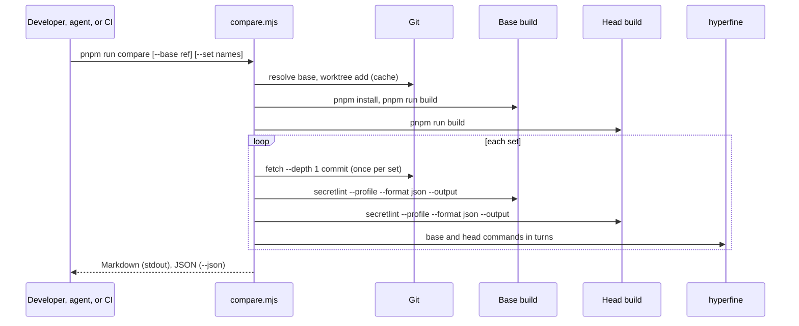

# Change comparison design

[日本語](design.ja.md)

## About this document

This document designs [Change comparison](requirements.md) of [Secretlint](../../product.md): how one script builds the base and the head, prepares the sets of files, runs both builds, and writes the differences, and how CI runs it for a pull request without giving the code of the pull request any secret or write access.

### Audience

People and agents who implement or change the comparison script, its CI workflow, or the sets of files.

### Prerequisites

- [Performance profile](../performance-profile/requirements.md): the JSON summary of `--profile --format json`
- [Result output](../result-output/requirements.md): `--format json` and `--output`
- GitHub Actions: the `pull_request` event, `permissions`, the job summary (`GITHUB_STEP_SUMMARY`), and artifacts

### Outside this document

- The meaning of the numbers of the profile. They belong to Performance profile.
- The benchmark of `master` in `benchmark.yml`. It is not changed.
- A comment on the pull request and a history of results. They are out of scope of the Requirements.

## Implementation approach

The deliverables are:

- `examples/benchmark/compare.mjs`: the comparison script. It is in the private benchmark package, next to the small set (`targets/`) and the configuration of the lint (`.secretlintrc.json`, the canary preset). The root `package.json` has `"compare": "node examples/benchmark/compare.mjs"`.
- `examples/benchmark/compare-sets.json`: the sets other than small, each with its repository URL and the commit.
- `.github/workflows/compare.yml`: the CI workflow.
- A line in `AGENTS.md` that tells an agent to run `pnpm run compare` and to paste its Markdown output into the description of the pull request.

The script uses only the built-in modules of Node.js, so it runs on a fresh checkout without installing a package, and the same file compares any two commits.

The main flow of the script is:

1. **Builds.** The head is the working tree. The script runs `pnpm run build` in it unless `--no-build` is given. The base is a commit: the script resolves `--base` (default `origin/master`, or `master` when there is no remote branch) to a commit, and creates a detached worktree of it in the cache directory with `git worktree add`. It runs `pnpm install --frozen-lockfile` and `pnpm run build` there. A worktree of the same commit that has been built is reused.
2. **Sets.** The small set is `examples/benchmark/targets` of the head. For another set, the script creates a directory in the cache directory, runs `git init`, `git fetch --depth 1 <url> <commit>`, and `git checkout FETCH_HEAD`, and writes a marker file when the checkout is complete. A directory with the marker is reused, so a set is downloaded once. `--set` selects the sets, separated by commas; the default is all sets.
3. **Lint runs.** For each set and each build, the script runs the CLI of the build once in the directory of the set:
   `node <build>/packages/secretlint/bin/secretlint.js "**/*" --secretlintrc <head>/examples/benchmark/.secretlintrc.json --profile --format json --output <tmp>/results.json`.
   With `--profile`, the standard output is the profile as JSON and `--output` gets the lint results, so one run gives both. Both builds use the configuration file of the head, and each build resolves the canary preset to its own rules.
4. **Run time.** When `hyperfine` is on `PATH`, the script runs `hyperfine -N -i --warmup 1 --runs <n> --export-json <tmp>/time.json` with the two commands of the lint without `--profile` (`--format json --output /dev/null`). `-i` is needed because the exit status is 1 when the lint finds a secret. `-N` runs the commands without a shell, so the glob is passed to Secretlint as it is. The default runs are 10 for small and medium, 5 for large, and 3 for huge; `--runs` overrides them.
5. **Differences.** The script compares the two profiles and the two lint results (see Data model) and writes Markdown to the standard output and JSON to `--json <path>` (default: `compare-result.json` in the current directory).

A build failure, a failure to download a set, or a lint run that ends with the exit status 2 stops the script with the exit status 2 and a message that names the build or the set. The script writes no output then. When `hyperfine` is not found, the run time section says that it was not measured, and the exit status is 0.

## Architecture and sequence diagrams



In CI, each set is one job of a matrix. Each job builds both builds, because sharing a build between jobs would mean uploading the packages and their `node_modules` as an artifact, which is much larger than the source, and every job would wait for one build job.

## Data model and ER diagrams

The JSON output:

```ts
type CompareResult = {
    base: { ref: string; commit: string };
    head: { commit: string; dirty: boolean };
    sets: SetResult[];
};
type SetResult = {
    name: "small" | "medium" | "large" | "huge";
    repository: string | null; // null for small
    commit: string | null;
    files: { base: number; head: number };
    patterns: PatternDiff[]; // only the patterns whose numbers differ
    rules: RuleDiff[]; // the number of files of each rule, only when it differs
    keywordGuards: GuardDiff[]; // only when it differs
    findings: { added: Finding[]; removed: Finding[]; base: number; head: number };
    time: { base: Stats; head: Stats; ratio: number; mark: "slower" | "faster" | null } | null; // null when not measured
};
type PatternDiff = {
    id: string; // "<ruleId>#<index>"
    pattern: string;
    base: { runs: number; matches: number; lineTests: number } | null; // null: the pattern did no work, or does not exist
    head: { runs: number; matches: number; lineTests: number } | null;
};
type Finding = { ruleId: string; messageId: string; file: string; line: number }; // file is relative to the set
type Stats = { median: number; mean: number; stddev: number; runs: number }; // milliseconds
```

A pattern is identified by `<ruleId>#<index>`, the id that the profile uses. Only the counts are compared: the times of the profile are not, because they change between runs. A pattern that is missing from one profile did no work there (the profile lists only the patterns that ran or tested a line), and it is shown as `-`.

Findings are compared as multisets of `ruleId`, `messageId`, file, and line. The message text is not used, because it can contain the secret.

`mark` is `slower` when `ratio >= 1.3`, `faster` when `ratio <= 0.77`, and otherwise `null`. `ratio` is the median of the head divided by the median of the base.

The Markdown output has, for each set: a header with the set, the commit, and the number of files; the run time with the ratio and a mark (`⚠️ slower` or `faster`); a table of the patterns that differ, or "No change in pattern work"; and the added and removed findings, at most 50 rows each, or "No change in findings". The JSON has all rows.

## APIs and interfaces

### Command

```
pnpm run compare [--base <ref>] [--set small,medium,large,huge] [--runs <n>] [--json <path>] [--cache-dir <dir>] [--no-build]
```

- `--base`: a Git ref or commit. Default: `origin/master`, else `master`.
- `--set`: the sets. Default: all.
- `--runs`: the runs of each command for hyperfine, for every set.
- `--json`: the path of the JSON output.
- `--cache-dir`: where the base worktree and the sets are kept. Default: `$XDG_CACHE_HOME/secretlint-compare`, or `~/.cache/secretlint-compare`. It is outside the repository, so the formatter, the lint of the repository, and the pnpm workspace do not see it.
- `--no-build`: do not build the head (it is already built).

Exit status: 0 when the comparison is written, whatever the differences are; 2 when it can not run.

### CI workflow

`.github/workflows/compare.yml`:

- `on: pull_request` with `paths`: `packages/**`, `examples/benchmark/**`, `package.json`, `pnpm-lock.yaml`, `pnpm-workspace.yaml`, `.github/workflows/compare.yml`, and `!**/*.md`.
- `permissions: contents: read` for the workflow. No step uses `secrets`.
- One job with `strategy.matrix.set: [small, medium, large, huge]` and `fail-fast: false`, on `ubuntu-latest`, `timeout-minutes: 30`.
- Steps: checkout with `persist-credentials: false` and `fetch-depth: 0` (the base commit is needed); pnpm and Node.js as in `test.yml`; `sudo apt-get install -y hyperfine`; `pnpm install --frozen-lockfile`; then the script with `--set ${{ matrix.set }}`, with its standard output appended to `$GITHUB_STEP_SUMMARY`; then the JSON uploaded as the artifact `compare-<set>`.
- The base commit is passed through an environment variable from `github.event.pull_request.base.sha`, not written into the shell command.

### AGENTS.md

A line in Agent Workflows: when a change touches a rule or the code of the lint, run `pnpm run compare` (or `--set small,medium` for a quick check) and paste the Markdown output into the description of the pull request.

## External service integration

- **GitHub Actions**: runs the workflow and keeps the artifact for the retention period of the repository. No token other than the default read-only `GITHUB_TOKEN` is used, and the script does not use it.
- **GitHub (git over HTTPS)**: the sets are fetched by commit with `git fetch --depth 1`, which GitHub allows for a commit of a public repository. A fetch failure stops the script with the exit status 2. Measured on 2026-11-14 (4 vCPU cloud machine): react 3 s, vscode 10 s, linux 21 s.
- **hyperfine**: installed with apt in CI. Optional locally.

## Data handling

The sets are public repositories at fixed commits:

| Set | Repository | Commit | Files (git ls-files) |
| --- | --- | --- | --- |
| small | `examples/benchmark/targets` | (the head) | about 600 |
| medium | https://github.com/facebook/react | `61aa00df822d0eb76d0362eb8b6fdd3527693efe` (v19.3.1) | 7,222 |
| large | https://github.com/microsoft/vscode | `69047191fc427f2f92828279aae1d90d8eeda7ab` (1.146.0) | 21,005 |
| huge | https://github.com/torvalds/linux | `c03c1a14507dfaf8b856c2608f9ac216021fc222` (v7.3) | 96,080 |

A commit is changed only in a pull request of its own, so the comparison of a pull request never mixes a change of a set with a change of the code. The cache directory is kept until the user deletes it. The temporary files of a run (results and times) are deleted when the script ends; only the JSON output stays.

The lint results of a build are read only for `ruleId`, `messageId`, the file, and the line. The message, which can contain the secret, is not written to any output.

## Authentication and authorization notes

The CI job has the read-only `GITHUB_TOKEN` and no secret. `actions/checkout` does not keep the token in the Git configuration (`persist-credentials: false`), so the code of the pull request can not use it to push.

## Security considerations

The workflow runs the code of the pull request, including a pull request from a fork, so it uses `pull_request` and not `pull_request_target`: GitHub gives a pull request from a fork no secret and a read-only token on `pull_request`. Nothing that has write access reads the output of the comparison. A later workflow that comments on the pull request must use `workflow_run`, must not check out or run the code of the pull request, and must treat the artifact as untrusted data.

The base commit and the set names come from the event and the matrix, and they are passed through environment variables, so a branch name or a title of a pull request is never part of a shell command.

## Deployment notes

None. The workflow starts with the first pull request that changes the code of the lint after it is merged. A pull request opened before that runs the workflow of its own head.

## Alternatives considered

### Label-gated `pull_request_target`

It could post a comment directly, but it gives the code of the pull request the secrets and a write token, and GitHub Security Lab calls label gating a temporary fix with a race condition (https://securitylab.github.com/resources/github-actions-preventing-pwn-requests/). Not chosen.

### Time from the profile instead of hyperfine

The profile has the total time of one run, but one run changes by more than 10% on a shared machine, and repeating runs is the job of a benchmark tool (Performance profile, out of scope). Not chosen.

### Building once and sharing the builds between the jobs

It saves the build in each job, but the artifact would have the packages and their `node_modules`, and the jobs would wait for one build job. Not chosen, because the jobs run in parallel.

### Caching the sets in CI

`actions/cache` could keep the sets, but the fetch takes at most about 20 seconds, and a cache shared with pull requests adds a place where the files of a set could be changed. Not chosen.

### CodSpeed or another service

Instruction counting has little noise, but it adds an external service, and measuring a CLI with worker threads in its simulation mode was not verified. Not chosen for now; the counts of the profile already give a comparison without noise.

## Open questions

None.
