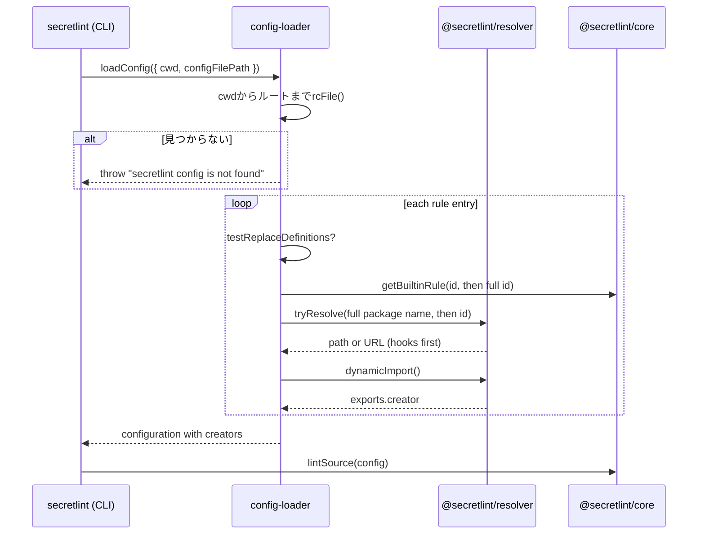

# 設定の読み込みの設計

[English](design.md)

## このドキュメントについて

このドキュメントでは、`@secretlint/config-loader`と`@secretlint/node`が[設定の読み込み](requirements.ja.md)の設定を探す方法と、読み込みがそのルールIDをルールに解決する方法を説明します。
親のProductは[Secretlint](../../product.ja.md)です。

### 対象読者

設定とルールを探して読み込む処理を変更する人とエージェント。

### 前提知識

Node.jsのモジュール解決と、[ルールとルールプリセット](../rules-and-presets/requirements.ja.md)で説明しているルールのパッケージのexport。

### このドキュメントで扱わないこと

設定ファイルの検証と、読み込んだルールを`@secretlint/core`で実行すること。

## 実装方針

### 設定ファイルの探索

`@secretlint/node`の`createEngine()`は、設定の取得方法を次のように選びます。

- `configFileJSON`があるとき（CLIは`--secretlintrcJSON`をパースして渡します）は、そのオブジェクトで`loadPackagesFromConfigDescriptor()`を呼び、`configFilePath`を設定しません。そのため、設定についての結果は報告されません。
- それ以外のときは`loadConfig({ cwd, configFilePath })`を呼びます。CLIは`--secretlintrc`を`configFilePath`として渡します。

`loadConfigDescriptor()`は、`rc-config-loader`の`rcFile("secretlint", { cwd, configFileName: configFilePath, packageJSON: { fieldName: "secretlint" } })`を呼びます。
`rcFile()`は`cwd`をディレクトリに分け、最も深いディレクトリから、`<configFileName>`を`.json`、`.yaml`、`.yml`、`.js`、`.cjs`の読み込み方で順に試し、次に`<configFileName>.json`、`.yaml`、`.yml`、`.js`、`.cjs`を試し、最後に`package.json`の`secretlint`フィールドを試します。これを親ディレクトリでルートまで繰り返します。
`configFileName`の既定値は`.secretlintrc`です。`--secretlintrc`の値は各ディレクトリと結合されるため、相対パスは親ディレクトリでも探されます。
`rcFile()`が`undefined`を返すと、`loadConfigDescriptor()`は`Error("secretlint config is not found ...")`を投げます。CLIの入り口は投げられたエラーを`console.error()`で出力し（スタックトレースを含みます）、終了ステータスを2にします。

Dockerイメージは、ルートまでの探索を利用しています。recommendの設定を`/.secretlintrc.json`にコピーしているため、自分の設定がないディレクトリでもそのファイルが見つかります。

### ルールIDの解決

`loadConfig()`は設定ファイルを読んで設定の記述（descriptor）にし、`loadPackagesFromConfigDescriptor()`は記述の各ルールの項目を、ルールのcreatorを持つ項目に変換します。
変換結果は`@secretlint/core`の設定になります。`@secretlint/core`は、creatorがどこから来たかを知らずに実行します。

読み込みは、各ルールの項目について、次のうち最初に当てはまるものからcreatorを取得します。

1. `testReplaceDefinitions`: 呼び出し側が渡す`{ id, rule }`の一覧で、ルールIDをcreatorに置き換えます。`@secretlint/tester`は、インストール済みのパッケージではなく開発中のルールをテストで動かすためにこれを使います。
2. `@secretlint/core`の組み込みの対応表。`resolveBuiltinRule()`が`@secretlint/core/builtin`を`await import()`で読み込み、まずIDのまま、次に`createFullPackageName("secretlint-rule-", id)`で作ったIDで`getBuiltinRule()`を呼びます。
3. ルールIDに対応するnpmパッケージ。`SecretLintModuleResolver.resolveRulePackageName()`が`createFullPackageName("secretlint-rule-", id)`で完全なパッケージ名を作り、そのパッケージ名とID自体を順に`@secretlint/resolver`の`tryResolve()`で試します。見つかったモジュールを`@secretlint/resolver`の`dynamicImport()`でimportし、`creator`のexportを取得します。

`meta.type: "preset"`のcreatorは、記述の項目の`rules`を持つプリセットの項目になります。それ以外のcreatorは、`options`、`severity`、`disabled`、`allowMessageIds`を持つルールの項目になります。
記述の項目の`id`を結果にそのままコピーするため、メッセージには設定ファイルに書いたIDが残ります。

#### resolverのフック

`@secretlint/resolver`は、`require.resolve()`や`import()`を使う前に、プログラムが登録したresolveフックとimportフックを実行します。
resolveフックはパッケージ名に対して決まったURLを返すことができ、importフックは読み込み済みのモジュールのexportを返すことができます。
これにより、単一実行ファイルのようにバンドルされたプログラムでも、`node_modules`にないパッケージを提供できます。組み込みルールはresolverを使う前に見つかるため、フックは必要ありません。

#### 失敗

1つの項目でエラーが起きても、そのエラーを記録してほかの項目の読み込みを続けます。すべての項目を処理したあと、各エラーの先頭に`Failed to load rule module: <id>`を付けた`AggregationError`を投げます。
`allowMessageIds`の検証にはルールのメッセージが必要なため、設定の検証は読み込みのあとにcreatorと合わせて行います。

## アーキテクチャ・シーケンス図

## データモデル・ER 図

- **設定の記述:** 読み込んだ設定ファイルの内容。ルールの項目は`id`、`options`、`severity`、`disabled`、`allowMessageIds`を持ち、プリセットの場合は`rules`も持ちます。
- **`@secretlint/core`の設定:** 設定の記述の各項目に、creatorである`rule`を加えたもの。

## API・インターフェース

- `loadConfig({ cwd, configFilePath, node_moduleDir, testReplaceDefinitions })`は`{ ok, config, configDescriptor, configFilePath, messages }`を返します。設定が見つからないときは例外を投げます。
- `loadConfigDescriptor({ cwd, configFilePath })`は、ルールを読み込まずに`{ ok, configDescriptor, configFilePath }`を返します。同じ場合に例外を投げます。
- `loadPackagesFromConfigDescriptor({ configDescriptor, node_moduleDir, testReplaceDefinitions })`は、読み込み済みの設定の記述から同じ処理をします。
- `node_moduleDir`は、`SecretLintModuleResolver`がパッケージ名と結合する基準のディレクトリです。

## 外部サービスとの連携方式

なし。

## データの取り扱い設計

設定ファイル、ルートまでの途中にある`package.json`、パッケージのモジュールを読み込むだけで、ファイルには書き込みません。

## 認証認可に関する特記事項

なし。パッケージは、実行しているプロセスの権限でimportされます。

## セキュリティ上の留意事項

パッケージをimportするとそのコードが実行されるため、設定ファイルに書かれたパッケージ名だけをimportします。

## デプロイに関する特記事項

なし。

## 検討した代替手段

- **resolverのフックで組み込みルールを解決する:** 以前の単一実行ファイルがパッケージに対して使っていた方法です。すべてのプログラムがフックを登録する必要があり、npmパッケージでは結局ルールのパッケージのインストールが必要になるため、採用しませんでした。
- **インストールしたパッケージを組み込みルールより優先する:** ルールのバージョンを常にインストールしたSecretlintと一致させ、古いプリセットのパッケージで新しいルールが隠れないようにするため、採用しませんでした。

## 未決事項

なし。
