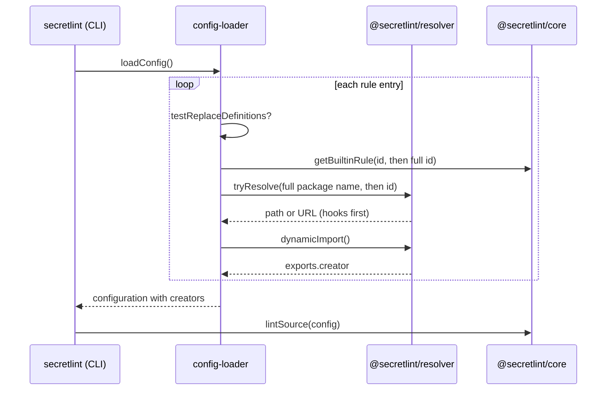

# 設定の読み込みの設計

[English](design.md)

## この文書について

この文書は、`@secretlint/config-loader`が[設定の読み込み](requirements.ja.md)のルールIDをルールに解決するしかたを説明します。
親のProductは[Secretlint](../../product.ja.md)です。
Requirementsと同じく、ルールIDの解決だけを扱います。

### 読者

ルールを見つけて読み込むしかたを変える人とエージェント。

### 前提

Node.jsのモジュール解決と、[ルールとルールプリセット](../rules-and-presets/requirements.ja.md)が説明するルールのパッケージのexport。

### この文書の外

設定ファイルを探して検証すること、読み込んだルールを`@secretlint/core`で実行すること。

## 実装方針

`loadConfig()`は設定ファイルを設定の記述（descriptor）として読み、`loadPackagesFromConfigDescriptor()`はその各ルールの項目を、ルールのcreatorを持つ項目に変えます。
結果は`@secretlint/core`の設定になり、coreはcreatorがどこから来たかを知らずに実行します。

各ルールの項目について、読み込みは次のうち最初に当てはまるものからcreatorを取ります。

1. `testReplaceDefinitions`: 呼び出し側が渡す`{ id, rule }`の一覧で、ルールIDをcreatorに置き換えます。`@secretlint/tester`は、インストール済みのパッケージではなく開発中のルールをテストで動かすためにこれを使います。
2. `@secretlint/core`の組み込みの表。`resolveBuiltinRule()`が`@secretlint/core/builtin`を`await import()`でimportし、IDで、次に`createFullPackageName("secretlint-rule-", id)`で`getBuiltinRule()`を呼びます。
3. ルールIDのnpmパッケージ。`SecretLintModuleResolver.resolveRulePackageName()`が`createFullPackageName("secretlint-rule-", id)`で完全なパッケージ名を作り、それとID自体を順に`@secretlint/resolver`の`tryResolve()`で試します。`@secretlint/resolver`の`dynamicImport()`がモジュールをimportし、読み込みはその`creator`のexportを取ります。

`meta.type: "preset"`のcreatorは、記述の項目の`rules`を持つプリセットの項目になります。ほかのcreatorは、`options`、`severity`、`disabled`、`allowMessageIds`を持つルールの項目になります。
記述の項目の`id`が結果にコピーされるので、メッセージは設定ファイルに書いたIDを保ちます。

### resolverのフック

`@secretlint/resolver`は、`require.resolve()`と`import()`に頼る前に、プログラムが登録したresolveフックとimportフックを実行します。
フックはパッケージ名に対して決まったURLを返せ、importフックは読み込み済みのモジュールのexportを返せます。
これにより、単一実行ファイルのようにバンドルしたプログラムが、`node_modules`にないパッケージを提供できます。組み込みルールはresolverより先に見つかるので、フックはいりません。

### 失敗

1つの項目のエラーは集められ、読み込みはほかの項目を続けます。すべての項目のあとで、読み込みは各エラーに`Failed to load rule module: <id>`を前置した`AggregationError`を投げます。
読み込みのあと、`allowMessageIds`がルールのメッセージを必要とするため、設定はcreatorと合わせて検証されます。

## 構成図とシーケンス図

## データモデルとER図

- **設定の記述:** 読んだ設定ファイル。ルールの項目は`id`、`options`、`severity`、`disabled`、`allowMessageIds`、プリセットなら`rules`を持ちます。
- **coreの設定:** 同じ項目に、creatorである`rule`を加えたもの。

## APIとインターフェース

- `loadConfig({ cwd, configFilePath, node_moduleDir, testReplaceDefinitions })`は`{ ok, config, configDescriptor, configFilePath, messages }`を返します。
- `loadPackagesFromConfigDescriptor({ configDescriptor, node_moduleDir, testReplaceDefinitions })`は、読み済みの記述から同じことをします。
- `node_moduleDir`は、`SecretLintModuleResolver`がパッケージ名と結合する基準のディレクトリです。

## 外部サービスとの連携

なし。

## データの扱い

読み込みは設定ファイルとパッケージのモジュールを読みます。ファイルは書きません。

## 認証と認可

なし。パッケージはプロセスの権限でimportされます。

## セキュリティの考慮

パッケージのimportはそのコードを実行するので、読み込みは設定ファイルにあるパッケージ名だけをimportします。

## デプロイの注意

なし。

## 検討した代替案

- **resolverのフックで組み込みルールを解決する:** 単一実行ファイルがパッケージに対してしていた方法です。すべてのプログラムがフックを登録する必要があり、npmパッケージではやはりパッケージのインストールが必要なので、選びませんでした。
- **インストールしたパッケージを組み込みルールより優先する:** ルールが常にインストールしたSecretlintのバージョンになり、古いプリセットのパッケージが新しいルールを隠さないように、選びませんでした。

## 未解決事項

なし。
