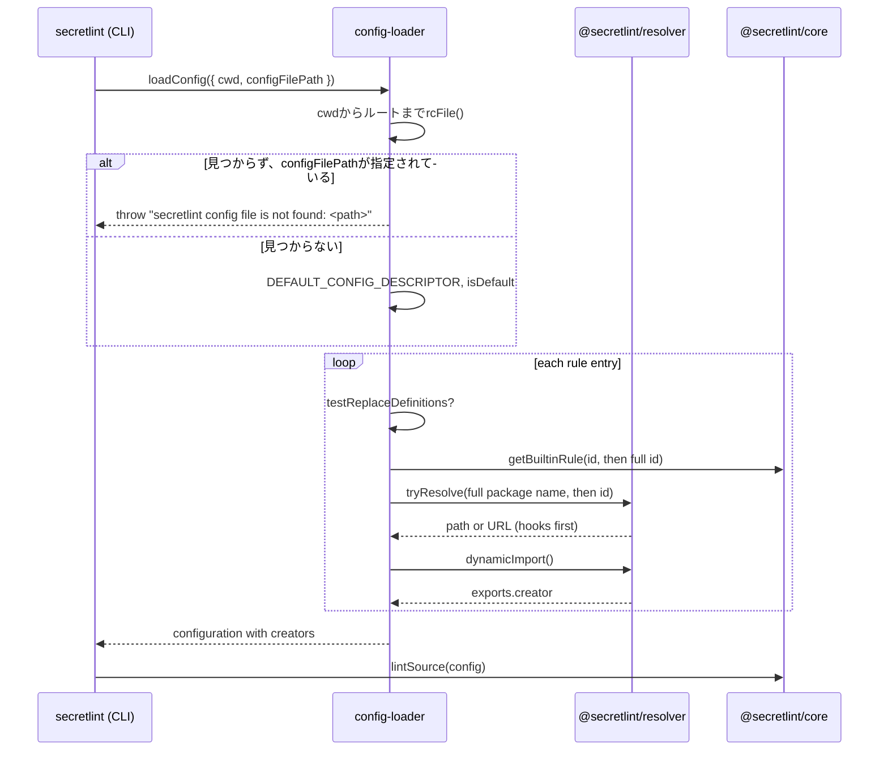

# 設定の読み込みの設計

[English](design.md)

## このドキュメントについて

このドキュメントでは、`@secretlint/config-loader`と`@secretlint/node`が[設定の読み込み](requirements.ja.md)の設定を探す方法、設定がないときに既定の設定を使う方法、読み込みがルールIDをルールに解決する方法を説明します。
親のProductは[Secretlint](../../product.ja.md)です。

### 対象読者

設定とルールを探して読み込む処理を変更する人とエージェント。

### 前提知識

Node.jsのモジュール解決と、[ルールとルールプリセット](../rules-and-presets/requirements.ja.md)で説明しているルールのパッケージのexport。

### このドキュメントで扱わないこと

設定ファイルの検証と、読み込んだルールを`@secretlint/core`で実行すること。

## 実装方針

### 設定ファイルの探索

`@secretlint/node`の`createEngine()`は、設定の取得方法を次のように選びます。

- `configFileJSON`があるとき（CLIは`--secretlintrcJSON`をパースして渡します）は、そのオブジェクトで`loadPackagesFromConfigDescriptor()`を呼び、`configFilePath`を設定しません。そのため、設定についての結果は報告されません。
- それ以外のときは`loadConfig({ cwd, configFilePath })`を呼びます。CLIは`--secretlintrc`を`configFilePath`として渡します。

`loadConfigDescriptor()`は、`rc-config-loader`の`rcFile("secretlint", { cwd, configFileName: configFilePath, packageJSON: { fieldName: "secretlint" } })`を呼びます。
`rcFile()`は`cwd`をディレクトリに分け、最も深いディレクトリから、`<configFileName>.cjs`、`.js`、`.json`、`.yaml`、`.yml`を試し（読み込み方の表のキーの順です）、次に`<configFileName>`を`.json`、`.yaml`、`.yml`、`.js`、`.cjs`の読み込み方で順に試し、最後に`package.json`の`secretlint`フィールドを試します。これを親ディレクトリでルートまで繰り返します。
`configFileName`は`.secretlintrc`です。

`configFilePath`が指定されたとき（`--secretlintrc`）は、`loadConfigDescriptor()`は探索しません。`path.resolve(cwd, configFilePath)`を解決してファイルがあることを確かめ、そのファイルだけを拡張子に合った読み込み方で読みます（`.json`、`.yaml`、`.yml`、`.js`、`.cjs`。これらの拡張子がない名前は、`.secretlintrc`と同じくJSON、YAML、JavaScriptの順に読みます）。
この変更の前は、`configFilePath`を`configFileName`として`rcFile()`に渡していたため、各ディレクトリと結合され、相対パスは親ディレクトリでも、拡張子を付けた名前でも探されていました。
ファイルが見つからないと、`loadConfigDescriptor()`は`configFilePath`によって次のように決めます。

- `configFilePath`が指定されていてファイルがないときは、`Error("secretlint config file is not found: <configFilePath>")`を投げます。CLIの入り口は、ほかの読み込みのエラーと同じくエラーを出力し、終了ステータスを2にします。
- 指定されていないときは、`DEFAULT_CONFIG_DESCRIPTOR`を`configFilePath: undefined`と`isDefault: true`で返します。

`DEFAULT_CONFIG_DESCRIPTOR`は`{ rules: [{ id: "@secretlint/secretlint-rule-preset-recommend" }] }`で、`@secretlint/config-loader`がexportします。
`--init`のファイルを書き出す`@secretlint/config-creator`も同じ定数を使うので、既定の設定と`--init`のファイルが食い違うことはありません。
既定の設定も設定ファイルと同じく`loadPackagesFromConfigDescriptor()`を通るので、recommendプリセットは`@secretlint/core`の組み込みの対応表から取得され、パッケージはimportされません。

構文エラーなど、見つかったファイルのエラーはこれまでどおり`rcFile()`が投げるので、壊れた設定が既定の設定に置き換わることはありません。

### 既定の設定の通知

`createEngine()`が返すエンジンは`configSource`を持ちます。ファイルが見つかったか指定されたときは`"file"`、`configFileJSON`のときは`"json"`、既定の設定のときは`"default"`です。
`secretlint`パッケージの`runSecretLint()`は文字列の一覧`notices`を返し、`configSource`が`"default"`のときは次の通知を加えます。

```
secretlint: No configuration file was found. The recommended rules (@secretlint/secretlint-rule-preset-recommend) are used. Run `secretlint --init` to create .secretlintrc.json.
```

CLIの入り口は、stdoutを書く前に、各通知を`console.error()`で書きます。通知は結果のメッセージではないので、フォーマッター、終了ステータス、`--output`、`--format mask-result`には影響しません。
`@secretlint/node`を使うプログラムは自分で出力を決めるので、エンジン自身はstderrに書きません。

Dockerイメージは、ルートまでの探索を利用しています。recommendの設定を`/.secretlintrc.json`にコピーしているため、自分の設定がないディレクトリでもそのファイルが見つかり、通知は出ません。この変更ではこのファイルを残します（デプロイに関する特記事項を参照）。

### ルールIDの解決

`loadConfig()`は設定ファイルを読んで設定の記述（descriptor）にし、`loadPackagesFromConfigDescriptor()`は記述の各ルールの項目を、ルールのcreatorを持つ項目に変換します。
変換結果は`@secretlint/core`の設定になります。`@secretlint/core`は、creatorがどこから来たかを知らずに実行します。

読み込みは、各ルールの項目について、次のうち最初に当てはまるものからcreatorを取得します。

1. `testReplaceDefinitions`: 呼び出し側が渡す`{ id, rule }`の一覧で、ルールIDをcreatorに置き換えます。`@secretlint/tester`は、インストール済みのパッケージではなく開発中のルールをテストで動かすためにこれを使います。
2. `@secretlint/core`の組み込みの対応表。`resolveBuiltinRule()`が`@secretlint/core/builtin`を`await import()`で読み込み、まずIDのまま、次に`createFullPackageName("secretlint-rule-", id)`で作ったIDで`getBuiltinRule()`を呼びます。
3. ルールIDに対応するnpmパッケージ。`SecretLintModuleResolver.resolveRulePackageName()`が`createFullPackageName("secretlint-rule-", id)`で完全なパッケージ名を作り、そのパッケージ名とID自体を順に`@secretlint/resolver`の`tryResolve()`で試します。見つかったモジュールを`@secretlint/resolver`の`dynamicImport()`でimportし、`creator`のexportを取得します。

`meta.type: "preset"`のcreatorは、記述の項目の`rules`を持つプリセットの項目になります。それ以外のcreatorは、`options`、`severity`、`disabled`、`allowMessageIds`を持つルールの項目になります。
記述の項目の`id`を結果にそのままコピーするため、メッセージには設定ファイルに書いたIDが残ります。

#### resolverのフック

`@secretlint/resolver`は、`require.resolve()`や`import()`を使う前に、プログラムが登録したresolveフックとimportフックを実行します。
resolveフックはパッケージ名に対して決まったURLを返すことができ、importフックは読み込み済みのモジュールのexportを返すことができます。
これにより、単一実行ファイルのようにバンドルされたプログラムでも、`node_modules`にないパッケージを提供できます。組み込みルールはresolverを使う前に見つかるため、フックは必要ありません。

#### 失敗

1つの項目でエラーが起きても、そのエラーを記録してほかの項目の読み込みを続けます。すべての項目を処理したあと、各エラーの先頭に`Failed to load rule module: <id>`を付けた`AggregationError`を投げます。
`allowMessageIds`の検証にはルールのメッセージが必要なため、設定の検証は読み込みのあとにcreatorと合わせて行います。

## アーキテクチャ・シーケンス図



## データモデル・ER 図

- **設定の記述:** 読み込んだ設定ファイルの内容。ルールの項目は`id`、`options`、`severity`、`disabled`、`allowMessageIds`を持ち、プリセットの場合は`rules`も持ちます。
- **`@secretlint/core`の設定:** 設定の記述の各項目に、creatorである`rule`を加えたもの。

## API・インターフェース

- `loadConfig({ cwd, configFilePath, node_moduleDir, testReplaceDefinitions })`は`{ ok, config, configDescriptor, configFilePath, isDefault, messages }`を返します。`isDefault`が`true`のとき、`configFilePath`は`undefined`です。指定された`configFilePath`が見つからないときは例外を投げます。
- `loadConfigDescriptor({ cwd, configFilePath })`は、ルールを読み込まずに`{ ok, configDescriptor, configFilePath, isDefault }`を返します。同じ場合に例外を投げます。
- `DEFAULT_CONFIG_DESCRIPTOR`は、設定が見つからないときに使う設定です。
- 結果の`configFilePath`の型は`string`から`string | undefined`に変わります。結果を使うプログラムにとってはAPIの破壊的変更なので、メジャーバージョンでリリースします。
- `@secretlint/node`のエンジンは`configSource: "file" | "json" | "default"`を持ちます。`secretlint`の`runSecretLint()`は、`exitStatus`、`stdout`、`stderr`と一緒に`notices: string[]`を返します。
- `loadPackagesFromConfigDescriptor({ configDescriptor, node_moduleDir, testReplaceDefinitions })`は、読み込み済みの設定の記述から同じ処理をします。
- `node_moduleDir`は、`SecretLintModuleResolver`がパッケージ名と結合する基準のディレクトリです。

## 外部サービスとの連携方式

なし。

## データの取り扱い設計

設定ファイル、ルートまでの途中にある`package.json`、パッケージのモジュールを読み込むだけで、ファイルには書き込みません。

## 認証認可に関する特記事項

なし。パッケージは、実行しているプロセスの権限でimportされます。

## セキュリティ上の留意事項

パッケージをimportするとそのコードが実行されるため、設定ファイルに書かれたパッケージ名だけをimportします。

## デプロイに関する特記事項

この変更は次のメジャーバージョンv14で、設定がなくても実行が失敗しなくなったというリリースノートと一緒にリリースします。
Dockerイメージは、Node.jsなしで使える配布形態として引き続き必要です。この変更では、既定の設定と同じルールを持つ`/.secretlintrc.json`を残します。
既定の設定があれば`@secretlint/quick-start`の役目はなくなるので、非推奨にするのは後続の作業とします。

## 検討した代替手段

- **resolverのフックで組み込みルールを解決する:** 以前の単一実行ファイルがパッケージに対して使っていた方法です。すべてのプログラムがフックを登録する必要があり、npmパッケージでは結局ルールのパッケージのインストールが必要になるため、採用しませんでした。
- **インストールしたパッケージを組み込みルールより優先する:** ルールのバージョンを常にインストールしたSecretlintと一致させ、古いプリセットのパッケージで新しいルールが隠れないようにするため、採用しませんでした。
- **設定が見つからないときのエラーを残し、メッセージだけを改善する:** 採用しませんでした。recommendプリセットはSecretlintの一部で、誤検知が少なくなるように設計されているので、すべての利用者に先にファイルを作らせる負担のほうが、それで防げるものより大きいからです。
- **オプションを付けたときだけ既定の設定を使う:** オプションを知っている利用者なら`--init`を使えるので、最初の実行の助けにならないため、採用しませんでした。
- **既定の設定を読み込みではなく`@secretlint/node`で決める:** エディターとの連携など、`loadConfig()`を使うすべてのプログラムがCLIと同じ設定を得られるように、採用しませんでした。
- **通知を`EMPTY_RULES`のように結果のメッセージとして報告する:** 報告先のファイルがなく、JSON、SARIF、`mask-result`の出力にも現れてしまうため、採用しませんでした。
- **oxlintのように通知を出さない:** 設定ファイルで選んだルールではないことと、設定ファイルの作り方を利用者が分かるように、採用しませんでした。

## 未決事項

なし。
