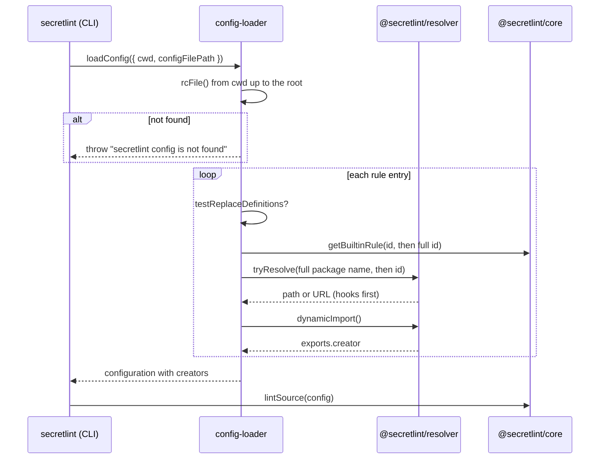

# Configuration loading design

[日本語](design.ja.md)

## About this document

This document describes how `@secretlint/config-loader` and `@secretlint/node` find the configuration of [Configuration loading](requirements.md), and how the loader resolves its rule ids to rules.
The parent Product is [Secretlint](../../product.md).

### Audience

People and agents who change how the configuration and the rules are found and loaded.

### Prerequisites

Node.js module resolution, and the exports of rule packages described in [Rules and rule presets](../rules-and-presets/requirements.md).

### Outside this document

Validating the configuration file, and running the loaded rules in `@secretlint/core`.

## Implementation approach

### Finding the configuration file

`createEngine()` of `@secretlint/node` chooses how to get the configuration:

- With `configFileJSON` (the CLI passes the parsed `--secretlintrcJSON`), it calls `loadPackagesFromConfigDescriptor()` with the object, and sets no `configFilePath`, so no config result is reported.
- Otherwise it calls `loadConfig({ cwd, configFilePath })`, and the CLI passes `--secretlintrc` as `configFilePath`.

`loadConfigDescriptor()` calls `rcFile("secretlint", { cwd, configFileName: configFilePath, packageJSON: { fieldName: "secretlint" } })` of `rc-config-loader`.
`rcFile()` splits `cwd` into its directories and, from the deepest one, tries `<configFileName>` with the loaders of `.json`, `.yaml`, `.yml`, `.js`, and `.cjs` in order, then `<configFileName>.json`, `.yaml`, `.yml`, `.js`, `.cjs`, then the `secretlint` field of `package.json`, and repeats this in the parent directory up to the root.
`configFileName` defaults to `.secretlintrc`. A `--secretlintrc` value is joined to each directory, so a relative path is also looked for in the parent directories.
When `rcFile()` returns `undefined`, `loadConfigDescriptor()` throws `Error("secretlint config is not found ...")`. The CLI entry point prints the thrown error with `console.error()`, which includes the stack trace, and sets the exit status 2.

The Docker image relies on the search up to the root: it copies the recommend configuration to `/.secretlintrc.json`, so a directory without its own configuration finds that file.

### Resolving rule ids

`loadConfig()` reads the configuration file into a configuration descriptor, and `loadPackagesFromConfigDescriptor()` turns each rule entry of the descriptor into an entry with a rule creator.
The result is the configuration of `@secretlint/core`, which runs the creators without knowing where they came from.

For each rule entry, the loader takes the creator from the first of these that applies:

1. `testReplaceDefinitions`: a list of `{ id, rule }` that a caller passes to replace a rule id with a creator. `@secretlint/tester` uses it so that a test runs the rule under development instead of an installed package.
2. The built-in table of `@secretlint/core`. `resolveBuiltinRule()` imports `@secretlint/core/builtin` with `await import()`, and calls `getBuiltinRule()` with the id, and then with `createFullPackageName("secretlint-rule-", id)`.
3. The npm package of the rule id. `SecretLintModuleResolver.resolveRulePackageName()` makes the full package name with `createFullPackageName("secretlint-rule-", id)`, and tries it and then the id itself with `tryResolve()` of `@secretlint/resolver`. `dynamicImport()` of `@secretlint/resolver` imports the module, and the loader takes its `creator` export.

A creator with `meta.type: "preset"` becomes a preset entry with the `rules` of its descriptor entry. Other creators become rule entries with `options`, `severity`, `disabled`, and `allowMessageIds`.
The `id` of the descriptor entry is copied to the result, which is why the messages keep the id written in the configuration file.

#### Resolver hooks

`@secretlint/resolver` runs the resolve hooks and the import hooks that a program registered before it falls back to `require.resolve()` and `import()`.
A hook can return a fixed URL for a package name, and the import hook can return the exports of a module that is already loaded.
This lets a bundled program, such as the single-executable binary, provide packages that are not in a `node_modules` directory. Built-in rules do not need hooks, because they are found before the resolver runs.

#### Failures

An error of one entry is collected, and the loader continues with the other entries. After all entries, the loader throws an `AggregationError` with all errors, each prefixed with `Failed to load rule module: <id>`.
After loading, the configuration is validated together with the creators, because `allowMessageIds` needs the messages of the rule.

## Architecture and sequence diagrams

## Data model and ER diagrams

- **Configuration descriptor:** the parsed configuration file. A rule entry has `id`, `options`, `severity`, `disabled`, `allowMessageIds`, and for a preset `rules`.
- **Core configuration:** the same entries with `rule`, the creator, added.

## APIs and interfaces

- `loadConfig({ cwd, configFilePath, node_moduleDir, testReplaceDefinitions })` returns `{ ok, config, configDescriptor, configFilePath, messages }`, and throws when no configuration is found.
- `loadConfigDescriptor({ cwd, configFilePath })` returns `{ ok, configDescriptor, configFilePath }` without loading the rules, and throws in the same case.
- `loadPackagesFromConfigDescriptor({ configDescriptor, node_moduleDir, testReplaceDefinitions })` does the same from a descriptor that is already read.
- `node_moduleDir` is the base directory that `SecretLintModuleResolver` joins with the package name.

## External service integration

None.

## Data handling

The loader reads the configuration file, the `package.json` files on the way to the root, and the modules of the packages. It does not write files.

## Authentication and authorization notes

None. Packages are imported with the permissions of the process.

## Security considerations

Importing a package runs its code, so the loader imports only the package names that the configuration file lists.

## Deployment notes

None.

## Alternatives considered

- **Resolve built-in rules with resolver hooks:** The binary did this for its packages. It was not chosen, because every program would have to register the hooks, and the npm package would still need the packages installed.
- **Let an installed package win over the built-in rule:** It was not chosen, so that the rules always have the version of the installed Secretlint, and an older preset package does not hide new rules.

## Open questions

None.
