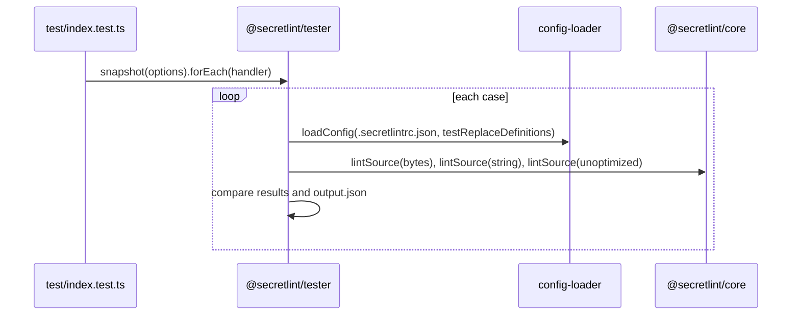

# 独自ルールの設計

[English](design.md)

## この文書について

この文書は、ルールのパッケージの構成と、`@secretlint/tester`が[独自ルール](requirements.ja.md)のスナップショットテストを実行するしかたを説明します。
親のProductは[Secretlint](../../product.ja.md)です。

### 読者

ルールを書いたりテストしたりする人とエージェント、`@secretlint/tester`を変える人とエージェント。

### 前提

`@secretlint/types`のルールのインターフェースと、Node.jsのテストランナー（`node:test`）。

### この文書の外

ケースの設定のためにtesterが使う設定の読み込みと、ルールを実行する`@secretlint/core`。

## 実装方針

ルールはコードの隣にテストを持つパッケージで、`@secretlint/tester`はスナップショットのディレクトリの各ディレクトリを1つのテストにします。

### ルールのパッケージの構成

```text
packages/@secretlint/secretlint-rule-<name>/
  README.md
  package.json        # name is the rule id; @secretlint/tester is a devDependency
  src/index.ts        # exports creator and messages
  test/
    index.test.ts     # calls snapshot() of @secretlint/tester
    snapshots/<case>/ # input*, output.json, optional .secretlintrc.json and options.*
```

`pnpm run gen:rule`は、scaffdogのテンプレート`.scaffdog/new-rule.md`からこの構成を作ります。
パッケージのtestスクリプトは`test/index.test.ts`を`node --import tsx --test`で実行し、`updateSnapshot`はそれを`UPDATE_SNAPSHOT=1`で実行します。

### テストケースの実行

`snapshot(options)`はスナップショットのディレクトリを読み、`forEach(handler)`を持つオブジェクトを返します。`forEach`は各ケースの名前と、それを実行する関数でhandlerを呼びます。
テストファイルはその関数を`t.test()`に渡し、`"skip"`が返ればテストをスキップします。

ケースの関数は次のことをします。

1. ケースのオプション（`options.js`、`options.json`、`options.ts`）を読み、入力ファイルを選ぶ。
2. ケースに`.secretlintrc.json`があれば、テストするルールを`testReplaceDefinitions`として渡し、`@secretlint/config-loader`の`loadConfig()`で読む。なければ既定の設定を使う。
3. 入力ファイルを`@secretlint/source-creator`の`createRawSource()`で読み（バイト列と内容の種類が得られる）、`@secretlint/core`の`lintSource()`でlintする。
4. 内容をバイト列なしの文字列として、さらに各ルールの`meta.keywords`をなくし各パターンのキーワードをなくして範囲を`file`にした設定で、もう一度lintする。どちらも`assert.deepStrictEqual`で最初の結果と比べる。
5. `output.json`がないかスナップショットを更新するなら、キーを並べ替えて`[SNAPSHOT]`のパスにした結果を書き、`"skip"`を返す。そうでなければ結果を`output.json`と比べる。

4の手順があるので、間違ったキーワードや、ほかの行が必要な`line`範囲があると、最適化しない結果が最適化した結果の見逃した秘密情報を報告し、テストが失敗します。

### プリセット

プリセットのテストも同じ`snapshot()`を使い、プリセットのルールごとに1つのスナップショットのディレクトリを持ちます。プリセットの`import-tests.js`スクリプトはルールのテストケースをコピーし、その`.secretlintrc.json`をプリセットの項目の下でオプションを設定するように変えます。

## 構成図とシーケンス図



## データモデルとER図

- **SnapshotOptions:** `snapshotDirectory`（パスかURL）、`defaultConfig`、任意の`testDefinitions`、`updateSnapshot`。
- **SecretLintTestCaseOptions:** 任意の`inputFilePath`。

## APIとインターフェース

`@secretlint/tester`は`snapshot()`と、型`SnapshotOptions`と`SecretLintTestCaseOptions`をexportします。
依存は`@secretlint/core`、`@secretlint/config-loader`、`@secretlint/source-creator`、`@secretlint/types`です。

## 外部サービスとの連携

テストにはなし。Secretlintのリポジトリのルールは、リポジトリのリリースのワークフローで公開されます。

## データの扱い

testerはスナップショットのディレクトリのファイルを読み、スナップショットがないときか更新するときだけ`output.json`を書きます。

## 認証と認可

なし。

## セキュリティの考慮

リポジトリはCIで変更したファイルにSecretlintを実行します。テストの入力はダミーの秘密情報を含み、リポジトリの`.secretlintignore`はその検査から`**/packages/**/test/**`を外しています。

## デプロイの注意

Secretlintのリポジトリのパッケージは、npmのtrusted publishingで公開されます。新しいパッケージは、npmでtrusted publisherを手で設定する必要があります。

## 検討した代替案

ケースごとに1つのディレクトリを持つスナップショットテストについて、代替案の記録はありません。

## 未解決事項

なし。
