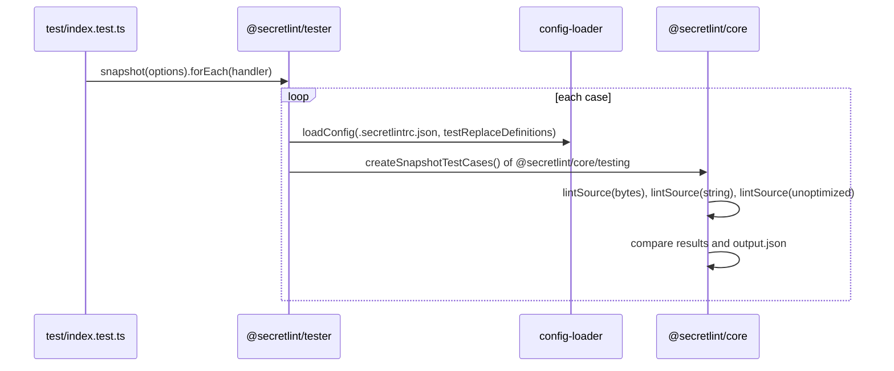

# カスタムルールの設計

[English](design.md)

## このドキュメントについて

このドキュメントでは、カスタムルールのパッケージの構成と、`@secretlint/tester`が[カスタムルール](requirements.ja.md)のスナップショットテストを実行する方法を説明します。
親のProductは[Secretlint](../../product.ja.md)です。

### 対象読者

ルールを書いたりテストしたりする人とエージェント、および`@secretlint/tester`を変更する人とエージェント。

### 前提知識

`@secretlint/types`のルールのインターフェースと、Node.jsのテストランナー（`node:test`）。

### このドキュメントで扱わないこと

testerがテストケースの設定を読むために使う設定の読み込みと、ルールを実行する`@secretlint/core`。

## 実装方針

カスタムルールは、コードと同じパッケージにテストを持ちます。`@secretlint/tester`は、スナップショットのディレクトリにあるディレクトリをそれぞれ1つのテストにします。

### カスタムルールのパッケージの構成

```text
packages/@secretlint/secretlint-rule-<name>/
  README.md
  package.json        # name is the rule id; @secretlint/tester is a devDependency
  src/index.ts        # exports creator and messages
  test/
    index.test.ts     # calls snapshot() of @secretlint/tester
    snapshots/<case>/ # input*, output.json, optional .secretlintrc.json and options.*
```

Secretlintが公開するカスタムルールも、この構成になっています。
パッケージの`test`スクリプトは`node --import tsx --test`で`test/index.test.ts`を実行し、`updateSnapshot`スクリプトは`UPDATE_SNAPSHOT=1`を付けて同じテストを実行します。

### テストケースの実行

各ケースの確認処理は、組み込みルールのテストでも使うテストランナー`@secretlint/core/testing`にあります。`@secretlint/tester`はこのテストランナーをラップし、入力ファイルの読み込み処理と設定ファイルの読み込み処理を渡します。

`snapshot(options)`はスナップショットのディレクトリを読み、`forEach(handler)`を持つオブジェクトを返します。`forEach`は、各ケースの名前とそのケースを実行する関数を引数にしてhandlerを呼びます。
テストファイルはその関数を`t.test()`に渡し、関数が`"skip"`を返したらテストをスキップします。

ケースを実行する関数は、次の処理をします。

1. ケースのオプション（`options.js`、`options.json`、`options.ts`）を読み、入力ファイルを決める。
2. ケースに`.secretlintrc.json`があれば、テストするルールを`testReplaceDefinitions`として渡し、`@secretlint/config-loader`の`loadConfig()`で読み込む。なければ既定の設定を使う。
3. `@secretlint/source-creator`の`createRawSource()`で入力ファイルを読み込み（バイト列と内容の種類が得られる）、`@secretlint/core`の`lintSource()`でlintする。
4. バイト列を除いて内容を文字列として渡した場合と、各ルールの`meta.keywords`と各パターンのキーワードを除き、スコープを`file`にした設定の場合で、もう一度lintする。どちらの結果も`assert.deepStrictEqual`で最初の結果と比較する。
5. lintの結果にはソースの内容が含まれないため、テキストのソースの内容を`sourceContent`として結果に加える。`output.json`がない場合やスナップショットを更新する場合は、キーを並べ替え、パスを`[SNAPSHOT]`に置き換えた結果を書き出して`"skip"`を返す。それ以外の場合は、結果を`output.json`と比較する。

手順4があるため、キーワードが間違っている場合や、ほかの行も見る必要があるパターンに`line`スコープを指定した場合には、最適化した結果が見逃した秘密情報を最適化しない結果が報告し、テストが失敗します。

ガード付きキーワードのガードが秘密情報を落とす場合も、キーワードなしのlintがそれを報告するので、手順4で見つかります。ただし、そのメッセージはキーワードとスコープ全般についてのものです。そこでテストランナーは、手順4の比較の前に、ガードだけを確かめます。

- 設定のパターンの`keywords`にガード付きキーワードがあれば、テストランナーは、ガード付きキーワード`{ keyword, after }`を文字列の`keyword`にした設定で、文字列をもう一度lintします。
- この結果にあって、ルールID、メッセージID、範囲で比べて手順3の結果にないメッセージは、ガードが落とした秘密情報です。
- そのようなメッセージについて、テストランナーはそのルールのパターンのガード付きキーワードを調べます。メッセージの行（「file」スコープでは内容全体）から各キーワードの場所を探し、キーワードマッチャーが使うのと同じ関数で、その場所のガードをテストします。
- ガードを満たさない場所を示すエラーを投げます。たとえば次のようなメッセージです。`@secretlint/secretlint-rule-example: the guard "[A-Za-z0-9]{40,}" of the keyword "00" is not met at 3:12, but the rule reports a secret at 3:12-3:54. Every secret of the pattern must meet the guard.`

この確認はcoreのパーサーとガードの関数を使うので、テストはlintが実際に行うことを確かめます。
ガード付きキーワードを持つパターンがなければ、ガードなしのlintは行いません。そのため、ほかのルールのテストにかかる時間は変わりません。
手順4の設定はキーワードを持たないので、ガード付きキーワードも持ちません。

### プリセット

サードパーティのプリセットも、同じ`snapshot()`を使い、プリセットのルールごとにスナップショットのディレクトリを用意すればテストできます。組み込みのプリセットは、`@secretlint/tester`ではなく`@secretlint/core`でテストします。

## アーキテクチャ・シーケンス図



## データモデル・ER 図

- **SnapshotOptions:** `snapshotDirectory`（パスまたはURL）、`defaultConfig`、任意の`testDefinitions`、`updateSnapshot`。
- **SecretLintTestCaseOptions:** 任意の`inputFilePath`。

## API・インターフェース

`@secretlint/tester`は、`snapshot()`と、型`SnapshotOptions`、`SecretLintTestCaseOptions`をexportします。
依存パッケージは`@secretlint/core`、`@secretlint/config-loader`、`@secretlint/source-creator`、`@secretlint/types`です。
APIはテストランナーを`@secretlint/core`に移す前と同じなので、カスタムルールのテストを変更する必要はありません。

## 外部サービスとの連携方式

テストでは使いません。Secretlintのリポジトリにあるカスタムルールは、リポジトリのリリースワークフローで公開されます。

## データの取り扱い設計

testerはスナップショットのディレクトリにあるファイルを読み、スナップショットがない場合と更新する場合だけ`output.json`を書き出します。

## 認証認可に関する特記事項

なし。

## セキュリティ上の留意事項

このリポジトリは、CIで変更されたファイルにSecretlintを実行しています。テストの入力にはダミーの秘密情報が含まれるため、リポジトリの`.secretlintignore`で`**/packages/**/test/**`をこの検査の対象外にしています。

## デプロイに関する特記事項

Secretlintのリポジトリのパッケージは、npmのtrusted publishingで公開されます。新しいパッケージを公開するには、まず空のパッケージを公開し、npmでtrusted publisherを手作業で設定してから、最初のリリースをする必要があります。そのため、Secretlintに新しいルールを追加するときは、新しいカスタムルールのパッケージを作らず、組み込みルールとして追加します。

## 検討した代替手段

ケースごとにディレクトリを1つ用意するスナップショットテストについて、ほかの案を検討した記録はありません。

## 未決事項

- Requirementsの未決事項。どのケースもガードを満たさないときに失敗するテスト。
