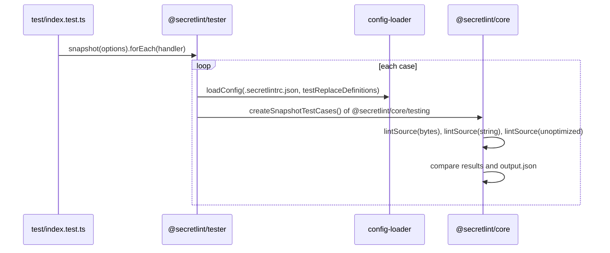

# Custom rules design

[日本語](design.ja.md)

## About this document

This document describes how a custom rule package is laid out and how `@secretlint/tester` runs the snapshot tests of [Custom rules](requirements.md).
The parent Product is [Secretlint](../../product.md).

### Audience

People and agents who write or test a rule, or change `@secretlint/tester`.

### Prerequisites

The rule interface of `@secretlint/types`, and the Node.js test runner (`node:test`).

### Outside this document

The configuration loader that the tester uses for the configuration of a case, and `@secretlint/core`, which runs the rule.

## Implementation approach

A custom rule is a package with its tests next to its code, and `@secretlint/tester` turns each directory of its snapshot directory into one test.

### Layout of a custom rule package

```text
packages/@secretlint/secretlint-rule-<name>/
  README.md
  package.json        # name is the rule id; @secretlint/tester is a devDependency
  src/index.ts        # exports creator and messages
  test/
    index.test.ts     # calls snapshot() of @secretlint/tester
    snapshots/<case>/ # input*, output.json, optional .secretlintrc.json and options.*
```

The custom rules published by Secretlint have this layout.
The test script of the package runs `test/index.test.ts` with `node --import tsx --test`, and `updateSnapshot` runs it with `UPDATE_SNAPSHOT=1`.

### Running a test case

The checks of a case are in the runner `@secretlint/core/testing`, which the tests of the built-in rules also use. `@secretlint/tester` wraps it, and gives it the reading of the input file and the loading of the configuration file.

`snapshot(options)` reads the snapshot directory and returns an object whose `forEach(handler)` calls the handler with the name of each case and a function that runs it.
The test file passes the function to `t.test()` and skips the test when it returns `"skip"`.

The function of a case does the following:

1. Load the options of the case (`options.js`, `options.json`, or `options.ts`) and choose the input file.
2. If the case has `.secretlintrc.json`, load it with `loadConfig()` of `@secretlint/config-loader`, passing the rules under test as `testReplaceDefinitions`. Otherwise use the default configuration.
3. Read the input file with `createRawSource()` of `@secretlint/source-creator`, which gives the bytes and the content type, and lint it with `lintSource()` of `@secretlint/core`.
4. Lint the content again as a string without the bytes, and again with a configuration in which each rule has no `meta.keywords` and each pattern has no keywords and the `file` scope. Compare both with the first result with `assert.deepStrictEqual`.
5. Add the content of the text source to the result as `sourceContent`, because the lint result does not have it. If `output.json` does not exist or the snapshots are updated, write the result with sorted keys and the `[SNAPSHOT]` path, and return `"skip"`. Otherwise compare the result with `output.json`.

Step 4 is how a wrong keyword or a `line` scope that needs other lines makes the test fail, because the unoptimized result reports a secret that the optimized result missed.

Step 4 also finds a guard of a guarded keyword that rejects a secret, because the lint without keywords reports it. But its message is about keywords and scope in general, so the runner checks guards by themselves before the comparison of step 4.

- If `keywords` of a pattern of the configuration has a guarded keyword, the runner lints the string once more with a configuration in which each guarded keyword `{ keyword, after }` is the string `keyword`.
- A message of this result that is not in the result of step 3, by its rule id, message id, and range, is a secret that a guard rejected.
- For such a message, the runner looks at the guarded keywords of the patterns of that rule. It finds the places of each keyword in the line of the message, or in the content for the "file" scope, and tests the guard there with the function that the keyword matcher uses.
- It throws an error with the places whose guard is not met, such as: `@secretlint/secretlint-rule-example: the guard "[A-Za-z0-9]{40}" of the keyword "00" is not met at 3:12, but the rule reports a secret at 3:12-3:54. Every secret of the pattern must meet the guard.`

The check uses the parser and the guard function of the core, so the tests check what the lint does.
The lint without guards is skipped when no pattern has a guarded keyword, so the tests of other rules take the same time as before.
The configuration of step 4 has no keywords, so it also has no guarded keywords.

### Presets

A third-party preset can be tested with the same `snapshot()`, with one snapshot directory per rule of the preset. The built-in presets are tested in `@secretlint/core`, not with `@secretlint/tester`.

## Architecture and sequence diagrams



## Data model and ER diagrams

- **SnapshotOptions:** `snapshotDirectory` (path or URL), `defaultConfig`, optional `testDefinitions`, and `updateSnapshot`.
- **SecretLintTestCaseOptions:** optional `inputFilePath`.

## APIs and interfaces

`@secretlint/tester` exports `snapshot()` and the types `SnapshotOptions` and `SecretLintTestCaseOptions`.
Its dependencies are `@secretlint/core`, `@secretlint/config-loader`, `@secretlint/source-creator`, and `@secretlint/types`.
The API is the same as before the runner moved to `@secretlint/core`, so the tests of a custom rule do not change.

## External service integration

None for testing. A custom rule of the Secretlint repository is published by the release workflow of the repository.

## Data handling

The tester reads the files of the snapshot directory and writes `output.json` only when the snapshot is missing or updated.

## Authentication and authorization notes

None.

## Security considerations

The repository runs Secretlint on its changed files in CI. The test inputs contain dummy secrets, and `.secretlintignore` of the repository excludes `**/packages/**/test/**` from that check.

## Deployment notes

The packages of the Secretlint repository are published with npm trusted publishing. To publish a new package, an empty package has to be published first and its trusted publisher set up on npm by hand before the first release, which is why a new rule of Secretlint is added as a built-in rule instead of a new custom rule package.

## Alternatives considered

There is no record of alternatives to snapshot tests with one directory per case.

## Open questions

- The open question of the Requirements: a test that fails when no case meets a guard.
