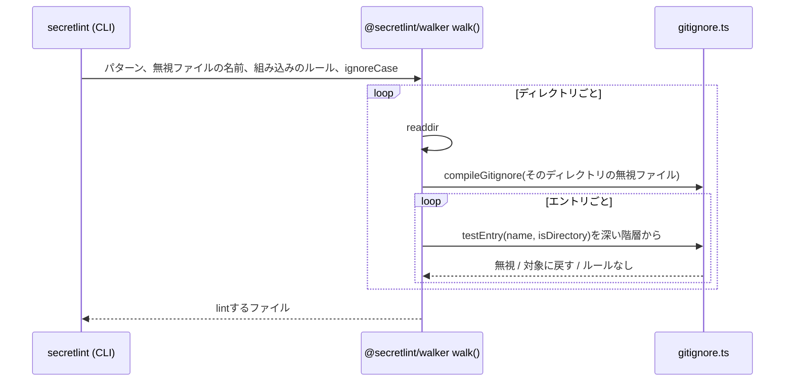

# 対象ファイルの選択の設計

[English](design.md)

## このドキュメントについて

このドキュメントは、[対象ファイルの選択](requirements.ja.md)の無視ルールをどう照合するかを説明します。
親Productは[Secretlint](../../product.ja.md)です。
Requirementsと同じく、無視ルールだけを扱います。

### 対象読者

ファイルの探し方と無視のしかたを変更する人とエージェント。

### 前提知識

[Gitのマニュアル](https://git-scm.com/docs/gitignore)にある`.gitignore`の書式。

### このドキュメントで扱わないこと

利用者のglobの展開、シンボリックリンク、選んだファイルのlint。

## 実装方針

`secretlint`パッケージの`searchFiles()`が、組み込みのルール、無視ファイルの名前、`ignoreCase: true`を渡して`@secretlint/walker`の`walk()`を呼びます。
walkerはディレクトリを上から読み、ディレクトリに入る前に各エントリを判定します。無視されたディレクトリは読みません。これによって、無視されたディレクトリの中のファイルは対象に戻せないというGitの挙動にもなります。

### 照合は依存を持たず、Gitに合わせる

ルールの照合は、ライブラリではなく`@secretlint/walker`の中のコード（`gitignore.ts`と`glob.ts`）で行います。
この二つのモジュールはNode.jsもwalkerもimportしないので、あとでほかの場所でも使えます。

Gitのマニュアルは細部をfnmatch(3)に任せており、ライブラリによって解釈が違います。照合はGitの実際の挙動を正解とします。

- 行はGitと同じように読みます。ファイル先頭のバイトオーダーマークと行末の前のCRを取り除き、`#`はコメントを始め、行末の空白はエスケープされていなければ取り除き、`!`は否定し、末尾の`/`はルールをディレクトリだけに一致させます。
- 末尾以外に`/`を含まないルールは、エントリの名前と比べます。この中の`**`は`*`と同じです。
- `/`を含むルールは、無視ファイルのディレクトリからのパスと比べます。`*`、`?`、文字クラスは`/`に一致しません。スラッシュに挟まれた`**`は、0個を含む任意の数のディレクトリに一致します。
- 比較はGitと同じくUTF-8のバイト単位です。`?`は1バイトに一致し、大文字小文字を区別しないときに同一視するのはAからZだけです。
- Gitが解釈できないルール（閉じていない文字クラス、末尾のバックスラッシュ、`[[:foo:]]`のような未知のクラス名）は、何にも一致しません。

照合のコードは、マニュアルとGitの実行結果の観察から書いています。Gitのソースコードはライセンスが異なる（GPLv2）ため、その移植ではありません。

### テストはGitと突き合わせる

- `test/git-compat/generate-fixtures.mjs`は、一時的なリポジトリで多数のルールの組とパスに対して`git check-ignore --no-index -v -n`を実行し、結果を`test/git-compat/git-check-ignore.json`に保存します。`test/gitignore.test.ts`は、`ignoreCase`のありとなしの両方で、すべての組について照合の結果が同じであることを確かめます。このテストにGitは要りません。照合に新しい書式を足したときや、Gitが変わったときに、ファイルを作り直します。
- `test/walk-git-compat.test.ts`は、複数のディレクトリに`.gitignore`を置いたランダムなツリーを作り、`walkSync()`が`git ls-files --others --exclude-standard`と同じファイルを返すことを確かめます。Gitが入っていない環境ではスキップします。

### 速さ

ほとんどのルールは、名前（`node_modules`）、拡張子（`*.log`）、ワイルドカードのないパスのどれかです。
照合は名前と拡張子を表に入れておくので、エントリの判定は数回の表引きで済み、そのディレクトリに関係する残りのルールだけを一つずつ試します。
ルールを正規表現にするのは、`?`、文字クラス、エスケープ、またはセグメント全体ではない`**`を含むときだけです。
`ignoreCase`のときは、エントリの名前を一度だけ小文字にし、すべての階層が同じ文字列と比べます。

### 階層

無視ファイルのあるディレクトリごとに、そのファイルのルールを持つ階層が一つ増えます。エントリは最も深い階層から上へ順に判定し、一致するルールを持つ最初の階層が結果を決めます。
組み込みのルールは、作業ディレクトリにある最上位の階層です。
利用者が直接渡したパスは、作業ディレクトリからの親ディレクトリも合わせて判定します。walkerが途中でそれらを判定していないためです。

## アーキテクチャ・シーケンス図

## データモデル・ER 図

- **階層:** 無視ファイルのディレクトリ、そのルールの照合、親の階層。
- **ルール:** 否定かどうか、ディレクトリだけかどうか、比べ方（名前、拡張子、パスのセグメント、正規表現）。

## API・インターフェース

- `@secretlint/walker`の`walk({ cwd, patterns, ignoreFiles, extraIgnorePatterns, ignoreCase, ... })`と`walkSync()`。ライブラリとしての`ignoreCase`の既定はfalseで、大文字小文字を区別するファイルシステムでのGitと同じです。コマンドは常にtrueを渡します。
- `compileGitignore(contents, { ignoreCase })`は照合を返します。パスには`test(path)`、ディレクトリのエントリには`forDirectory(dir)`と`testEntry(rules, name, isDirectory)`を使います。`@secretlint/walker`の内部のAPIです。

## 外部サービスとの連携方式

なし。

## データの取り扱い設計

無視ファイルはディスクから読み、ファイルを探しているあいだメモリに持ちます。

## 認証認可に関する特記事項

なし。

## セキュリティ上の留意事項

Requirementsに書いたこと以外はなし。

## デプロイに関する特記事項

`@secretlint/walker`は`ignore`パッケージ（node-ignore）に依存しなくなりました。

## 検討した代替手段

### 速い経路が対応しないルールにはnode-ignoreを使い続ける

以前の設計です。無視ファイルに単純な形以外のルールが一つでもあると、そのファイルのルールをすべてnode-ignoreで照合していました。
そのようなファイルでは遅く、またnode-ignoreは一部のルール（`a**/b`や、ASCII以外の文字の大文字小文字）でGitと結果が違うため、二つの照合が二つの答えを出す可能性がありました。

### Gitを実行する

`git ls-files`は正確な答えを返します。しかしSecretlintはGitが入っていない環境やリポジトリの外でも動きますし、`.secretlintignore`はGitのファイルではありません。

### ネイティブのwalkerを使う

Rustで書かれたwalker（ripgrepの`ignore`クレート）は、21,000ファイルのリポジトリでこの実装とほぼ同じ時間でした。また、プラットフォームごとのネイティブのバイナリが増えます。

### 大文字と小文字をファイルシステムに合わせる

Gitの挙動です。Productの指針「誤検知を減らす」から、採用しませんでした。

## 未決事項

なし。
