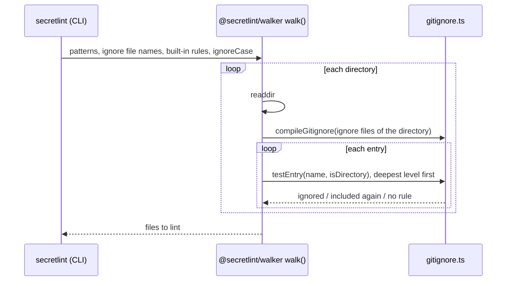

# File selection design

[日本語](design.ja.md)

## About this document

This document describes how the ignore rules of [File selection](requirements.md) are matched.
The parent Product is [Secretlint](../../product.md).
Like the Requirements, it covers only the ignore rules.

### Audience

People and agents who change how files are found and ignored.

### Prerequisites

The format of `.gitignore` in the [Git manual](https://git-scm.com/docs/gitignore).

### Outside this document

Expanding the globs of the user, symbolic links, and the lint of the chosen files.

## Implementation approach

`searchFiles()` of the `secretlint` package calls `walk()` of `@secretlint/walker` with the built-in rules, the names of the ignore files, and `ignoreCase: true`.
The walker reads directories from the top, and tests each entry before it goes into a directory. It does not read an ignored directory, which also gives the Git behavior that a file in an ignored directory can not be included again.

### The matcher has no dependency and follows Git

The rules are matched by code in `@secretlint/walker` (`gitignore.ts` and `glob.ts`), not by a library.
The two modules do not import Node.js or the walker, so they can be used in other places later.

The manual of Git leaves details to fnmatch(3), and libraries read them differently. The matcher takes what Git does as the answer:

- A line is read as Git reads it: a byte order mark at the start of the file and a CR before the end of a line are removed, `#` starts a comment, trailing spaces are removed unless they are escaped, `!` negates, and a trailing `/` makes the rule match only directories.
- A rule without `/` (other than a trailing one) is compared with the name of an entry, and `**` in it is the same as `*`.
- A rule with `/` is compared with the path from the directory of the ignore file. `*`, `?`, and a character class do not match `/`. `**` between slashes matches any number of directories, including none.
- The comparison is by the bytes of UTF-8, as in Git: `?` matches one byte, and only A to Z are folded when case is ignored.
- A rule that Git can not parse (an unclosed character class, a backslash at the end, an unknown class name such as `[[:foo:]]`) matches nothing.

The matcher is written from the manual and from the observed results of Git. It is not a port of the source code of Git, which has a different license (GPLv2).

### Tests compare with Git

- `test/git-compat/generate-fixtures.mjs` runs `git check-ignore --no-index -v -n` for many rule sets and paths in temporary repositories, and saves the results to `test/git-compat/git-check-ignore.json`. `test/gitignore.test.ts` checks that the matcher gives the same result for every pair, with and without `ignoreCase`. The test does not need Git, and the file is created again when the matcher gets new syntax or Git changes.
- `test/walk-git-compat.test.ts` creates random trees with `.gitignore` files in several directories and checks that `walkSync()` returns the files of `git ls-files --others --exclude-standard`. It is skipped where Git is not installed.

### Speed

Most rules are a name (`node_modules`), an extension (`*.log`), or a path without wildcards.
A matcher puts names and extensions in tables, so an entry is tested with a few table lookups, and only the other rules of the directory are tested one by one.
A rule is compiled to a list of parts for the whole name or path only when it has `?`, a character class, an escape, or `**` that is not a whole segment.
With `ignoreCase`, the name of an entry is converted to lowercase once, and all levels compare the same string.

### Time of a match

An ignore file can come from a repository that the user does not trust, so a rule must not make the walk hang.
The matcher does not use regular expressions and does not try every way to match the wildcards. When the rest of a rule does not match, only the last `*` and the last `**` move forward, which is enough to find a match if there is one.
The time of one test is at most about (length of the path)² × (length of the rule), and a rule such as `*a*a*a*a*b` or `**/a/**/a/**/a/b` is not slower than other rules.
The walker keeps the directories that it is reading in a list, not in recursive calls, so a tree as deep as the OS allows does not overflow the call stack.

### Levels

Each directory that has an ignore file adds a level with the rules of that file. An entry is tested from the deepest level to the top, and the first level that has a matching rule decides.
The built-in rules are the top level, at the working directory.
A path that the user gives directly is tested with its parent directories from the working directory, because the walker did not test them on the way.

## Architecture and sequence diagrams

## Data model and ER diagrams

- **Level:** the directory of an ignore file, the matcher of its rules, and the parent level.
- **Rule:** negated or not, directories only or not, and how it is compared: a name, an extension, path segments, or a regular expression.

## APIs and interfaces

- `walk({ cwd, patterns, ignoreFiles, extraIgnorePatterns, ignoreCase, ... })` and `walkSync()` of `@secretlint/walker`. `ignoreCase` is false by default in the library, like Git on a case-sensitive file system. The command always passes true.
- `compileGitignore(contents, { ignoreCase })` returns a matcher with `test(path)` for a path, and `forDirectory(dir)` and `testEntry(rules, name, isDirectory)` for the entries of a directory. It is internal to `@secretlint/walker`.

## External service integration

None.

## Data handling

Ignore files are read from the disk and kept in memory during the walk.

## Authentication and authorization notes

None.

## Security considerations

None in addition to the Requirements.

## Deployment notes

`@secretlint/walker` no longer depends on the `ignore` package (node-ignore).

## Alternatives considered

### Keep node-ignore for the rules that the fast path does not support

It was the earlier design: when an ignore file had one rule outside the simple forms, all its rules were matched by node-ignore.
It was slower for such files, and node-ignore differs from Git for some rules (`a**/b`, and the case of non-ASCII letters), so two matchers could give two answers.

### Run Git

`git ls-files` gives the exact answer, but Secretlint also runs where Git is not installed and outside a repository, and `.secretlintignore` is not a file of Git.

### Use a native walker

A walker written in Rust (the `ignore` crate of ripgrep) was measured at about the same time as this implementation for a repository of 21,000 files, and it adds a native binary for each platform.

### Follow the file system for the case of letters

It is what Git does. It was not chosen because of the principle "Reduce false positives" of the Product.

## Open questions

None.
