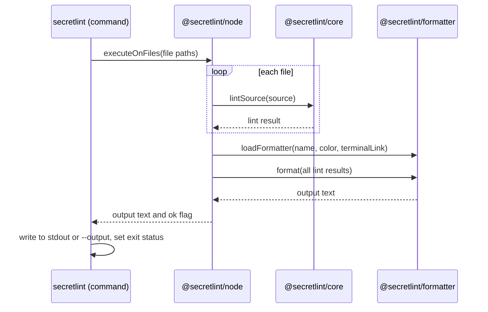

# 結果の出力の設計

[English](design.md)

## このドキュメントについて

このドキュメントは、[Secretlint](../../product.ja.md)の[結果の出力](requirements.ja.md)をどう実現しているかを説明する。フォーマッターの選び方と読み込み方、フォーマッターが受け取るもの、出力が利用者に届くまでを扱う。

### 対象読者

フォーマッター、フォーマッターが受け取るデータ、コマンドが出力を書き出す方法を変更する人とエージェント。

### 前提知識

Productの主要な概念と、この機能のRequirements。

### このドキュメントで扱わないこと

ルールがメッセージを作る方法、メッセージ中の秘密情報の値をマスクする方法、lintするファイルの選び方と読み方。

## 実装方針

出力は3つの段階で作る。すべての対象をlintし、フォーマッターを1つ読み込み、フォーマッターが返したテキストを書き出す。

エンジン（`@secretlint/node`）は対象を1つずつlintし、対象ごとにlintの結果を1つ集める。
すべての対象をlintしたあと、エンジンは名前からフォーマッターを読み込み、すべての結果を1回の呼び出しで渡す。
フォーマッターは1つのテキストを返し、エンジンはそのテキストを、重大度がエラーのメッセージがあるかを示すフラグと一緒に返す。
コマンド（`secretlint`）はテキストを標準出力か`--output`のファイルへ書き出し、フラグから終了ステータスを決める。

### フォーマッターの読み込み

`@secretlint/formatter`は、名前から次の順でフォーマッターを読み込む。

1. Secretlint自身のフォーマッター。`json`、`mask-result`、`table`。
2. 利用者が追加するフォーマッター。ファイルのパス、現在のディレクトリからのパス、指定した名前のパッケージ、接頭辞`secretlint-formatter-`を付けた名前のパッケージ。モジュールは動的importで読み込み、そのdefault exportがフォーマッターになる。
3. textlintのフォーマッター（`@textlint/linter-formatter`）。`checkstyle`、`compact`、`github`、`jslint-xml`、`junit`、`pretty-error`、`stylish`、`tap`、`unix`。

人が読む形式とCIツール向けの形式には、textlintのフォーマッターを再利用している。
これらのフォーマッターのために、lintの結果をtextlintの結果の形式に変換する。重大度は数値になり、ルールIDにはプリセットのIDが接頭辞として付き、メッセージにはメッセージIDが接頭辞として付く。
変換後の結果はファイルパスとメッセージだけを持ち、ファイルの内容は持たない。

3つの段階のどれでもフォーマッターが見つからない場合、読み込みはフォーマッター名を示すエラーを投げる。

### lintの結果が持つファイルの内容

lintの結果はファイルの内容を`sourceContent`として持つ。フォーマッターがファイルを読まずに内容を使えるようにするためである。
`json`は結果を`JSON.stringify`でそのまま出力するので、内容がJSON出力に現れる。

lintの結果はコア（`@secretlint/core`）が作る。
ソースが内容を文字列で持つ場合、結果はその文字列を持つ。
ソースが内容をバイト列で持つ場合、`sourceContent`は読まれた時点でバイト列をデコードするプロパティになる。lint自体は、秘密情報の候補がないファイルのバイト列をデコードしない。このプロパティにより、内容を読まないフォーマッターではデコードしないままになる。
バイナリの内容の結果は、内容を持たない。

エンジンはファイルを1つの共有バッファに読み込み、バッファがファイルを保持するのは次のファイルを読むまでである。
フォーマッターはすべてのファイルをlintしたあとに動くので、フォーマッターがファイルの内容を読む時点では、バッファにそのファイルは残っていない。
その場合、ファイルをディスクから読み直す。ファイルのサイズやタイムスタンプがlintの時点と違う場合、読み直しはエラーを投げる。新しい内容はどのルールも検査していないためである。

textlintの`pretty-error`は、メッセージの前後の行を表示する。その行はlintの結果からではなく、ファイルパスのファイルをディスクから読んで得ている。

### ターミナル向けの出力

ファイルパス、メッセージ、メッセージID、ルールIDは、lintしたファイルとルールに由来するので、ターミナルにとって信頼できないテキストである。
textlintのフォーマッター向けの変換と`table`フォーマッターは、これらからANSIエスケープシーケンスと制御文字を取り除く。タブと改行は残す。
`pretty-error`はファイルを読むために実際のファイルパスが必要なので、パスはそのまま渡し、出力のテキストの中で制御文字を除いたパスに置き換える。
`json`は制御文字を取り除かない。`JSON.stringify`がエスケープするためである。

ターミナルのリンクは、`stylish`と`pretty-error`向けの変換でだけ、ルールの説明のURLを使って付ける。

### 失敗

フォーマッターの読み込みやフォーマッター自体が投げたエラーを、エンジンは捕まえない。
コマンドがそれを標準エラー出力に表示し、終了ステータス2で終了する。

## アーキテクチャ・シーケンス図

## データモデル・ER 図

lintの結果（`SecretLintCoreResult`）は次のプロパティを持つ。

| プロパティ | 意味 |
| --- | --- |
| `filePath` | lintしたファイルのパス、またはSTDINの内容に付けた名前 |
| `sourceContent` | ファイルの内容。バイナリの内容では`undefined` |
| `sourceContentType` | `text`、`binary`、`unknown`のいずれか |
| `messages` | ファイルのメッセージ。位置の順に並ぶ |

図は不要である。関係は、lintの結果がメッセージの一覧を持つことだけだからである。

## API・インターフェース

### フォーマッター

フォーマッターは、lintの結果の一覧とフォーマッターのオプションを受け取り、出力のテキストを返す関数である。
フォーマッターのオプションは`color`を持ち、ANSIカラーを使うかどうかを示す。
利用者が追加するフォーマッターは、この関数をモジュールのdefault exportにする。

### `loadFormatter`

`@secretlint/formatter`の`loadFormatter`は、フォーマッター名、`color`、`terminalLink`を受け取り、`format(results)`を持つオブジェクトを返す。
フォーマッターが見つからない場合はrejectする。

### エンジン

`@secretlint/node`の`executeOnFiles`と`executeOnContent`は`{ ok, output }`を返す。
`output`はフォーマッターのテキストで、`ok`は重大度がエラーのメッセージが1つ以上あるとfalseになる。

## 外部サービスとの連携方式

なし。フォーマッターはSecretlintのプロセスの中で動く。

## データの取り扱い設計

lintの結果は、1回の実行の間だけメモリ上にある。
ファイルの内容は、lintの結果か共有バッファが保持している間だけ保持され、必要になるとディスクから読み直す。
出力のテキストは、標準出力か`--output`のファイルへ書き出す。Secretlintはそれ以外の場所に保存しない。

## 認証認可に関する特記事項

なし。この機能はコマンドの利用者が読めるファイルを読み、独自の権限を持たない。

## セキュリティ上の留意事項

[ターミナル向けの出力](#ターミナル向けの出力)で説明した制御文字の除去により、ファイル名やメッセージがターミナルの行を隠したり、タイトルを変えたり、リンクを偽装したりすることを防ぐ。
メッセージ中の秘密情報の値のマスクは、結果がフォーマッターに届く前に行うので、どのフォーマッターも既定でマスク済みのメッセージを受け取る。
`sourceContent`はマスクされない。`json`のようにそれを出力するフォーマッターは、ファイルの秘密情報を出力する。

## デプロイに関する特記事項

なし。

## 検討した代替手段

次の判断について、代替手段の記録はなく、理由は不明である。

- ファイルの内容を別の方法でフォーマッターに渡すのではなく、lintの結果に持たせること。
- JSON出力にファイルの内容を含めること。

## 未決事項

なし。
