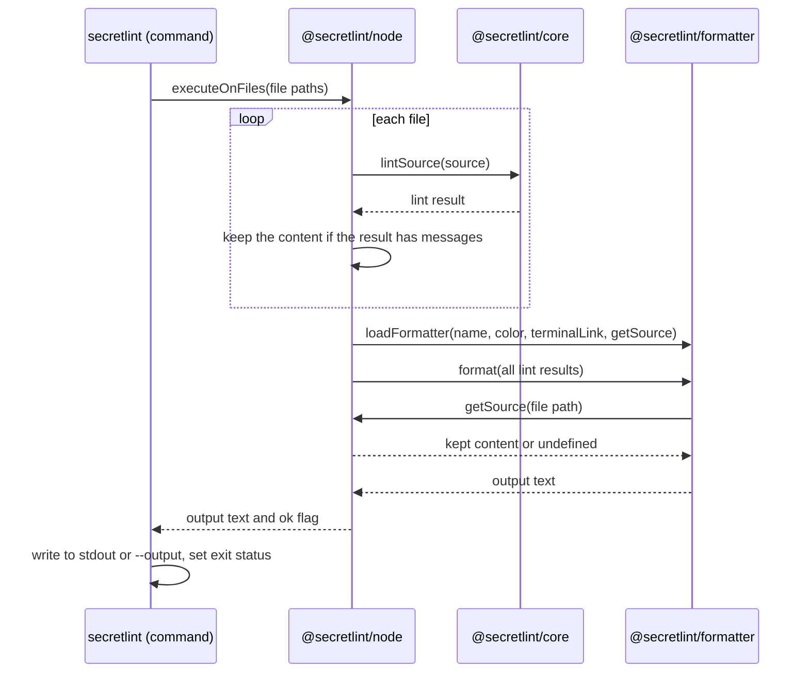

# 結果の出力の設計

[English](design.md)

## このドキュメントについて

このドキュメントは、[Secretlint](../../product.ja.md)の[結果の出力](requirements.ja.md)をどう実現しているかを説明する。フォーマッターの選び方と読み込み方、フォーマッターが受け取るもの、出力が利用者に届くまでを扱う。

### 対象読者

フォーマッター、フォーマッターが受け取るデータ、コマンドが出力を書き出す方法を変更する人とエージェント。

### 前提知識

Productの主要な概念と、この機能のRequirements。

### このドキュメントで扱わないこと

ルールがメッセージを作る方法、メッセージ中の秘密情報の値をマスクする方法、lintするファイルの選び方と読み方。

## 実装方針

出力は3つの段階で作る。すべての対象をlintし、フォーマッターを1つ読み込み、フォーマッターが返したテキストを書き出す。

エンジン（`@secretlint/node`）は対象を1つずつlintし、対象ごとにlintの結果を1つ集める。
lintの間、エンジンは、フォーマッターが問い合わせることのできる対象の内容も保持する。
すべての対象をlintしたあと、エンジンは名前からフォーマッターを読み込み、すべての結果を、保持した内容を返す関数と一緒に1回の呼び出しで渡す。
フォーマッターは1つのテキストを返し、エンジンはそのテキストを、重大度がエラーのメッセージがあるかを示すフラグと一緒に返す。
コマンド（`secretlint`）はテキストを標準出力か`--output`のファイルへ書き出し、フラグから終了ステータスを決める。

### フォーマッターの読み込み

`@secretlint/formatter`は、名前から次の順でフォーマッターを読み込む。

1. Secretlint自身のフォーマッター。`json`、`mask-result`、`table`。
2. 利用者が追加するフォーマッター。ファイルのパス、現在のディレクトリからのパス、指定した名前のパッケージ、接頭辞`secretlint-formatter-`を付けた名前のパッケージ。モジュールは動的importで読み込み、そのdefault exportがフォーマッターになる。
3. textlintのフォーマッター（`@textlint/linter-formatter`）。`checkstyle`、`compact`、`github`、`jslint-xml`、`junit`、`pretty-error`、`stylish`、`tap`、`unix`。

人が読む形式とCIツール向けの形式には、textlintのフォーマッターを再利用している。
これらのフォーマッターのために、lintの結果をtextlintの結果の形式に変換する。重大度は数値になり、ルールIDにはプリセットのIDが接頭辞として付き、メッセージにはメッセージIDが接頭辞として付く。
変換後の結果はファイルパスとメッセージだけを持つ。textlintのフォーマッターは、Secretlintからファイルの内容を受け取らない。

3つの段階のどれでもフォーマッターが見つからない場合、読み込みはフォーマッター名を示すエラーを投げる。

### フォーマッターに渡すファイルの内容

lintの結果は、ファイルの内容を持たない。内容が必要なフォーマッターは、フォーマッターのオプションで受け取る`getSource(filePath)`を、結果のファイルパスで呼ぶ。
`getSource`は内容を文字列で返し、内容が取得できない場合は`undefined`を返す。

内容を結果から分けた理由は3つある。
1つ目は、結果は`json`が`JSON.stringify`で出力するものであり、内容はマスクされていないことである。内容を持たない結果なら、ファイルの秘密情報がJSON出力に入ることはない。
2つ目は、ほとんどのファイルにはメッセージがなく、そのバイト列はlintの間に一度もデコードされないことである。結果を埋めるためだけにデコードすると、lintが避けた処理を足すことになる。
3つ目は、内容の持ち主がはっきりすることである。ソースを作った呼び出し側が内容を保持し、コア（`@secretlint/core`）は見つけたものだけを返す。

コマンドにとっての呼び出し側はエンジンであり、どの内容を保持するかはエンジンが決める。
エンジンはファイルを1つの共有バッファに読み込み、バッファがファイルを保持するのは次のファイルを読むまでである。
ファイルのlintの直後、バッファにまだそのファイルがある間に、ファイルがテキストでメッセージが1つ以上あれば、エンジンは内容をデコードして保持する。
内容はファイルパスから内容へのマップに保持し、`getSource`はこのマップを引く。
STDINの内容では、`getSource`は指定されたファイル名に対して、渡された文字列を返す。
`mask-result`フォーマッターでは、そのRequirementsのとおり、エンジンはすべてのテキストファイルの内容を保持する。

フォーマッターのためにディスクから読み直すことはない。
バッファが再利用されたあとにソースの内容を読むと、ファイルを読み直さずにエラーを投げる。そのため、どのルールも検査していない内容がフォーマッターに届くことはない。
`executeOnFiles`の呼び出しはそれぞれ自分のバッファを持つので、同時に動く呼び出しが互いのファイルを置き換えることはない。

textlintの`pretty-error`は、メッセージの前後の行を表示する。その行は`getSource`からではなく、ファイルパスのファイルをディスクから読んで得ている。

### ルールのテストのスナップショット

ルールのテスト（`@secretlint/tester`）のスナップショットは、lintの結果をJSONで保存したもので、範囲が指すものを示すために`sourceContent`を持ってきた。
testerは、lintしたソースから`sourceContent`をスナップショットに足す。そのため、lintの結果にこのプロパティがなくても、既存のルールのスナップショットは有効なままである。

### ターミナル向けの出力

ファイルパス、メッセージ、メッセージID、ルールIDは、lintしたファイルとルールに由来するので、ターミナルにとって信頼できないテキストである。
textlintのフォーマッター向けの変換と`table`フォーマッターは、これらからANSIエスケープシーケンスと制御文字を取り除く。タブと改行は残す。
`pretty-error`はファイルを読むために実際のファイルパスが必要なので、パスはそのまま渡し、出力のテキストの中で制御文字を除いたパスに置き換える。
`json`は制御文字を取り除かない。`JSON.stringify`がエスケープするためである。

ターミナルのリンクは、`stylish`と`pretty-error`向けの変換でだけ、ルールの説明のURLを使って付ける。

### 失敗

フォーマッターの読み込みやフォーマッター自体が投げたエラーを、エンジンは捕まえない。
コマンドがそれを標準エラー出力に表示し、終了ステータス2で終了する。

## アーキテクチャ・シーケンス図

## データモデル・ER 図

lintの結果（`SecretLintCoreResult`）は次のプロパティを持つ。

| プロパティ | 意味 |
| --- | --- |
| `filePath` | lintしたファイルのパス、またはSTDINの内容に付けた名前 |
| `sourceContentType` | `text`、`binary`、`unknown`のいずれか |
| `messages` | ファイルのメッセージ。位置の順に並ぶ |

ファイルの内容は、lintの結果のプロパティではない。内容は、`getSource`を通して、ファイルパスだけで結果とつながる。
図は不要である。関係は、lintの結果がメッセージの一覧を持つことと、ファイルパスから内容にたどれることだけだからである。

## API・インターフェース

### フォーマッター

フォーマッターは、lintの結果の一覧とフォーマッターのオプションを受け取り、出力のテキストを返す関数である。
フォーマッターのオプションは、ANSIカラーを使うかどうかを示す`color`と、`getSource`を持つ。
`getSource(filePath)`は、lintしたファイルの内容を文字列で返し、内容が取得できない場合は`undefined`を返す。呼び出し側がすでに内容をメモリに持っているので、同期の関数である。
フォーマッターの呼び出し側が渡さない場合、`getSource`自体がないことがある。フォーマッターは、関数がない場合を、内容が取得できない場合と同じに扱う。
利用者が追加するフォーマッターは、この関数をモジュールのdefault exportにする。

### `loadFormatter`

`@secretlint/formatter`の`loadFormatter`は、フォーマッター名、`color`、`terminalLink`、`getSource`を受け取り、`format(results)`を持つオブジェクトを返す。
`getSource`は、フォーマッターのオプションとしてフォーマッターに渡す。
フォーマッターが見つからない場合はrejectする。

### エンジン

`@secretlint/node`の`executeOnFiles`と`executeOnContent`は`{ ok, output }`を返す。
`output`はフォーマッターのテキストで、`ok`は重大度がエラーのメッセージが1つ以上あるとfalseになる。

### コア

`@secretlint/core`の`lintSource`は、内容を持たないlintの結果を返す。ブラウザで動くツールのようにコアを直接使う呼び出し側は、渡した内容をすでに持っているので、自分の`getSource`でフォーマッターに渡す。

## 外部サービスとの連携方式

なし。フォーマッターはSecretlintのプロセスの中で動く。

## データの取り扱い設計

lintの結果は、1回の実行の間だけメモリ上にある。
ファイルの内容は、次のファイルを読むまで共有バッファにある。エンジンは、メッセージのあるファイルのデコードした内容を、`mask-result`ではすべてのテキストファイルの内容を、フォーマッターが返るまで保持する。
出力のテキストは、標準出力か`--output`のファイルへ書き出す。Secretlintはそれ以外の場所に保存しない。

## 認証認可に関する特記事項

なし。この機能はコマンドの利用者が読めるファイルを読み、独自の権限を持たない。

## セキュリティ上の留意事項

[ターミナル向けの出力](#ターミナル向けの出力)で説明した制御文字の除去により、ファイル名やメッセージがターミナルの行を隠したり、タイトルを変えたり、リンクを偽装したりすることを防ぐ。
メッセージ中の秘密情報の値のマスクは、結果がフォーマッターに届く前に行うので、どのフォーマッターも既定でマスク済みのメッセージを受け取る。
`getSource`が返す内容はマスクされない。lintの結果はそれを持たないので、`json`とtextlintのフォーマッターは内容を出力できない。

## デプロイに関する特記事項

lintの結果とJSON出力から`sourceContent`をなくすことは破壊的変更なので、メジャーバージョンでリリースする。
`result.sourceContent`を読むフォーマッターは、`getSource(result.filePath)`に変える。
JSON出力から`sourceContent`を読むプログラムは、代わりに`filePath`からファイルを読む。

## 検討した代替手段

### メッセージのあるファイルだけ、lintの結果に`sourceContent`を残す

結果は、メッセージがあるときは内容を持ち、ないときは持たない。
メッセージのないファイルをデコードせずに済み、既存のフォーマッターはメッセージのあるファイルについてそのまま動く。
採用しなかった理由は、秘密情報のあるすべてのファイルについて、マスクされていない内容がJSON出力に残ることと、結果の形がメッセージの有無で変わることである。

### フォーマッターが内容を問い合わせたときに、ファイルをディスクから読む

内容を保持していないファイルについて`getSource`がファイルを読み直すので、すべてのファイルの内容を取得できる。
採用しなかった理由は、lintのあとにファイルが変わりうることである。サイズとタイムスタンプの確認では、内容が同じであることを証明できない。また、コアとフォーマッターはファイルシステムなしで動けるのに、フォーマッターがファイルシステムに依存することになる。

### すべてのファイルの内容を保持する

エンジンがすべてのファイルのデコードした内容を保持するので、`getSource`は常に内容を返す。
採用しなかった理由は、ほとんどのフォーマッターが読まない内容のために、すべてのファイルをデコードし、フォーマッターが動くまでメモリに保持することになるためである。エンジンがこれを行うのは、すべてのファイルを出力する`mask-result`のときだけである。

## 未決事項

なし。
