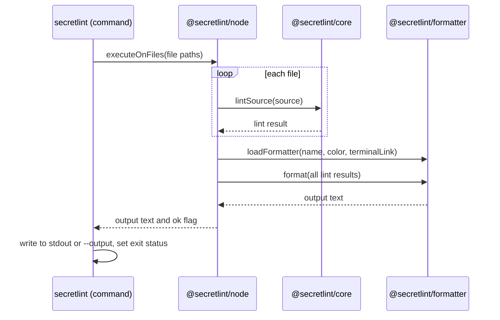

# Result output design

[日本語](design.ja.md)

## About this document

This document describes how the [Result output](requirements.md) of [Secretlint](../../product.md) is realized: how a formatter is chosen and loaded, what a formatter receives, and how the output reaches the user.

### Audience

People and agents who change the formatters, the data that formatters receive, or the way the command writes its output.

### Prerequisites

The key concepts of the Product, and the Requirements of this feature.

### Outside this document

How rules create messages, how secret values in messages are masked, and how files are chosen and read for linting.

## Implementation approach

The output is created in three steps: lint every target, load one formatter, and write the text that the formatter returns.

The engine (`@secretlint/node`) lints the targets one by one and collects one lint result for each.
After all targets are linted, the engine loads the formatter by its name and passes all the results to it in one call.
The formatter returns one text, and the engine returns the text together with a flag that tells whether any message has the severity error.
The command (`secretlint`) writes the text to the standard output or to the file of `--output`, and decides the exit status from the flag.

### Loading a formatter

`@secretlint/formatter` loads a formatter by its name in this order.

1. A formatter of Secretlint itself: `json`, `mask-result`, or `table`.
2. A formatter that a user adds: a file path, a path from the current directory, a package with the given name, or a package with the prefix `secretlint-formatter-`. The module is loaded with a dynamic import, and its default export is the formatter.
3. A formatter of textlint (`@textlint/linter-formatter`): `checkstyle`, `compact`, `github`, `jslint-xml`, `junit`, `pretty-error`, `stylish`, `tap`, and `unix`.

Secretlint reuses the formatters of textlint for the formats for people and for CI tools.
For these formatters, each lint result is converted to the result format of textlint: the severity becomes a number, the rule ID gets the ID of its preset as a prefix, and the message gets its message ID as a prefix.
The converted result has only the file path and the messages. It does not have the content of the file.

When no formatter is found in the three steps, loading throws an error that names the formatter.

### The content of the file in a lint result

A lint result carries the content of its file as `sourceContent`, so that a formatter can use the content without reading the file.
`json` outputs the results as they are with `JSON.stringify`, so the content appears in the JSON output.

The core (`@secretlint/core`) creates the lint result.
When the source has the content as a string, the result has the string.
When the source has the content as bytes, `sourceContent` is a property that decodes the bytes at the time it is read. The lint itself does not decode the bytes of a file that has no candidate of a secret, and this property keeps that for formatters that do not read the content.
A result of binary content has no content.

The engine reads files into one shared buffer, and the buffer has a file only until the next file is read.
The formatter runs after all files are linted, so when a formatter reads the content of a file, the buffer no longer has it.
In that case the file is read again from the disk. If the size or the time stamps of the file differ from the time of the lint, reading throws an error, because the new content has not been checked by any rule.

`pretty-error` of textlint shows the lines around a message. It gets them by reading the file of the file path from the disk, not from the lint result.

### Output for a terminal

File paths, messages, message IDs, and rule IDs come from linted files and rules, so they are untrusted text for a terminal.
The conversion for the formatters of textlint and the `table` formatter remove ANSI escape sequences and control characters from them, except tabs and line breaks.
`pretty-error` needs the real file path to read the file, so the path is passed as it is and replaced with the cleaned path in the output text.
`json` does not remove control characters, because `JSON.stringify` escapes them.

Terminal links are added in the conversion for `stylish` and `pretty-error` only, with the URL of the documentation of the rule.

### Failures

An error from loading the formatter or from the formatter itself is not caught by the engine.
The command shows it on the standard error and exits with the status 2.

## Architecture and sequence diagrams

## Data model and ER diagrams

A lint result (`SecretLintCoreResult`) has these properties.

| Property | Meaning |
| --- | --- |
| `filePath` | The path of the linted file, or the name given for the STDIN content |
| `sourceContent` | The content of the file. `undefined` for binary content |
| `sourceContentType` | `text`, `binary`, or `unknown` |
| `messages` | The messages of the file, sorted by location |

A diagram is not needed, because the only relationship is that a lint result has a list of messages.

## APIs and interfaces

### Formatter

A formatter is a function that receives the list of lint results and the formatter options, and returns the output text.
The formatter options have `color`, which tells whether ANSI colors are used.
A formatter that a user adds exports this function as the default export of its module.

### `loadFormatter`

`loadFormatter` of `@secretlint/formatter` receives the name of the formatter, `color`, and `terminalLink`, and returns an object with `format(results)`.
It rejects when the formatter is not found.

### Engine

`executeOnFiles` and `executeOnContent` of `@secretlint/node` return `{ ok, output }`.
`output` is the text of the formatter, and `ok` is false when at least one message has the severity error.

## External service integration

None. Formatters run in the process of Secretlint.

## Data handling

Lint results exist only in memory during one run.
The content of a file is kept only as long as the lint result or the shared buffer keeps it, and is read again from the disk when needed.
The output text is written to the standard output or to the file of `--output`. Secretlint does not store it anywhere else.

## Authentication and authorization notes

None. The feature reads the files that the user of the command can read, and has no permission of its own.

## Security considerations

The removal of control characters described in [Output for a terminal](#output-for-a-terminal) prevents a file name or a message from hiding lines, changing the title, or forging links in a terminal.
Masking of secret values in messages is done before the results reach the formatter, so every formatter gets masked messages by default.
`sourceContent` is not masked. A formatter that outputs it, such as `json`, outputs the secrets of the file.

## Deployment notes

None.

## Alternatives considered

There is no record of alternatives for the following decisions, and their reasons are unknown.

- Carrying the content of the file in the lint result instead of giving it to formatters in another way.
- Including the content of the file in the JSON output.

## Open questions

None.
