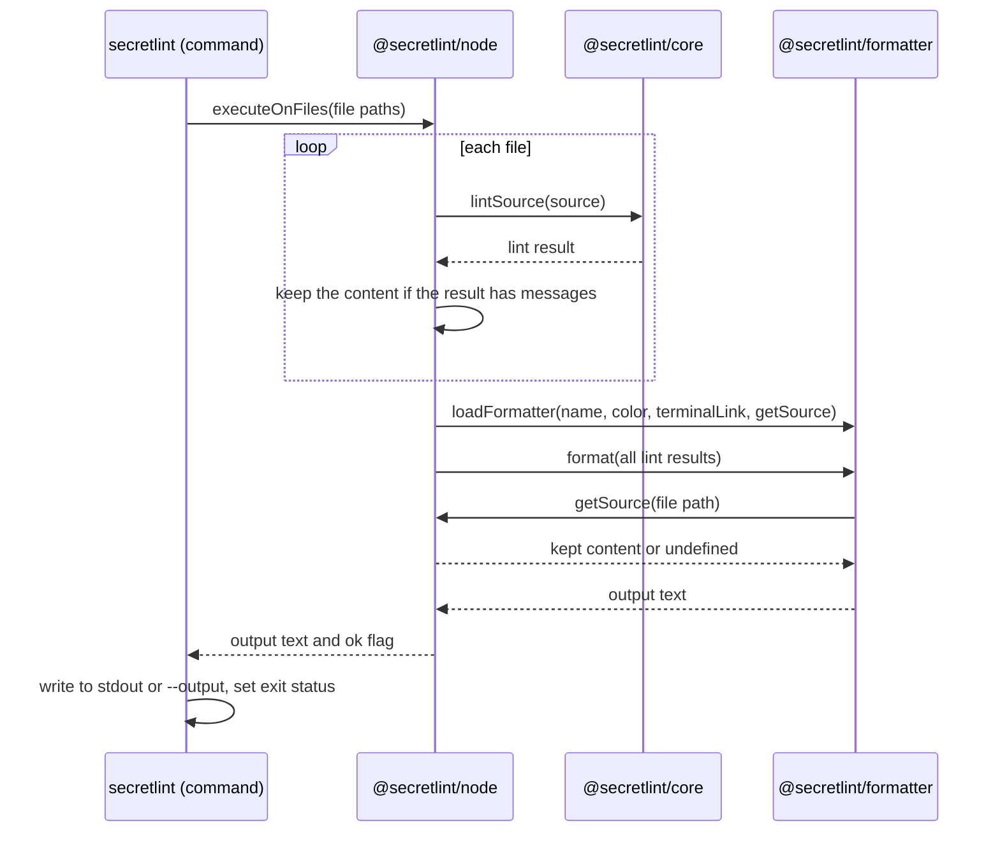

# Result output design

[日本語](design.ja.md)

## About this document

This document describes how the [Result output](requirements.md) of [Secretlint](../../product.md) is realized: how a formatter is chosen and loaded, what a formatter receives, and how the output reaches the user.

### Audience

People and agents who change the formatters, the data that formatters receive, or the way the command writes its output.

### Prerequisites

The key concepts of the Product, and the Requirements of this feature.

### Outside this document

How rules create messages, how secret values in messages are masked, and how files are chosen and read for linting.

## Implementation approach

The output is created in three steps: lint every target, load one formatter, and write the text that the formatter returns.

The engine (`@secretlint/node`) lints the targets one by one and collects one lint result for each.
While linting, the engine also keeps the content of the targets that a formatter can ask for.
After all targets are linted, the engine loads the formatter by its name and passes all the results to it in one call, together with a function that returns the kept content.
The formatter returns one text, and the engine returns the text together with a flag that tells whether any message has the severity error.
The command (`secretlint`) writes the text to the standard output or to the file of `--output`, and decides the exit status from the flag.

### Loading a formatter

`@secretlint/formatter` loads a formatter by its name in this order.

1. A formatter of Secretlint itself: `json`, `mask-result`, or `table`.
2. A formatter that a user adds: a file path, a path from the current directory, a package with the given name, or a package with the prefix `secretlint-formatter-`. The module is loaded with a dynamic import, and its default export is the formatter.
3. A formatter of textlint (`@textlint/linter-formatter`): `checkstyle`, `compact`, `github`, `jslint-xml`, `junit`, `pretty-error`, `stylish`, `tap`, and `unix`.

Secretlint reuses the formatters of textlint for the formats for people and for CI tools.
For these formatters, each lint result is converted to the result format of textlint: the severity becomes a number, the rule ID gets the ID of its preset as a prefix, and the message gets its message ID as a prefix.
The converted result has only the file path and the messages. The formatters of textlint do not get the content of the file from Secretlint.

When no formatter is found in the three steps, loading throws an error that names the formatter.

### The content of the file for formatters

A lint result does not carry the content of its file. A formatter that needs the content calls `getSource(filePath)`, which it receives in the formatter options, with the file path of a result.
`getSource` returns the content as a string, or `undefined` when the content is not available.

The content is separated from the result for three reasons.
First, the result is what `json` outputs with `JSON.stringify`, and the content is not masked. A result without the content can not put the secrets of a file into the JSON output.
Second, most files have no message, and their bytes are never decoded during the lint. Decoding them only to fill the result would add work that the lint avoids.
Third, the owner of the content becomes clear: the caller that created the source keeps the content, and the core (`@secretlint/core`) only returns what it found.

The engine is the caller for the command, and it decides which contents to keep.
It reads files into one shared buffer, and the buffer has a file only until the next file is read.
Right after the lint of a file, while the buffer still has the file, the engine decodes and keeps the content if the file is text and has at least one message.
The contents are kept in a map from the file path to the content, and `getSource` looks up this map.
For the STDIN content, `getSource` returns the given string for the given file name.
For the `mask-result` formatter, the engine keeps the content of every text file, as the Requirements of the mask-result formatter describe.

Nothing is read again from the disk for a formatter.
Reading the content of a source after the buffer was reused throws an error instead of reading the file again, so a content that no rule has checked can not reach a formatter.
Each call of `executeOnFiles` has its own buffer, so calls that run at the same time do not replace the file of each other.

`pretty-error` of textlint shows the lines around a message. It gets them by reading the file of the file path from the disk, not from `getSource`.

### Snapshots of rule tests

The snapshot of a rule test (`@secretlint/tester`) is a lint result saved as JSON, and it has had `sourceContent` to show what the ranges point to.
The tester adds `sourceContent` to the snapshot from the source that it linted, so existing snapshots of rules stay valid without the property in the lint result.

### Output for a terminal

File paths, messages, message IDs, and rule IDs come from linted files and rules, so they are untrusted text for a terminal.
The conversion for the formatters of textlint and the `table` formatter remove ANSI escape sequences and control characters from them, except tabs and line breaks.
`pretty-error` needs the real file path to read the file, so the path is passed as it is and replaced with the cleaned path in the output text.
`json` does not remove control characters, because `JSON.stringify` escapes them.

Terminal links are added in the conversion for `stylish` and `pretty-error` only, with the URL of the documentation of the rule.

### Failures

An error from loading the formatter or from the formatter itself is not caught by the engine.
The command shows it on the standard error and exits with the status 2.

## Architecture and sequence diagrams

## Data model and ER diagrams

A lint result (`SecretLintCoreResult`) has these properties.

| Property | Meaning |
| --- | --- |
| `filePath` | The path of the linted file, or the name given for the STDIN content |
| `sourceContentType` | `text`, `binary`, or `unknown` |
| `messages` | The messages of the file, sorted by location |

The content of a file is not a property of the lint result. It is connected to the result only by the file path, through `getSource`.
A diagram is not needed, because the only relationships are that a lint result has a list of messages and that a file path leads to a content.

## APIs and interfaces

### Formatter

A formatter is a function that receives the list of lint results and the formatter options, and returns the output text.
The formatter options have `color`, which tells whether ANSI colors are used, and `getSource`.
`getSource(filePath)` returns the content of the linted file as a string, or `undefined` when the content is not available. It is synchronous, because the caller already has the content in memory.
`getSource` itself can be missing when a caller of the formatter does not provide it, so a formatter treats a missing function like a content that is not available.
A formatter that a user adds exports this function as the default export of its module.

### `loadFormatter`

`loadFormatter` of `@secretlint/formatter` receives the name of the formatter, `color`, `terminalLink`, and `getSource`, and returns an object with `format(results)`.
`getSource` is passed to the formatter in the formatter options.
It rejects when the formatter is not found.

### Engine

`executeOnFiles` and `executeOnContent` of `@secretlint/node` return `{ ok, output }`.
`output` is the text of the formatter, and `ok` is false when at least one message has the severity error.

### Core

`lintSource` of `@secretlint/core` returns a lint result without the content. A caller that uses the core directly, such as a tool in a browser, already has the content that it passed, and gives it to a formatter by its own `getSource`.

## External service integration

None. Formatters run in the process of Secretlint.

## Data handling

Lint results exist only in memory during one run.
The content of a file is in the shared buffer until the next file is read. The engine keeps the decoded content of the files that have messages, and of all text files for `mask-result`, until the formatter returns.
The output text is written to the standard output or to the file of `--output`. Secretlint does not store it anywhere else.

## Authentication and authorization notes

None. The feature reads the files that the user of the command can read, and has no permission of its own.

## Security considerations

The removal of control characters described in [Output for a terminal](#output-for-a-terminal) prevents a file name or a message from hiding lines, changing the title, or forging links in a terminal.
Masking of secret values in messages is done before the results reach the formatter, so every formatter gets masked messages by default.
The content from `getSource` is not masked. The lint result does not have it, so `json` and the formatters of textlint can not output it.

## Deployment notes

Removing `sourceContent` from the lint result and from the JSON output is a breaking change, so it is released in a major version.
A formatter that reads `result.sourceContent` changes to `getSource(result.filePath)`.
A program that reads `sourceContent` from the JSON output reads the file by `filePath` instead.

## Alternatives considered

### Keep `sourceContent` in the lint result only for files with messages

The result would have the content when it has messages, and no content otherwise.
It avoids decoding files without messages, and existing formatters keep working for files with messages.
It was not chosen because the JSON output would still have the unmasked content of every file that has a secret, and because the shape of the result would depend on whether the file has messages.

### Read the file from the disk when a formatter asks for the content

`getSource` would read the file again for the files whose content is not kept, so the content of every file would be available.
It was not chosen because the file can change after the lint, and a check of the size and the time stamps can not prove that the content is the same. It also makes the formatter depend on the file system, while the core and formatters can run without it.

### Keep the content of every file

The engine would keep the decoded content of all files, so `getSource` always returns a content.
It was not chosen because it decodes every file and keeps all of them in memory until the formatter runs, for a content that most formatters never read. The engine does this only for `mask-result`, which outputs every file.

## Open questions

None.
