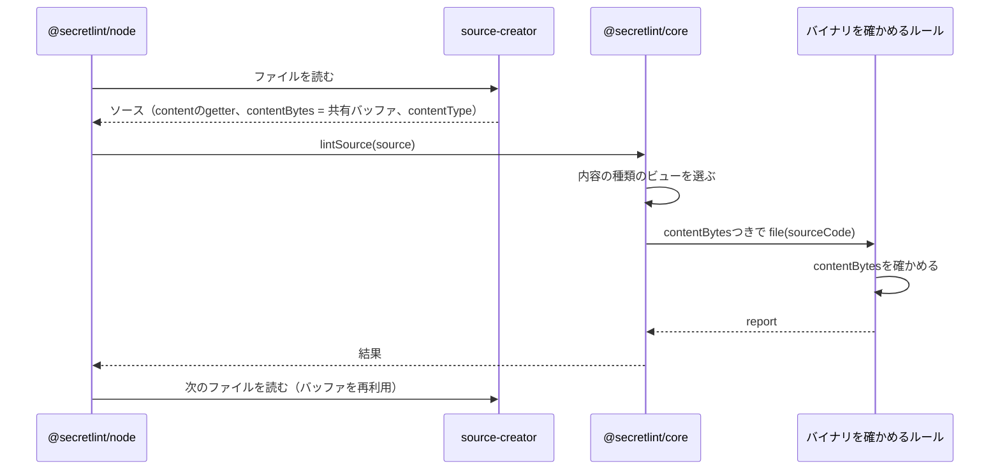
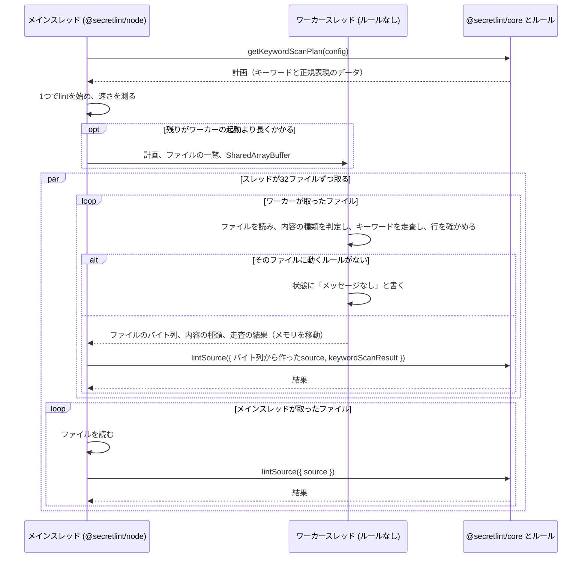

# 秘密情報の検査の設計

[English](design.md)

## このドキュメントについて

このドキュメントは、[Secretlint](../../product.ja.md)の[秘密情報の検査](requirements.ja.md)が、ソースを作り、内容の種類を決め、ルールに渡す方法を説明する。

### 対象読者

ルールが受け取るもの、lintのためのファイルの読み方、内容の種類ごとに実行するルールを変える人とエージェント。

### 前提知識

Productの主要な概念と、この機能のRequirements。

### このドキュメントで扱わないこと

ファイルの選び方、設定の読み込み、キーワードが見つかったあとの宣言的なパターンの確認方法、メッセージのマスク、結果の表示。

## 実装方針

lintは2つの側に分かれる。呼び出し元がソースを作り、core（`@secretlint/core`）がそれをlintする。
内容がファイル、STDIN、ツールのメモリのどこから来たかを知っているのは呼び出し元で、coreは自分では何も読まない。
この分担によって、Productが求めるとおりcoreがブラウザで動く。

### ソースを作る

ソース（`SecretLintRawSource`）は、文字列としての内容、ファイルパス、拡張子、内容の種類を持つ。
内容のバイト列`contentBytes`を持つこともできる。
バイト列が渡された場合、coreはまずバイト列からルールのキーワードを探し、ルールが必要とするときだけ文字列を読む。ほとんどのファイルにはキーワードがなく、デコードは探すことより時間がかかるためである。

ファイルの場合、エンジン（`@secretlint/node`）は`@secretlint/source-creator`を使う。
source-creatorは、すべてのファイルで共有する1つのバッファに各ファイルを読み込み、内容の種類を決め、最初に読まれたときにバッファをUTF-8としてデコードする`content`を持つソースを返す。
バッファにファイルが入っているのは次のファイルを読むまでなので、エンジンは1ファイルずつlintし、結果を待ってから次のファイルを読む。
`lintSource()`はpromiseを返したルールを待ってから返るので、バイト列はそのファイルのlintの間ずっと有効である。

ファイルの内容の種類は`istextorbinary`で決める。これは拡張子を見てから、バイト列を見る。
バイナリと判断されたファイルは`binary`、テキストと判断されたファイルは`text`、それ以外は`unknown`になる。

`mask-result`フォーマッターはすべてのファイルの内容を必要とするので、その場合エンジンは`createRawSource()`で各ファイルを専用のバッファに読み、そのソースをバイト列ごとcoreに渡す。
STDINの場合、エンジンは文字列を内容の種類`text`で渡す。
ブラウザのツールのように`lintSource()`を直接呼ぶプログラムは、ソースを自分で作る。

### ルールを選ぶ

coreは設定から計画を一度だけ作り、内容の種類ごとに計画のビューを持つ。
ビューには、`meta.supportedContentTypes`にその種類か`all`を含むルールが入る。`unknown`の場合はすべてのルールが入る。
`meta.keywords`はテキストのときだけ使う。バイナリで実行するルールはキーワードではなく内容の構造やファイル名を見るので、常に実行される。

### キーワードを探す

ソースのlintには2つのステージがある。まずキーワード走査が内容からルールのキーワードを探し、次にキーワードが選んだルールとパターンを実行する。
ほとんどのソースにはキーワードがないので、ほとんどのソースは最初のステージで終わる。

coreは、テキスト用のビューにあるルールとパターンのキーワードを集め、それらに対するキーワードマッチャーを1つ作る。マッチャーはキーワードごとにキャッシュする。
マッチャーはAho-Corasickのオートマトンである。内容を先頭から末尾まで一度だけ読み、その1回ですべてのキーワードを見つける。
キーワードはASCIIである。既定ではASCIIの英字の大文字と小文字を区別せず、大文字と小文字を区別するキーワードは、見つけたあとで内容ともう一度比べる。
キーワードがASCIIなので、UTF-8のバイト列を走査しても、デコードした文字列を走査しても、同じキーワードが見つかる。

ソースにバイト列がある場合、coreはバイト順マークの後ろからバイト列を走査する。
キーワードが見つからず、キーワードなしで実行するルールやパターンもなければ、結果はメッセージなしになり、内容はデコードされない。
キーワードが見つかった場合、coreはキーワードのある行をバイト列のまま確かめ、パターンかルールを実行するときだけ内容をデコードする。
パターンを実行するときは、デコードした文字列をもう一度走査する。パターンには文字列での位置が必要で、それはバイト列での位置と違うためである。

オートマトンは、キーワードが何であっても、1バイトにつき表を1回引くだけである。
そのため、時間は内容の大きさで決まり、キーワードの数にはほとんど左右されない。
内容についての知識も持たない。これがRequirementsの「どんな内容でも」と「キーワードの数」を満たす理由である。

### 複数のスレッドでキーワードを探す

Node.jsはJavaScriptを1つのスレッドで実行するので、エンジンはファイルを1つずつ順にlintする。
大きなリポジトリのプロファイルを見ると、その1つのスレッドが時間を使っている場所が分かる。いちばん大きいのがキーワード走査で、次がファイルの読み込みである。ルールにはあまり時間がかからない。ルールが動くのは、キーワードで絞り込んだソースだけだからである。
そこで、複数のスレッドで実行するのは、ソースを絞り込むステージ、つまりファイルを読んでキーワードを走査するステージにする。

走査を並列にする方法はいくつかあり、どれを選ぶかは配布と起動という2つのコストで決まる。

- ネイティブのプログラムやネイティブアドオンは、プラットフォームごとのビルドと配布の手段が必要になる。WebAssemblyはプラットフォームごとのビルドがいらないが、Node.js、ブラウザ、単一実行バイナリのそれぞれで読み込み方が違い、スレッドを始めるのは結局ホスト側である。また、計測では、1スレッドあたりの速さはネイティブの走査とJavaScriptの走査でほぼ同じだった。速くなるのはスレッドの分だけである。
- Node.jsのワーカースレッドは、配布するものが増えない。コストは起動である。ワーカーは仕事の前に自分のコードを読み込む。

そのため、走査はワーカースレッドで行い、ワーカーの起動を小さく一定に保つ設計にする。
`lintSource()`を実行するワーカーは、設定とすべてのルールを読み込まなければならず、カスタムルールの大きさは決まっていない。起動はルールとともに大きくなり、一定にならない。
キーワード走査にルールはいらない。必要なのはキーワードだけで、キーワードは文字列である。キーワードのある行の確認に必要なのはパターンの正規表現だけで、ワーカーは正規表現をそのソースとフラグから作れる。そこで、ワーカーはcoreのキーワードマッチャーと行の確認だけを読み込み、キーワードと正規表現はデータとして受け取る。このコードはルールが増えても大きくならない。
ルールはメインスレッドに残り、一度だけ読み込まれ、これまでと同じく1ファイルずつ実行される。

#### 走査を独立したステージにする

coreには、lintの最初のステージだけを取り出した入口`@secretlint/core/keyword-scan`がある。
この入口が読み込むのはキーワードマッチャーだけで、ルールも設定もNode.jsのモジュールも読み込まない。
coreの`getKeywordScanPlan({ config })`は、走査するものをただのデータとして返す。キーワード、そのうち大文字と小文字を区別するもの、`requiresKeyword`、`ruleCheck`、これら全体を表すidである。
`requiresKeyword`は、キーワードなしで実行するルールやパターンがないときにtrueになる。このとき、キーワードのないソースにメッセージは出ない。
`ruleCheck`は、キーワードのあるソースにルールが動くかどうかを決めるためのデータである。「line」スコープのパターンを、正規表現のソースとフラグ、キーワードの番号の組として持つ。あわせて、内容全体に対してルールを選ぶキーワードの番号を持つ。パターンを持たないルールのキーワードと、「file」スコープのパターンのキーワードである。
`createKeywordScanner(plan).scan(bytes)`は、ヒットを計画のid、`runsRules`、`lineMatched`と一緒に返す。
内容全体に対するキーワードが見つかれば、`runsRules`はtrueになり、行は確かめない。それ以外の場合、スキャナーはパターンのキーワードがある行をデコードし、そのパターンの正規表現でテストする。1つでも一致すれば`lineMatched`と`runsRules`がtrueになる。これは`lintSource()`の中の確認と同じもので、どちらもcoreの同じ関数を呼ぶ。
`lintSource()`は、自分で行を確かめる代わりに、結果の`lineMatched`を使う。
`lintSource()`はこの結果を`keywordScanResult`として受け取り、idがソースの内容の種類に対する自分の計画のidと同じであれば、自分でバイト列を走査する代わりに使う。
マッチャーはどのスレッドでも同じキーワードから同じ順序で作るので、ヒットの意味はどのスレッドでも同じである。

coreは自分ではワーカーを始めない。ワーカーにはスクリプトファイルのURLが必要で、ブラウザでスレッドの間でメモリを共有するにはクロスオリジン分離が必要なので、始め方を知っているのは呼び出し側だけである。ファイルについてはNode.jsのエンジンが始め、ブラウザのツールはWeb Workerで同じことができる。

#### ファイルを読んで走査する

エンジン（`@secretlint/node`）は、ファイルを1回の処理でlintする。メインスレッドとワーカーは、ファイルの一覧と`SharedArrayBuffer`を共有する。`SharedArrayBuffer`には次のファイルの番号と、ファイルごとに1バイトの状態を持つ。
スレッドは`Atomics.add`で次の32ファイルを取る。スレッドは1つの一覧からファイルを取るので、遅れて始まったスレッドや失敗したスレッドは、受け持つファイルが少なくなるだけである。ファイルを前もってスレッドに割り当てることはしない。

メインスレッドは、自分が取ったファイルをこれまでと同じように処理する。ファイルを読み、`lintSource()`を呼ぶ。

ワーカーは絞り込む部分を受け持つ。ファイルを使い回しのバッファに読み、ソースを作る処理と同じように名前とバイト列から内容の種類を判定し、テキストであれば走査する。そのあと、次のどちらかを行う。

- そのファイルに動くルールがなければ、状態に「メッセージなし」と書くだけである。ファイルがテキストで、走査が`runsRules: false`を返し、計画の`requiresKeyword`がtrueの場合がこれに当たる。このファイルはメッセージなしの結果になり、誰も読み直さない。
- それ以外の場合は、ファイルをメインスレッドに渡す。バイト列をバッチ用のメモリにコピーし、32ファイルが終わったら、そのバッチを内容の種類と走査の結果と一緒にメインスレッドへ移す。メモリはコピーではなく移動で、メインスレッドはそのバイト列から`lintSource({ source, keywordScanResult })`でlintする。メインスレッドは内容の種類の判定も行の確認もやり直さない。

行の確認をワーカーで行うのは、キーワードで選ばれるファイルがパターンに一致するファイルよりずっと多く、1行がとても長いこともあるためである。メインスレッドが行を確かめると、キーワードのあるファイルがすべてメインスレッドに届き、メインスレッドが限界になる。
内容の種類をワーカーで判定するのも同じ理由である。そうしないと、名前で種類が分からないファイルをメインスレッドが走査することになる。

そのため、ファイルを読むのは、そのファイルを取ったスレッドの1回だけである。ワーカーが読んだファイルをメインスレッドが読むことはない。
これは読み込みが主なコストである環境で効く。マシンによっては、ファイルの読み込みがlintの時間の半分以上を占める。

利用者が書くパターンのルールのように、キーワードを持たないルールはすべてのファイルに動く。この場合`requiresKeyword`はfalseになり、ワーカーはすべてのファイルを渡す。それでも読み込み、走査、行の確認はワーカーが行い、メインスレッドはルールを実行する。この場合はメインスレッドが限界になる。ルールはメインスレッドでしか動かないためである。

メインスレッドは、自分がファイルを取る合間にワーカーからのメッセージを受け取り、渡されたファイルを先にlintする。渡されたファイルはメモリを持っているためである。
ワーカーは、メインスレッドがまだlintしていないバイト列が256MBを超えている間、次のファイルを取らずに待つ。そのため、メインスレッドがワーカーより遅いときでも、メモリには上限がある。

#### スレッドの数

Requirementsが決めているのは、得にならないときはワーカーを始めないことだけである。処理の分け方はここで実験から決める。以下の数はこれまでの計測の結果で、計測が変われば変わる。

メインスレッドは1つでlintを始めるので、短いlintがワーカーのコストを払うことはなく、ワーカーなしのときと同じように動く。
20msの慣らしのあと、次の20msでlintできたファイルの数を測り、残りのファイルにかかる時間を見積もる。
始めるワーカーの数は`floor(残りの時間 / 100ms)`で、多くても`os.availableParallelism() - 1`である。100msはワーカーの起動にかかるおおよその時間で、各ワーカーに起動より長い仕事があるようにしている。
慣らしの間は見積もりに使わない。ランタイムが最適化するまで、lintは数倍遅いためである。
ファイルの数ではなく時間で決めるので、ファイルの大きさやディスクの速さに合った判断になる。

#### 結果を同じに保つ

- メッセージを作るのはメインスレッドのルールだけである。パターンを実行するときは、これまでと同じくcoreがデコードした文字列を走査する。
- ルールが見るバイト列は、走査したバイト列そのものである。ワーカーは走査したのと同じバイト列を渡すので、lintの間にファイルが変わっても、ヒットと内容が食い違うことはない。
- 走査の結果を使うのは、テキストのファイルだけである。計画はテキストの内容の種類に対するものだからである。テキストではないファイルは、結果なしで必ず渡される。ワーカーは、ソースを作る処理と同じ関数と同じバイト列で内容の種類を判定する。
- 行の確認は、ワーカーでも`lintSource()`でもcoreの同じ関数である。ワーカーは、メインスレッドが使う正規表現のソースとフラグから正規表現を作るので、どちらも同じように行をテストする。
- `lintSource()`は、別の計画のidを持つ結果を使わない。idにはキーワードとパターンが入っているので、同じキーワードで別のパターンに対する結果は使われない。
- ワーカーが読めなかったファイルと、失敗したワーカーが取ったまま渡さなかったファイルは、結果がないまま残る。メインスレッドが最後にこれらを自分でlintするので、エラーも同じになる。
- 結果はファイルの番号で保存するので、結果の順序はファイルの順序になる。
- `mask-result`フォーマッターのときは、ワーカーを使わない。`mask-result`はすべてのファイルを文字列として読むためである。
- プロファイラーは経路を変えない。`--profile`のときもファイルは同じようにlintされるので、プロファイルは利用者が実際に得る実行を示す。各ワーカーが自分の時間とファイル数を測り、エンジンがそれを`@node>keyword-scan-thread`としてプロファイラーに足す。

#### 単一実行バイナリ

エンジンは、自分のファイルの隣にある`keyword-scan-worker.js`からワーカーを始める。
単一実行バイナリはBunで作った1つのバンドルなので、そのままではこのファイルがない。そこで、ビルドのときにワーカーを同じ名前の2つ目のエントリとして渡す。Bunはそれをバイナリの中でメインのエントリの隣に置く。
バイナリのテストで、バイナリの中でワーカーが始まることを確かめる。
このファイルを持たない別のツールのバンドルでも動く。ワーカーが始まらないだけで、ファイルはワーカーなしでlintされる。

それぞれの版の計測値は、ここではなく変更のプルリクエストに書く。計測値はマシンによって変わり、すぐに古くなるためである。

### ルールが受け取るもの

ルールはソースコードのオブジェクト（`SecretLintSourceCode`）を受け取る。
これは`content`、`hasBOM`、`filePath`、`physicalFilePath`、`ext`、`contentType`と、位置とインデックスの変換を持つ。
`content`はバイトオーダーマークを除いたデコード済みの文字列で、ルールが読んだときに初めてデコードされる。
呼び出し元が`noPhysicFilePath`を指定すると、`physicalFilePath`は`undefined`になる。
`contentBytes`は、呼び出し元が`source.contentBytes`として渡したバイト列で、渡されていなければ`undefined`になる。

ルールにバイト列を渡すのは、バイナリを確かめるルールには元のバイト列が必要で、バイナリファイルの`content`ではデコードでそれが失われているためである。
これまでは、そうしたルールは`node:fs`でファイルを読み直す必要があった。これはブラウザでは動かず、同じルールが環境によって違う結果を返す原因になっていた。
ソースコードのオブジェクトにバイト列があれば、ルールは呼び出し元が渡したものだけに依存する。これはcoreが内容をすでに扱っている方法と同じである。

coreは`lintSource()`の最初に`source.contentBytes`を一度だけ読み、同じ値をキーワードの検索とソースコードのオブジェクトに使う。
source-creatorの共有バッファのバイト列は、`lintSource()`が返るまで有効である。エンジンは結果を待ってから次のファイルを読み、`lintSource()`はpromiseを返したルールを待つためである。
そのためルールは、`await`のあとも含めて、ハンドラーの中でいつでも`contentBytes`を読める。
lintのあともバイト列を持ち続けるルールは、バッファが次のファイルに再利用されるので、コピーして持つ。Secretlintが提供するルールは持ち続けない。

`source.contentBytes`のテキストでの意味は変えない。`content`のUTF-8表現で、先頭にバイトオーダーマークがあってもよい。
バイナリでは、ファイルのバイト列で、`content`はそれをUTF-8として読んだ文字列である。source-creatorはすでにこのとおり動いているので、型のドキュメントにこれを書く。

### バイナリを確かめるルール

バイナリを確かめるルールは、`meta.supportedContentTypes`に`binary`を列挙し、テキストのファイルも確かめるなら`text`も列挙する。`all`ではなく種類を列挙することで、ルールがどの内容を確かめるかが宣言から読める。
バイナリにはキーワードを使わないので、ルールはすべてのバイナリファイルで実行される。ルールは`filePath`か`ext`から確かめる対象のファイルかを判断し、それ以外のファイルではすぐに戻る。

ルールはバイト列を、`content`やファイルからではなく、ソースコードのオブジェクトの`contentBytes`から読む。
`contentBytes`が`undefined`の場合、ルールはバイト列が必要な確認だけを行わず、その確認では何も報告しない。JSONのキーファイルのように`content`を使うテキストの確認は、これまでどおり行う。ファイルを読む方法に切り替えることはしない。コマンドは常にバイト列を渡すうえ、ファイルを読むと`noPhysicFilePath`を無視することになり、結果が環境に依存するためである。

プリセットはルールを静的にimportするので、静的なimportが1つあるだけでプリセットはブラウザで読み込めなくなる。そのためルールはNode.jsのモジュールを静的にimportしない。メッセージに使うファイル名は、`node:path`ではなく小さなヘルパーで`filePath`から取る。
`node:crypto`に対するWeb Cryptoのように、Node.jsでは速いが標準の代わりがあるAPIは、動的にimportし、importに失敗したら標準のAPIを使う。
これらを守ると、ルールはNode.js、ブラウザ、単一実行ファイルで同じ結果になる。

バイナリのメッセージはファイル全体を指す。デコードした文字列での位置は、バイト列にとって意味がないためである。

Secretlintが提供するルールでは、gcpルールがバイナリを確かめる。GCPがサービスアカウントキーに使うパスワードで`.p12`ファイルのMACを検証し、上の条件に従う。

### ルールのテスト

`@secretlint/tester`は、各テストファイルを2回lintする。1回はバイト列あり、もう1回は文字列だけでlintする。テキストではバイト列は速さのためだけにあるので、2つの結果が同じであることを確かめている。
バイナリではバイト列が必要なので、testerが2つの結果を比べるのはテキストのときだけにする。バイナリのスナップショットは、バイト列ありの結果にする。

## アーキテクチャ・シーケンス図

ワーカースレッドを使うlintの流れ:

## データモデル・ER 図

| 型 | プロパティ | 補足 |
| --- | --- | --- |
| `SecretLintRawSource` | `content`、`contentBytes?`、`filePath`、`ext?`、`contentType` | 呼び出し元が作る。テキストでは、`contentBytes`は`content`のUTF-8表現である。バイナリでは、`contentBytes`はファイルのバイト列で、`content`はそれをUTF-8として読んだ文字列である。 |
| `SecretLintSourceCode` | `content`、`contentBytes`、`hasBOM`、`filePath`、`physicalFilePath`、`ext`、`contentType`、位置のメソッド | coreがルールのために作る。`contentBytes`は新しいプロパティで、`Uint8Array \| undefined`、読み取り専用、そのソースのlintが終わるまで有効。 |

1つのソースから1回のlintで1つのソースコードのオブジェクトができるだけなので、図は不要である。

## API・インターフェース

### `lintSource({ source, options })`

coreの入口である。ソースと設定を受け取り、内容を含まない結果を返す。
`source.contentBytes`は呼び出しの最初に一度だけ読み、`source.content`はルールか結果が必要とするときだけ読む。

### ルールの`create(context, options)`

ルールはハンドラーを返し、`file(source)`ハンドラーがソースコードのオブジェクトを受け取る。ハンドラーはpromiseを返してよく、coreはそれを待つ。
`source.contentBytes`が新しいプロパティである。coreとほかのルールが同じバイト列を読むので、ルールはバイト列を書き換えない。
`meta.supportedContentTypes`には`text`と`binary`を列挙する。型`SecretLintRuleContentType`からは`all`を除くが、coreは実行時には`all`を両方として扱い続ける。そのため`all`を宣言したJavaScriptのルールや公開済みのルールはそのまま動く。

### `@secretlint/source-creator`

`createRawSource(filePath)`は、ファイルを専用のバッファに読む。`createFileSourceReader()`は、ファイルを1つの共有バッファに読むreaderを返す。readerが次のファイルを読んだあと、ソースの`contentBytes`は`undefined`になり、そのあとで初めて`content`を読むとエラーを投げる。

### `@secretlint/core/keyword-scan`

`createKeywordScanner(plan)`はスキャナーを返し、`scanner.scan(bytes)`は`KeywordScanResult`、つまり計画のid、ヒット、`runsRules`、`lineMatched`を返す。
`@secretlint/core`の`getKeywordScanPlan({ config, locale?, contentType? })`は、設定に対する`KeywordScanPlan`を返す。キーワードを持つルールがなければ`undefined`を返す。
計画と結果はただのデータと型付き配列なので、別のスレッドに送れる。
`lintSource({ source, options, keywordScanResult })`は、「走査を独立したステージにする」に書いたとおりに結果を使う。

## 外部サービスとの連携方式

なし。

## データの取り扱い設計

ファイルのバイト列は、次のファイルを読むまで共有バッファにある。デコードした文字列は、呼び出し元がソースを持っている間、ソースが持つ。
ルールはcoreと同じバイト列を読み、コピーしない。ファイルを2回読むことはない。

## 認証認可に関する特記事項

なし。lintはコマンドの利用者が読めるファイルを読む。

## セキュリティ上の留意事項

バイト列と内容には秘密情報が含まれうる。それらはメモリ上にあり、coreは書き出さない。

## デプロイに関する特記事項

型から`all`を除くので、`all`を宣言したTypeScriptのルールは、`text`と`binary`を列挙するまでコンパイルが通らなくなる。coreは`all`を受け付け続けるので、動きは変わらない。
公開している型から値を除くのは公開APIの互換性のない変更なので、コントリビューションガイドのバージョンの決まりに従い、この部分はメジャーリリースで出す。

ソースコードのオブジェクトに`contentBytes`を足しても、既存のルールは変わらない。
バイト列なしでバイナリファイルの`lintSource()`を呼ぶプログラムには、この変更のあと、バイナリを確かめるルールから報告されなくなる。これまでは、そうしたルール（`.p12`を見るgcpルール）がファイルを読んで報告していた。リリースノートで、そうした呼び出し元に`contentBytes`を渡すよう案内する。Productのバージョンの方針では、メジャーリリースにするのは既定で報告が増える変更で、この変更はそうした呼び出し元への報告が減るだけなので、破壊的変更ではない。
この変更は、ビルトインルールを`@secretlint/core`に移したあとに行う。そうするとビルトインルールはcoreのファイルになり、それぞれのパッケージはルールを再exportするだけで、同じリリースのcoreに依存する。
そのため設定は、`lintSource()`を動かすのと同じcoreからビルトインルールを解決し、ルールと`contentBytes`は常に同じcoreから来る。
新しいパッケージからルールのオブジェクトをimportして、古いcoreの`lintSource()`に渡すプログラムは、ルールはcoreと一緒に配布するという方針のとおりサポートしない。その場合、バイナリを確かめるルールにはバイト列がないので、ファイルを読まずに何も報告しない。

## 検討した代替手段

### ブラウザ向けのプリセットでNode.jsに依存するルールを無効にする

ブラウザ向けのプリセットでNode.jsを必要とするルールを外し、それを元にバンドルを作る。
採用しなかったのは、バイナリを確かめるルールに要るのはバイト列だけなためである。バイト列を渡せば、依存を隠すのではなく取り除ける。
また、プリセットはすべてのルールを静的にimportするので、無効にしたルールもバンドルに残り、ブラウザではその秘密情報が報告されないままになる。

### バイナリのときだけバイト列を渡す

テキストでは`contentBytes`を`undefined`にする。
採用しなかったのは、ルールがバイト列のある条件を知る必要が出てくるうえ、速さのためにテキストのバイト列を見るルールを後で作るときにまた変更が要るためである。coreはすでにバイト列を持っているので、渡すことにコストはかからない。

### 元のバイト列のための新しいプロパティを生のソースに足す

バイナリのために`originalBytes`のようなプロパティを足し、`contentBytes`は`content`の表現だけにする。
採用しなかったのは、source-creatorはすでにバイナリでもファイルのバイト列を`contentBytes`として渡していて、キーワードの検索もそれを使っているためである。いまの振る舞いを型のドキュメントに書いても呼び出し元には何も変わらないが、プロパティを2つにすると、呼び出し元は同じバイト列を2回渡すことになる。

### バイト列が渡されないときは`node:fs`でファイルを読む

`contentBytes`が`undefined`のとき、バイナリを確かめるルールは、これまでのgcpルールのようにファイルを読む。
メンテナーの判断で採用しなかった。コマンドは常にバイト列を渡し、ルールはcoreと一緒にリリースされる。また、ファイルを読むと`noPhysicFilePath`を無視することになり、ルールにNode.jsのimportが残る。

### ルールを実行するワーカー

各ワーカーが設定とルールを読み込み、ファイルの一部に対して`lintSource()`を実行する方法である。
採用しなかった。ワーカーの起動がルールで決まってしまうためである。組み込みルールだけでも、ルールなしのワーカーより起動が長くなり、カスタムルールの大きさは決まっていないので、コストが一定にならない。
ルールがワーカーの中で読み込めて動く必要もあり、内容を含む結果をスレッドの間でコピーすることにもなる。

### 走査にネイティブのプログラムやWebAssemblyを使う

ネイティブの言語で書いたプログラムが、自分のスレッドでファイルを読んで走査する方法である。
採用しなかった。プラットフォームごとのビルドと配布の手段が必要で、WebAssemblyも環境ごとの読み込み方が必要になるためである。
この処理では、ネイティブの1スレッドとJavaScriptの1スレッドの速さはほぼ同じだった。速くなるのはスレッドの分だけで、それはワーカースレッドでも得られる。

### coreの中でワーカーを始める

`lintSource()`やcoreが自分でワーカーを始める方法である。
採用しなかった。coreはブラウザで動くもので、どこでも通用するスレッドの始め方を持たないためである。スレッドは呼び出し側が始め、coreは走査をlintから切り離すだけにする。

### 先に全ファイルを走査し、メインスレッドがファイルを読み直す

メインスレッドとワーカーがlintの前に全ファイルを走査し、そのあとメインスレッドがキーワードのあるファイルを読んでlintする方法である。
この設計の最初の版がこれだった。採用しなかったのは、キーワードを持たないルールがある設定のためである。その場合はすべてのファイルをlintする必要があるので、すべてのファイルを2回読むことになり、1スレッドより遅くなった。

### メインスレッドで行を確かめる

ワーカーがキーワードのあるファイルをすべて渡し、メインスレッドがキーワードのある行を確かめる方法である。
ワーカーが正規表現を受け取る前の版がこれだった。採用しなかったのは、キーワードで選ばれるファイルがルールの動くファイルよりずっと多く、キーワードのあるファイルが多い場合や行が長い場合に、メインスレッドが限界になったためである。
正規表現を送っても、計測ではワーカーの起動は長くならなかった。

### キーワードがあるかどうかだけを返すワーカー

ワーカーがファイルごとに1つのフラグを返し、キーワードのあるファイルはメインスレッドがもう一度走査する方法である。
採用しなかった。キーワードのあるファイルを2回走査することになり、ヒットを送る方法より遅かったためである。

### スレッドごとのファイル数を固定する

スレッドの数を、ファイルの数を定数で割って決める方法である。ESLintはワーカー1つにつき50ファイルとしている。
採用しなかった。走査の時間はファイルの大きさで変わるので、あるリポジトリに合う定数が別のリポジトリには合わないためである。スレッドは1つの一覧からファイルを取るので、速さを測ってから決められる。

### オートマトンの前にふるいを置く

WebAssemblyのSIMD命令を使うふるいで16バイトをまとめて見て、キーワードがありえないブロックを捨て、残りだけをオートマトンで確かめる方法である。
いまのキーワードでは速かった。65個のキーワードで、ふるいが残すブロックは5%だった。
メンテナーの判断で採用しなかった。キーワードは増えていくためである。キーワードを100個足すとふるいは66%のブロックを残し、別の秘密情報スキャナーのキーワード（285個）を足すと94%を残したので、ふるいは仕事を増やすだけになる。
バイトごとの出やすさの表からまれなバイトを選ぶふるいも採用しなかった。Secretlintは内容を限定しないので、coreはどのバイトが多いかを前提にしない。

## 未決事項

- Requirementsの未決事項。オプション、コアが多いときの上限。
- キーワードを持たないルールがあると、メインスレッドが限界になる。大きなlintはワーカーで短くなるが、短くなる幅は小さい。ワーカーが始まるぎりぎりの長さのlintは、少し遅くなることがある。そのようなルールがキーワードを宣言できるかどうかは別の課題である。
