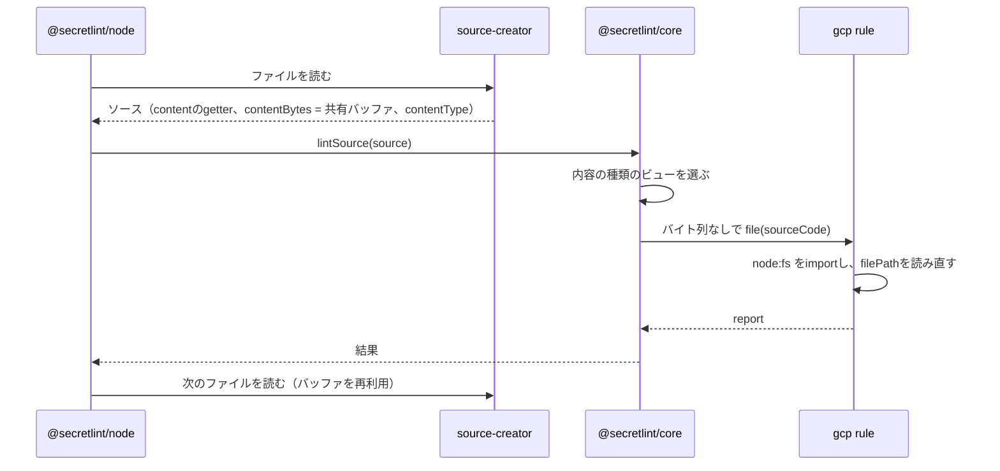

# 秘密情報の検査の設計

[English](design.md)

## このドキュメントについて

このドキュメントは、[Secretlint](../../product.ja.md)の[秘密情報の検査](requirements.ja.md)が、ソースを作り、内容の種類を決め、ルールに渡す方法を説明する。

### 対象読者

ルールが受け取るもの、lintのためのファイルの読み方、内容の種類ごとに実行するルールを変える人とエージェント。

### 前提知識

Productの主要な概念と、この機能のRequirements。

### このドキュメントで扱わないこと

ファイルの選び方、設定の読み込み、キーワードと宣言的なパターンの確認方法、メッセージのマスク、結果の表示。

## 実装方針

lintは2つの側に分かれる。呼び出し元がソースを作り、core（`@secretlint/core`）がそれをlintする。
内容がファイル、STDIN、ツールのメモリのどこから来たかを知っているのは呼び出し元で、coreは自分では何も読まない。
この分担によって、Productが求めるとおりcoreがブラウザで動く。

### ソースを作る

ソース（`SecretLintRawSource`）は、文字列としての内容、ファイルパス、拡張子、内容の種類を持つ。
内容のバイト列`contentBytes`を持つこともできる。
バイト列が渡された場合、coreはまずバイト列からルールのキーワードを探し、ルールが必要とするときだけ文字列を読む。ほとんどのファイルにはキーワードがなく、デコードは探すことより時間がかかるためである。

ファイルの場合、エンジン（`@secretlint/node`）は`@secretlint/source-creator`を使う。
source-creatorは、すべてのファイルで共有する1つのバッファに各ファイルを読み込み、内容の種類を決め、最初に読まれたときにバッファをUTF-8としてデコードする`content`を持つソースを返す。
バッファにファイルが入っているのは次のファイルを読むまでなので、エンジンは1ファイルずつlintし、結果を待ってから次のファイルを読む。
`lintSource()`はpromiseを返したルールを待ってから返るので、バイト列はそのファイルのlintの間ずっと有効である。

ファイルの内容の種類は`istextorbinary`で決める。これは拡張子を見てから、バイト列を見る。
バイナリと判断されたファイルは`binary`、テキストと判断されたファイルは`text`、それ以外は`unknown`になる。

`mask-result`フォーマッターはすべてのファイルの内容を必要とするので、その場合エンジンは`createRawSource()`で各ファイルを専用のバッファに読み、バイト列を付けずに文字列だけをcoreに渡す。
STDINの場合、エンジンは文字列を内容の種類`text`で渡す。
ブラウザのツールのように`lintSource()`を直接呼ぶプログラムは、ソースを自分で作る。

### ルールを選ぶ

coreは設定から計画を一度だけ作り、内容の種類ごとに計画のビューを持つ。
ビューには、`meta.supportedContentTypes`にその種類か`all`を含むルールが入る。`unknown`の場合はすべてのルールが入る。
`meta.keywords`はテキストのときだけ使う。バイナリで実行するルールはキーワードではなく内容の構造やファイル名を見るので、常に実行される。

### ルールが受け取るもの

ルールはソースコードのオブジェクト（`SecretLintSourceCode`）を受け取る。
これは`content`、`hasBOM`、`filePath`、`physicalFilePath`、`ext`、`contentType`と、位置とインデックスの変換を持つ。
`content`はバイトオーダーマークを除いたデコード済みの文字列で、ルールが読んだときに初めてデコードされる。
呼び出し元が`noPhysicFilePath`を指定すると、`physicalFilePath`は`undefined`になる。
ソースコードのオブジェクトはバイト列を持たないので、呼び出し元がバイト列を渡していても、ルールはそれを読めない。

### gcpルールと`.p12`ファイル

gcpルールは`all`に対応している。`.json`では`content`をパースし、`.p12`ではGCPがサービスアカウントキーに使うパスワードでPKCS#12ファイルのMACを検証する。
MACの検証には元のバイト列が必要だが、バイナリファイルの`content`ではデコードでそれが失われている。
そのためルールは`node:fs`を動的にimportし、`filePath`からファイルを読み直す。`physicalFilePath`ではなく`filePath`を読むので、呼び出し元が`noPhysicFilePath`を指定していてもファイルを読む。
ブラウザでは動的importが失敗し、ルールはそのエラーを捕まえて何も報告しない。
MACの検証そのものは、`node:crypto`があればそれを使い、なければWeb Cryptoを使う。

## アーキテクチャ・シーケンス図

## データモデル・ER 図

| 型 | プロパティ | 補足 |
| --- | --- | --- |
| `SecretLintRawSource` | `content`、`contentBytes?`、`filePath`、`ext?`、`contentType` | 呼び出し元が作る。テキストでは、`contentBytes`は`content`のUTF-8表現である。バイナリファイルでは、`contentBytes`はファイルのバイト列で、`content`はそれをUTF-8として読んだ文字列なので、`content`をエンコードし直しても`contentBytes`には戻らない。 |
| `SecretLintSourceCode` | `content`、`hasBOM`、`filePath`、`physicalFilePath`、`ext`、`contentType`、位置のメソッド | coreがルールのために作る。バイト列はない。 |

1つのソースから1回のlintで1つのソースコードのオブジェクトができるだけなので、図は不要である。

## API・インターフェース

### `lintSource({ source, options })`

coreの入口である。ソースと設定を受け取り、内容を含まない結果を返す。
`source.contentBytes`は呼び出しの最初に一度だけ読み、`source.content`はルールか結果が必要とするときだけ読む。

### ルールの`create(context, options)`

ルールはハンドラーを返し、`file(source)`ハンドラーがソースコードのオブジェクトを受け取る。ハンドラーはpromiseを返してよく、coreはそれを待つ。

### `@secretlint/source-creator`

`createRawSource(filePath)`は、ファイルを専用のバッファに読む。`createFileSourceReader()`は、ファイルを1つの共有バッファに読むreaderを返す。readerが次のファイルを読んだあと、ソースの`contentBytes`は`undefined`になり、そのあとで初めて`content`を読むとエラーを投げる。

## 外部サービスとの連携方式

なし。

## データの取り扱い設計

ファイルのバイト列は、次のファイルを読むまで共有バッファにある。デコードした文字列は、呼び出し元がソースを持っている間、ソースが持つ。
gcpルールは`.p12`ファイルをもう一度専用のバッファに読み、確認のあと捨てる。

## 認証認可に関する特記事項

なし。lintはコマンドの利用者が読めるファイルを読む。

## セキュリティ上の留意事項

バイト列と内容には秘密情報が含まれうる。それらはメモリ上にあり、coreは書き出さない。

## デプロイに関する特記事項

なし。

## 検討した代替手段

現状の記述なので、なし。

## 未決事項

なし。
