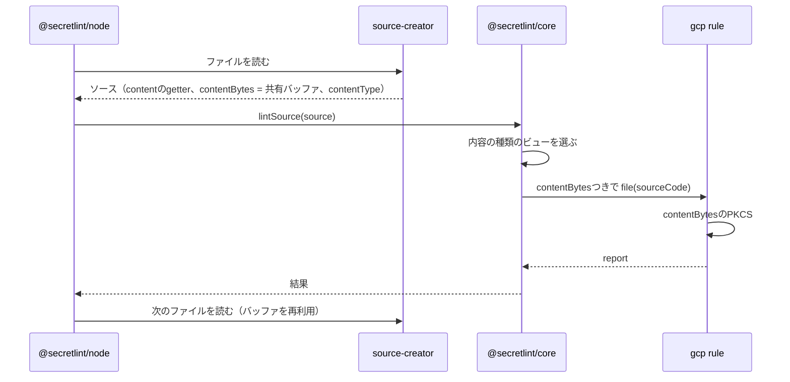

# 秘密情報の検査の設計

[English](design.md)

## このドキュメントについて

このドキュメントは、[Secretlint](../../product.ja.md)の[秘密情報の検査](requirements.ja.md)が、ソースを作り、内容の種類を決め、ルールに渡す方法を説明する。

### 対象読者

ルールが受け取るもの、lintのためのファイルの読み方、内容の種類ごとに実行するルールを変える人とエージェント。

### 前提知識

Productの主要な概念と、この機能のRequirements。

### このドキュメントで扱わないこと

ファイルの選び方、設定の読み込み、キーワードと宣言的なパターンの確認方法、メッセージのマスク、結果の表示。

## 実装方針

lintは2つの側に分かれる。呼び出し元がソースを作り、core（`@secretlint/core`）がそれをlintする。
内容がファイル、STDIN、ツールのメモリのどこから来たかを知っているのは呼び出し元で、coreは自分では何も読まない。
この分担によって、Productが求めるとおりcoreがブラウザで動く。

### ソースを作る

ソース（`SecretLintRawSource`）は、文字列としての内容、ファイルパス、拡張子、内容の種類を持つ。
内容のバイト列`contentBytes`を持つこともできる。
バイト列が渡された場合、coreはまずバイト列からルールのキーワードを探し、ルールが必要とするときだけ文字列を読む。ほとんどのファイルにはキーワードがなく、デコードは探すことより時間がかかるためである。

ファイルの場合、エンジン（`@secretlint/node`）は`@secretlint/source-creator`を使う。
source-creatorは、すべてのファイルで共有する1つのバッファに各ファイルを読み込み、内容の種類を決め、最初に読まれたときにバッファをUTF-8としてデコードする`content`を持つソースを返す。
バッファにファイルが入っているのは次のファイルを読むまでなので、エンジンは1ファイルずつlintし、結果を待ってから次のファイルを読む。
`lintSource()`はpromiseを返したルールを待ってから返るので、バイト列はそのファイルのlintの間ずっと有効である。

ファイルの内容の種類は`istextorbinary`で決める。これは拡張子を見てから、バイト列を見る。
バイナリと判断されたファイルは`binary`、テキストと判断されたファイルは`text`、それ以外は`unknown`になる。

`mask-result`フォーマッターはすべてのファイルの内容を必要とするので、その場合エンジンは`createRawSource()`で各ファイルを専用のバッファに読み、そのソースをバイト列ごとcoreに渡す。
STDINの場合、エンジンは文字列を内容の種類`text`で渡す。
ブラウザのツールのように`lintSource()`を直接呼ぶプログラムは、ソースを自分で作る。

### ルールを選ぶ

coreは設定から計画を一度だけ作り、内容の種類ごとに計画のビューを持つ。
ビューには、`meta.supportedContentTypes`にその種類か`all`を含むルールが入る。`unknown`の場合はすべてのルールが入る。
`meta.keywords`はテキストのときだけ使う。バイナリで実行するルールはキーワードではなく内容の構造やファイル名を見るので、常に実行される。

### ルールが受け取るもの

ルールはソースコードのオブジェクト（`SecretLintSourceCode`）を受け取る。
これは`content`、`hasBOM`、`filePath`、`physicalFilePath`、`ext`、`contentType`と、位置とインデックスの変換を持つ。
`content`はバイトオーダーマークを除いたデコード済みの文字列で、ルールが読んだときに初めてデコードされる。
呼び出し元が`noPhysicFilePath`を指定すると、`physicalFilePath`は`undefined`になる。
`contentBytes`は、呼び出し元が`source.contentBytes`として渡したバイト列で、渡されていなければ`undefined`になる。

ルールにバイト列を渡すのは、バイナリを確かめるルールには元のバイト列が必要で、バイナリファイルの`content`ではデコードでそれが失われているためである。
これまでは、そうしたルールは`node:fs`でファイルを読み直す必要があった。これはブラウザでは動かず、同じルールが環境によって違う結果を返す原因になっていた。
ソースコードのオブジェクトにバイト列があれば、ルールは呼び出し元が渡したものだけに依存する。これはcoreが内容をすでに扱っている方法と同じである。

coreは`lintSource()`の最初に`source.contentBytes`を一度だけ読み、同じ値をキーワードの検索とソースコードのオブジェクトに使う。
source-creatorの共有バッファのバイト列は、`lintSource()`が返るまで有効である。エンジンは結果を待ってから次のファイルを読み、`lintSource()`はpromiseを返したルールを待つためである。
そのためルールは、`await`のあとも含めて、ハンドラーの中でいつでも`contentBytes`を読める。
lintのあともバイト列を持ち続けるルールは、バッファが次のファイルに再利用されるので、コピーして持つ。Secretlintが提供するルールは持ち続けない。

`source.contentBytes`のテキストでの意味は変えない。`content`のUTF-8表現で、先頭にバイトオーダーマークがあってもよい。
バイナリでは、ファイルのバイト列で、`content`はそれをUTF-8として読んだ文字列である。source-creatorはすでにこのとおり動いているので、型のドキュメントにこれを書く。

### gcpルールと`.p12`ファイル

gcpルールは1つのルールで`.json`（テキスト）と`.p12`（バイナリ）の両方を確かめるので、`["text", "binary"]`を宣言する。これまでは`all`だったが、種類を列挙するほうが、ルールが何を確かめるかが宣言から読める。`.json`では`content`をパースし、`.p12`ではGCPがサービスアカウントキーに使うパスワードでPKCS#12ファイルのMACを検証する。
MACの検証には、ソースコードのオブジェクトの`contentBytes`を使う。`contentBytes`が`undefined`の場合、ルールは`.p12`ファイルを確かめず、何も報告しない。
ルールは`node:fs`をimportせず、ファイルも読まない。そのためNode.js、ブラウザ、単一実行ファイルで同じ結果になり、呼び出し元が`noPhysicFilePath`を指定したときにファイルを読むこともなくなる。
MACの検証そのものは、これまでどおり`node:crypto`があればそれを使い、なければWeb Cryptoを使う。
メッセージに使うファイル名は、`node:path`ではなく小さな`basename`ヘルパーで`filePath`から取る。そのためルールのどのモジュールもNode.jsのモジュールを静的にimportせず、recommendプリセットはNode.jsのpolyfillなしでブラウザに読み込める。`node:crypto`は動的にだけimportし、失敗したらWeb Cryptoを使う。

### ルールのテスト

`@secretlint/tester`は、各テストファイルを2回lintする。1回はバイト列あり、もう1回は文字列だけでlintする。テキストではバイト列は速さのためだけにあるので、2つの結果が同じであることを確かめている。
バイナリではバイト列が必要なので、testerが2つの結果を比べるのはテキストのときだけにする。バイナリのスナップショットは、バイト列ありの結果にする。

## アーキテクチャ・シーケンス図

## データモデル・ER 図

| 型 | プロパティ | 補足 |
| --- | --- | --- |
| `SecretLintRawSource` | `content`、`contentBytes?`、`filePath`、`ext?`、`contentType` | 呼び出し元が作る。テキストでは、`contentBytes`は`content`のUTF-8表現である。バイナリでは、`contentBytes`はファイルのバイト列で、`content`はそれをUTF-8として読んだ文字列である。 |
| `SecretLintSourceCode` | `content`、`contentBytes`、`hasBOM`、`filePath`、`physicalFilePath`、`ext`、`contentType`、位置のメソッド | coreがルールのために作る。`contentBytes`は新しいプロパティで、`Uint8Array \| undefined`、読み取り専用、そのソースのlintが終わるまで有効。 |

1つのソースから1回のlintで1つのソースコードのオブジェクトができるだけなので、図は不要である。

## API・インターフェース

### `lintSource({ source, options })`

coreの入口である。ソースと設定を受け取り、内容を含まない結果を返す。
`source.contentBytes`は呼び出しの最初に一度だけ読み、`source.content`はルールか結果が必要とするときだけ読む。

### ルールの`create(context, options)`

ルールはハンドラーを返し、`file(source)`ハンドラーがソースコードのオブジェクトを受け取る。ハンドラーはpromiseを返してよく、coreはそれを待つ。
`source.contentBytes`が新しいプロパティである。coreとほかのルールが同じバイト列を読むので、ルールはバイト列を書き換えない。
`meta.supportedContentTypes`には`text`と`binary`を列挙する。型`SecretLintRuleContentType`からは`all`を除くが、coreは実行時には`all`を両方として扱い続ける。そのため`all`を宣言したJavaScriptのルールや公開済みのルールはそのまま動く。

### `@secretlint/source-creator`

`createRawSource(filePath)`は、ファイルを専用のバッファに読む。`createFileSourceReader()`は、ファイルを1つの共有バッファに読むreaderを返す。readerが次のファイルを読んだあと、ソースの`contentBytes`は`undefined`になり、そのあとで初めて`content`を読むとエラーを投げる。

## 外部サービスとの連携方式

なし。

## データの取り扱い設計

ファイルのバイト列は、次のファイルを読むまで共有バッファにある。デコードした文字列は、呼び出し元がソースを持っている間、ソースが持つ。
ルールはcoreと同じバイト列を読み、コピーしない。ファイルを2回読むことはない。

## 認証認可に関する特記事項

なし。lintはコマンドの利用者が読めるファイルを読む。

## セキュリティ上の留意事項

バイト列と内容には秘密情報が含まれうる。それらはメモリ上にあり、coreは書き出さない。

## デプロイに関する特記事項

型から`all`を除くので、`all`を宣言したTypeScriptのルールは、`text`と`binary`を列挙するまでコンパイルが通らなくなる。coreは`all`を受け付け続けるので、動きは変わらない。

ソースコードのオブジェクトに`contentBytes`を足しても、既存のルールは変わらない。
バイト列なしで`.p12`ファイルの`lintSource()`を呼ぶプログラムは、これまではgcpルールがファイルを読んで報告していたが、この変更のあとは報告されない。リリースノートで、そうした呼び出し元に`contentBytes`を渡すよう案内する。Productのバージョンの方針では、メジャーリリースにするのは既定で報告が増える変更で、この変更はそうした呼び出し元への報告が減るだけなので、破壊的変更ではない。
この変更は、ビルトインルールを`@secretlint/core`に移したあとに行う。そうするとgcpルールはcoreのファイルになり、`@secretlint/secretlint-rule-gcp`パッケージはそれを再exportするだけで、同じリリースのcoreに依存する。
そのため設定は、`lintSource()`を動かすのと同じcoreからgcpルールを解決し、ルールと`contentBytes`は常に同じcoreから来る。
新しいパッケージからルールのオブジェクトをimportして、古いcoreの`lintSource()`に渡すプログラムは、ルールはcoreと一緒に配布するという方針のとおりサポートしない。その場合、`.p12`の確認にはバイト列がないので、ファイルを読まずに何も報告しない。

## 検討した代替手段

### ブラウザ向けのプリセットでNode.jsに依存するルールを無効にする

ブラウザ向けのプリセットでNode.jsを必要とするルールを外し、それを元にバンドルを作る。
採用しなかったのは、そうしたルールはgcpルールだけで、その確認にはバイト列しか要らないためである。バイト列を渡せば、依存を隠すのではなく取り除ける。
また、プリセットはすべてのルールを静的にimportするので、無効にしたルールもバンドルに残り、ブラウザでは`.p12`ファイルが報告されないままになる。

### バイナリのときだけバイト列を渡す

テキストでは`contentBytes`を`undefined`にする。
採用しなかったのは、ルールがバイト列のある条件を知る必要が出てくるうえ、速さのためにテキストのバイト列を見るルールを後で作るときにまた変更が要るためである。coreはすでにバイト列を持っているので、渡すことにコストはかからない。

### 元のバイト列のための新しいプロパティを生のソースに足す

バイナリのために`originalBytes`のようなプロパティを足し、`contentBytes`は`content`の表現だけにする。
採用しなかったのは、source-creatorはすでにバイナリでもファイルのバイト列を`contentBytes`として渡していて、キーワードの検索もそれを使っているためである。いまの振る舞いを型のドキュメントに書いても呼び出し元には何も変わらないが、プロパティを2つにすると、呼び出し元は同じバイト列を2回渡すことになる。

### バイト列が渡されないときは`node:fs`でファイルを読む

`contentBytes`が`undefined`のとき、gcpルールはこれまでどおりファイルを読む。
メンテナーの判断で採用しなかった。コマンドは常にバイト列を渡し、ルールはcoreと一緒にリリースされる。また、ファイルを読むと`noPhysicFilePath`を無視することになり、ルールにNode.jsのimportが残る。

## 未決事項

なし。
