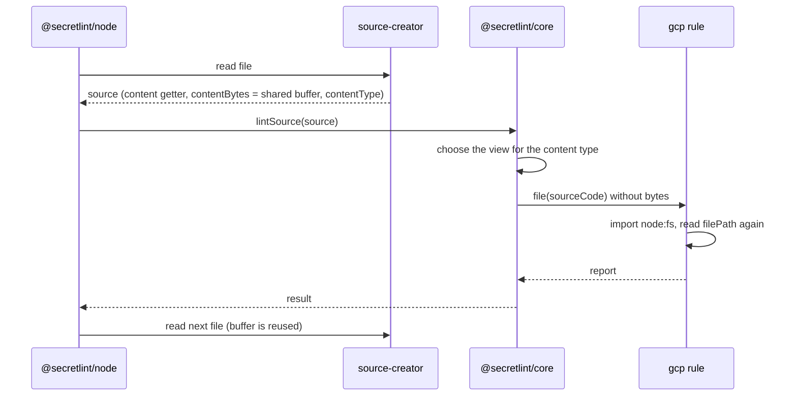

# Secret scanning design

[日本語](design.ja.md)

## About this document

This document describes how [Secret scanning](requirements.md) of [Secretlint](../../product.md) creates a source, decides its content type, and gives it to the rules.

### Audience

People and agents who change what a rule receives, how files are read for the lint, or which rules run for a content type.

### Prerequisites

The key concepts of the Product, and the Requirements of this feature.

### Outside this document

How files are chosen, how the configuration is loaded, how keywords and declarative patterns are checked, how messages are masked, and how results are shown.

## Implementation approach

A lint has two sides: the caller creates a source, and the core (`@secretlint/core`) lints it.
The caller knows where the content comes from, such as a file, STDIN, or the memory of a tool, and the core does not read anything by itself.
This split is what lets the core run in browsers, as the Product requires.

### Creating a source

A source (`SecretLintRawSource`) has the content as a string, the file path, the file extension, and the content type.
It can also have `contentBytes`, the bytes of the content.
When the bytes are given, the core scans them for the keywords of the rules first, and reads the string only when a rule needs it, because most files have no keyword and decoding them costs more than the scan.

For files, the engine (`@secretlint/node`) uses `@secretlint/source-creator`.
It reads each file into one buffer that is shared by all files, decides the content type, and returns a source whose `content` decodes the buffer as UTF-8 when it is read first.
The buffer has a file only until the next file is read, so the engine lints one file at a time and waits for the result before it reads the next file.
`lintSource()` waits for the rules that return a promise before it returns, so the bytes stay valid for the whole lint of the file.

The content type of a file comes from `istextorbinary`, which checks the file extension and then the bytes.
A file that it calls binary is `binary`, a file that it calls text is `text`, and other files are `unknown`.

The `mask-result` formatter needs the content of every file, so for it the engine reads each file into its own buffer with `createRawSource()` and passes only the string to the core, without the bytes.
For STDIN, the engine passes the string with the content type `text`.
A program that calls `lintSource()` directly, such as a tool in a browser, creates the source itself.

### Choosing the rules

The core builds a plan from the configuration once, and keeps a view of the plan for each content type.
A view has the rules whose `meta.supportedContentTypes` include the content type or `all`. For `unknown`, it has all rules.
`meta.keywords` are used only for text. A rule that runs for binary content always runs, because it checks the structure of the content or the file name, not keywords.

### What a rule receives

A rule receives a source code object (`SecretLintSourceCode`).
It has `content`, `hasBOM`, `filePath`, `physicalFilePath`, `ext`, `contentType`, and the conversions between locations and indexes.
`content` is the decoded string without the byte order mark, and it is decoded only when a rule reads it.
`physicalFilePath` is `undefined` when the caller sets `noPhysicFilePath`.
The source code object does not have the bytes, so a rule can not read the bytes even when the caller gave them.

### The gcp rule and `.p12` files

The gcp rule supports `all` content types. For `.json` it parses `content`, and for `.p12` it verifies the MAC of the PKCS#12 file with the password that GCP uses for service account keys.
The MAC check needs the original bytes, and `content` of a binary file has lost them in the decoding.
So the rule imports `node:fs` dynamically and reads the file again from `filePath`. It reads `filePath`, not `physicalFilePath`, so it reads the file even when the caller set `noPhysicFilePath`.
In a browser the dynamic import fails, and the rule catches the error and reports nothing.
The MAC check itself uses `node:crypto` when it is available and Web Crypto otherwise.

## Architecture and sequence diagrams

## Data model and ER diagrams

| Type | Properties | Note |
| --- | --- | --- |
| `SecretLintRawSource` | `content`, `contentBytes?`, `filePath`, `ext?`, `contentType` | Created by the caller. For text, `contentBytes` is the UTF-8 encoding of `content`. For a binary file, `contentBytes` is the bytes of the file and `content` is those bytes decoded as UTF-8, so encoding `content` again does not give `contentBytes` back. |
| `SecretLintSourceCode` | `content`, `hasBOM`, `filePath`, `physicalFilePath`, `ext`, `contentType`, location methods | Created by the core for the rules. No bytes. |

A diagram is not needed, because a source creates one source code object for one lint.

## APIs and interfaces

### `lintSource({ source, options })`

The entry point of the core. It receives a source and the configuration, and returns a result without the content.
It reads `source.contentBytes` once at the start of the call, and `source.content` only when a rule or the result needs it.

### Rule `create(context, options)`

A rule returns handlers, and the `file(source)` handler receives the source code object. The handler can return a promise, and the core waits for it.

### `@secretlint/source-creator`

`createRawSource(filePath)` reads a file into its own buffer. `createFileSourceReader()` returns a reader that reads files into one shared buffer; `contentBytes` of a source is `undefined` after the reader reads the next file, and reading `content` for the first time after that throws.

## External service integration

None.

## Data handling

The bytes of a file are in the shared buffer until the next file is read. The decoded string is kept by the source while the caller keeps the source.
The gcp rule reads a `.p12` file a second time into its own buffer, which is dropped after the check.

## Authentication and authorization notes

None. The lint reads the files that the user of the command can read.

## Security considerations

The bytes and the content can have secrets. They stay in memory and are not written by the core.

## Deployment notes

None.

## Alternatives considered

None for the current state.

## Open questions

None.
