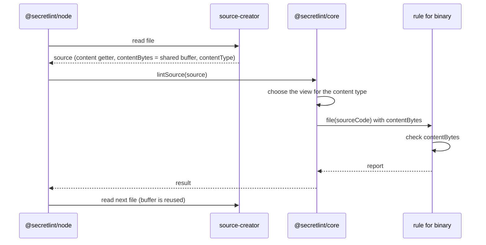

# Secret scanning design

[日本語](design.ja.md)

## About this document

This document describes how [Secret scanning](requirements.md) of [Secretlint](../../product.md) creates a source, decides its content type, and gives it to the rules.

### Audience

People and agents who change what a rule receives, how files are read for the lint, or which rules run for a content type.

### Prerequisites

The key concepts of the Product, and the Requirements of this feature.

### Outside this document

How files are chosen, how the configuration is loaded, how keywords and declarative patterns are checked, how messages are masked, and how results are shown.

## Implementation approach

A lint has two sides: the caller creates a source, and the core (`@secretlint/core`) lints it.
The caller knows where the content comes from, such as a file, STDIN, or the memory of a tool, and the core does not read anything by itself.
This split is what lets the core run in browsers, as the Product requires.

### Creating a source

A source (`SecretLintRawSource`) has the content as a string, the file path, the file extension, and the content type.
It can also have `contentBytes`, the bytes of the content.
When the bytes are given, the core scans them for the keywords of the rules first, and reads the string only when a rule needs it, because most files have no keyword and decoding them costs more than the scan.

For files, the engine (`@secretlint/node`) uses `@secretlint/source-creator`.
It reads each file into one buffer that is shared by all files, decides the content type, and returns a source whose `content` decodes the buffer as UTF-8 when it is read first.
The buffer has a file only until the next file is read, so the engine lints one file at a time and waits for the result before it reads the next file.
`lintSource()` waits for the rules that return a promise before it returns, so the bytes stay valid for the whole lint of the file.

The content type of a file comes from `istextorbinary`, which checks the file extension and then the bytes.
A file that it calls binary is `binary`, a file that it calls text is `text`, and other files are `unknown`.

The `mask-result` formatter needs the content of every file, so for it the engine reads each file into its own buffer with `createRawSource()` and passes that source to the core, with its bytes.
For STDIN, the engine passes the string with the content type `text`.
A program that calls `lintSource()` directly, such as a tool in a browser, creates the source itself.

### Choosing the rules

The core builds a plan from the configuration once, and keeps a view of the plan for each content type.
A view has the rules whose `meta.supportedContentTypes` include the content type or `all`. For `unknown`, it has all rules.
`meta.keywords` are used only for text. A rule that runs for binary content always runs, because it checks the structure of the content or the file name, not keywords.

### What a rule receives

A rule receives a source code object (`SecretLintSourceCode`).
It has `content`, `hasBOM`, `filePath`, `physicalFilePath`, `ext`, `contentType`, and the conversions between locations and indexes.
`content` is the decoded string without the byte order mark, and it is decoded only when a rule reads it.
`physicalFilePath` is `undefined` when the caller sets `noPhysicFilePath`.
`contentBytes` is the bytes that the caller gave as `source.contentBytes`, or `undefined` when the caller gave none.

The bytes are given to rules because a rule that checks binary content needs the original bytes, and `content` of a binary file has lost them in the decoding.
Before this, such a rule had to read the file again with `node:fs`, which does not work in browsers and makes the same rule give different results by environment.
With the bytes on the source code object, a rule depends only on what the caller gives, which is how the core already treats the content.

The core reads `source.contentBytes` once at the start of `lintSource()`, and the same value is used for the keyword scan and for the source code object.
The bytes of the shared buffer of source-creator stay valid until `lintSource()` returns, because the engine waits for the result before it reads the next file and `lintSource()` waits for the rules that return a promise.
So a rule can read `contentBytes` at any time during its handler, including after an `await`.
A rule that keeps the bytes after the lint copies them, because the buffer is reused for the next file. The rules that Secretlint provides do not keep them.

`source.contentBytes` keeps its meaning for text: the UTF-8 encoding of `content`, with an optional byte order mark at the start.
For binary, it is the bytes of the file, and `content` is those bytes decoded as UTF-8. source-creator already does this, so the documentation of the type is changed to say it.

### Rules that check binary content

A rule that checks binary content lists `binary` in `meta.supportedContentTypes`, and also `text` when it checks text files too. Listing the types, instead of `all`, states in the declaration which content the rule checks.
Keywords are not used for binary content, so the rule runs for every binary file. It decides from `filePath` or `ext` whether the file is one it checks, and returns quickly for other files.

The rule reads the bytes from `contentBytes` of the source code object, not from `content` and not from a file.
When `contentBytes` is `undefined`, the rule does not check the file and reports nothing. It does not fall back to reading the file, because the command always gives the bytes, and reading the file would ignore `noPhysicFilePath` and make the result depend on the environment.

The rule does not import a Node.js module statically, because a preset imports its rules statically and one such import stops the preset from loading in a browser. A file name for a message is taken from `filePath` with a small helper instead of `node:path`.
An API that is faster in Node.js but has a standard alternative, such as `node:crypto` for Web Crypto, is imported dynamically and falls back to the standard API when the import fails.
With these conditions, the rule gives the same result in Node.js, in browsers, and in the single-executable binary.

A message for binary content points to the whole file, because positions in the decoded string have no meaning for the bytes.

Among the rules that Secretlint provides, the gcp rule is the one that checks binary content: it verifies the MAC of a `.p12` file with the password that GCP uses for service account keys, and it follows the conditions above.

### Rule tests

`@secretlint/tester` lints each test file twice: once with the bytes, and once with the string only. It checks that both results are the same, because the bytes are only for speed for text.
For binary content the bytes are needed, so the tester compares the two results only for text. For binary, the snapshot is the result with the bytes.

## Architecture and sequence diagrams

## Data model and ER diagrams

| Type | Properties | Note |
| --- | --- | --- |
| `SecretLintRawSource` | `content`, `contentBytes?`, `filePath`, `ext?`, `contentType` | Created by the caller. For text, `contentBytes` is the UTF-8 encoding of `content`. For binary, `contentBytes` is the bytes of the file and `content` is those bytes decoded as UTF-8. |
| `SecretLintSourceCode` | `content`, `contentBytes`, `hasBOM`, `filePath`, `physicalFilePath`, `ext`, `contentType`, location methods | Created by the core for the rules. `contentBytes` is new: `Uint8Array \| undefined`, read-only, valid until the lint of the source ends. |

A diagram is not needed, because a source creates one source code object for one lint.

## APIs and interfaces

### `lintSource({ source, options })`

The entry point of the core. It receives a source and the configuration, and returns a result without the content.
It reads `source.contentBytes` once at the start of the call, and `source.content` only when a rule or the result needs it.

### Rule `create(context, options)`

A rule returns handlers, and the `file(source)` handler receives the source code object. The handler can return a promise, and the core waits for it.
`source.contentBytes` is the new property. A rule must not change the bytes, because the core and other rules read the same bytes.
`meta.supportedContentTypes` lists `text` and `binary`. `all` is removed from the type `SecretLintRuleContentType`, and the core still treats `all` as both at runtime, so a JavaScript rule or a published rule that declares `all` keeps working.

### `@secretlint/source-creator`

`createRawSource(filePath)` reads a file into its own buffer. `createFileSourceReader()` returns a reader that reads files into one shared buffer; `contentBytes` of a source is `undefined` after the reader reads the next file, and reading `content` for the first time after that throws.

## External service integration

None.

## Data handling

The bytes of a file are in the shared buffer until the next file is read. The decoded string is kept by the source while the caller keeps the source.
Rules read the same bytes as the core and do not copy them. No file is read a second time.

## Authentication and authorization notes

None. The lint reads the files that the user of the command can read.

## Security considerations

The bytes and the content can have secrets. They stay in memory and are not written by the core.

## Deployment notes

Removing `all` from the type makes a TypeScript rule that declares `all` fail to compile until it lists `text` and `binary`. Its behavior does not change, because the core still accepts `all`.
Removing a value from a public type is an incompatible change of the public API, so this part is released in a major version, following the versioning rules of the contributing guide.

Adding `contentBytes` to the source code object does not change existing rules.
A program that calls `lintSource()` for a binary file with only the string gets no report from a rule that checks binary content after this change, while such a rule (the gcp rule for `.p12`) read the file before. The release notes tell such a caller to pass `contentBytes`. It is not a breaking change: by the versioning principle of the Product, a major release is for a change that reports more by default, and this change only reports less for such a caller.
This change is made after the built-in rules move into `@secretlint/core`. Then the built-in rules are files of the core, and their packages only re-export them and depend on the core of the same release.
So the configuration resolves a built-in rule from the core that also runs `lintSource()`, and the rule and `contentBytes` always come from the same core.
A program that imports a rule object from a newer package and passes it to `lintSource()` of an older core is not supported, as the rules ship with the core. In that case a rule that checks binary content sees no bytes and reports nothing, without reading the file.

## Alternatives considered

### Disable rules that depend on Node.js in a preset for browsers

A preset for browsers would turn off the rules that need Node.js, and the bundle would be built from it.
It was not chosen because a rule that checks binary content needs only the bytes, so giving the bytes removes the dependency instead of hiding it.
A disabled rule also stays in the bundle, because a preset imports all its rules statically, and its secrets would still not be reported in browsers.

### Give the bytes only for binary content

`contentBytes` would be `undefined` for text.
It was not chosen because the rule would then need to know when the bytes exist, and a later rule that checks text bytes, for example for speed, would need another change. The bytes cost nothing to give, because the core already has them.

### A new property of the raw source for the original bytes

A property such as `originalBytes` would be added for binary, and `contentBytes` would stay only the encoding of `content`.
It was not chosen because source-creator already gives the bytes of the file as `contentBytes` for binary, and the keyword scan already uses them. Writing the existing behavior in the documentation of the type changes nothing for callers, while a second property would make callers pass the same bytes twice.

### Keep reading the file with `node:fs` when the bytes are not given

A rule that checks binary content would read the file when `contentBytes` is `undefined`, as the gcp rule did.
It was not chosen by the maintainer: the command always gives the bytes, the rules are released with the core, and reading the file ignores `noPhysicFilePath` and keeps a Node.js import in the rule.

## Open questions

None.
