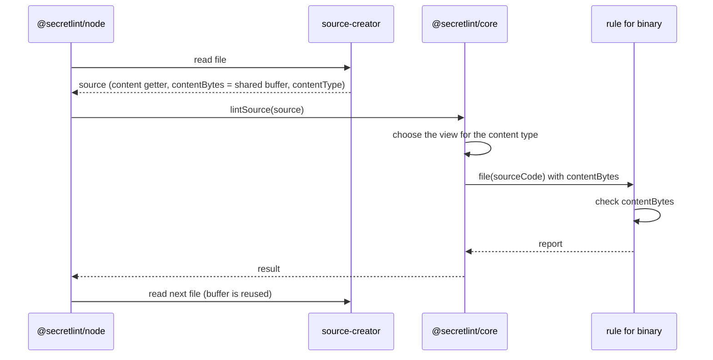
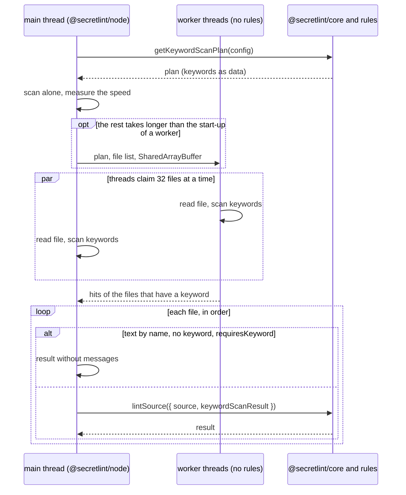

# Secret scanning design

[日本語](design.ja.md)

## About this document

This document describes how [Secret scanning](requirements.md) of [Secretlint](../../product.md) creates a source, decides its content type, and gives it to the rules.

### Audience

People and agents who change what a rule receives, how files are read for the lint, or which rules run for a content type.

### Prerequisites

The key concepts of the Product, and the Requirements of this feature.

### Outside this document

How files are chosen, how the configuration is loaded, how declarative patterns are checked after the keywords are found, how messages are masked, and how results are shown.

## Implementation approach

A lint has two sides: the caller creates a source, and the core (`@secretlint/core`) lints it.
The caller knows where the content comes from, such as a file, STDIN, or the memory of a tool, and the core does not read anything by itself.
This split is what lets the core run in browsers, as the Product requires.

### Creating a source

A source (`SecretLintRawSource`) has the content as a string, the file path, the file extension, and the content type.
It can also have `contentBytes`, the bytes of the content.
When the bytes are given, the core scans them for the keywords of the rules first, and reads the string only when a rule needs it, because most files have no keyword and decoding them costs more than the scan.

For files, the engine (`@secretlint/node`) uses `@secretlint/source-creator`.
It reads each file into one buffer that is shared by all files, decides the content type, and returns a source whose `content` decodes the buffer as UTF-8 when it is read first.
The buffer has a file only until the next file is read, so the engine lints one file at a time and waits for the result before it reads the next file.
`lintSource()` waits for the rules that return a promise before it returns, so the bytes stay valid for the whole lint of the file.

The content type of a file comes from `istextorbinary`, which checks the file extension and then the bytes.
A file that it calls binary is `binary`, a file that it calls text is `text`, and other files are `unknown`.

The `mask-result` formatter needs the content of every file, so for it the engine reads each file into its own buffer with `createRawSource()` and passes that source to the core, with its bytes.
For STDIN, the engine passes the string with the content type `text`.
A program that calls `lintSource()` directly, such as a tool in a browser, creates the source itself.

### Choosing the rules

The core builds a plan from the configuration once, and keeps a view of the plan for each content type.
A view has the rules whose `meta.supportedContentTypes` include the content type or `all`. For `unknown`, it has all rules.
`meta.keywords` are used only for text. A rule that runs for binary content always runs, because it checks the structure of the content or the file name, not keywords.

### Looking for keywords

The lint of a source has two steps: the keyword scan finds the keywords of the rules in the content, and then the rules and patterns that the keywords select run.
Most sources have no keyword, so most sources end after the first step.

The core collects the keywords of the rules and patterns in the view for text, and builds one keyword matcher for them. The matcher is cached by its keywords.
The matcher is an Aho-Corasick automaton: it reads the content once from the start to the end, and finds all keywords in that one pass.
Keywords are ASCII. They match without the case of ASCII letters by default, and a case-sensitive keyword is compared with the content again after it is found.
Because keywords are ASCII, scanning the UTF-8 bytes finds the same keywords as scanning the decoded string.

When the source has bytes, the core scans the bytes, from after the byte order mark.
If no keyword is found and no rule or pattern runs without keywords, the result has no messages, and the content is never decoded.
If a keyword is found, the core checks the lines that have a keyword on the bytes, and decodes the content only when a pattern or a rule runs.
When patterns run, the core scans the decoded string again, because the patterns need indexes in the string and these differ from indexes in the bytes.

The automaton does one table lookup for each byte, whatever the keywords are.
So its time depends on the size of the content and barely on the number of keywords: on 60MB of text, 65 keywords took 97ms and 1,065 keywords took 111ms.
It also has no knowledge about the content. This is why it meets "Any content" and "The number of keywords" of the Requirements.

### Looking for keywords on several threads

Node.js runs JavaScript on one thread, so the engine lints files one after another.
A profile of a large repository (about 96,000 files, 4.5 seconds) shows where that one thread spends its time: about 2.9 seconds in the keyword scan and 0.8 seconds in reading files. The rules take little, because they run only for the sources that the keywords select.
So the step to run on several threads is the one that narrows down the sources: read a file and scan it for keywords.

The scan can be made parallel in several ways, and the choice follows from two costs: distribution and start-up.

- A native program or a native add-on needs a build for each platform and a way to ship it. WebAssembly has no platform builds, but it has its own ways to load in Node.js, browsers, and the single-executable binary, and its threads are still started by the host. Per thread, a native scan was also as fast as the JavaScript scan (read 155ms and scan 580ms, against 230ms and 542ms), so only the threads gave a gain.
- Worker threads of Node.js need nothing to ship. Their cost is the start-up: a worker loads its code before it works.

So the scan runs on worker threads, and the design keeps the start-up of a worker small and constant.
A worker that runs `lintSource()` has to load the configuration and every rule, and custom rules can be of any size. Its start-up grows with the rules and it is not constant.
The keyword scan needs no rule: it needs only the keywords, which are strings. So a worker loads only the keyword matcher of the core, and it gets the keywords as data. This code does not grow when rules are added.
The rules stay on the main thread, are loaded once, and run for one file at a time as before.

#### The scan as a step of its own

The core has an entry `@secretlint/core/keyword-scan` for the first step of the lint alone.
It imports only the keyword matcher: no rule, no configuration, and no Node.js module.
`getKeywordScanPlan({ config })` of the core returns what to scan for as plain data: the keywords, which of them are case-sensitive, an id of these keywords, and `requiresKeyword`.
`requiresKeyword` is true when no rule or pattern runs without keywords. Then a source without a keyword has no messages.
`createKeywordScanner(plan).scan(bytes)` returns the hits with the id of the plan.
`lintSource()` accepts this result as `keywordScanResult`, and uses it in place of its own scan of the bytes if the id is the id of its own plan for the content type of the source.
The matcher is built from the same keywords in the same order on each thread, so the hits mean the same on each thread.

The core does not start workers by itself. A worker needs the URL of a script file, and sharing memory between threads in a browser needs cross-origin isolation, so only the caller knows how to start one. The Node.js engine does it for files, and a tool in a browser can do the same with Web Workers.

#### Scanning the files

The engine (`@secretlint/node`) scans the files before the lint loop.
The main thread and the workers run the same function. They share the list of files and a `SharedArrayBuffer` that has the index of the next file and one byte of state for each file.
A thread claims the next 32 files with `Atomics.add`, reads each file into a buffer that it reuses, scans it, and writes the state: not scanned, no keyword, or has a keyword.
A worker sends back only the hits of the files that have a keyword.
Because the threads claim from one list, a thread that starts late or fails only scans fewer files, and no file is given to a thread ahead of time.

Then the main thread goes through the files in their order.
A file that is text by its name, has no keyword, and has a plan with `requiresKeyword` gets a result without messages and is not read again.
Any other file is read and linted with `lintSource()` as before, with the hits of the file if it has them.

#### The number of threads

The Requirements only say that a worker is not started when it gives no gain. How the work is divided is decided here from experiments, and the numbers below are the result of the measurements so far. They can change when the measurements change.

The main thread starts the scan alone, so a short lint never pays for a worker.
After a warm-up of 20ms, it measures how many files it scans in the next 20ms, and estimates the time for the rest of the files.
It starts `floor(rest time / 100ms)` workers, at most `os.availableParallelism() - 1`. 100ms is the start-up of a worker (70-100ms measured), so each worker has work for longer than its start-up.
The warm-up is not used for the estimate, because the scan is several times slower until the runtime has optimized it.
The decision uses time, not the number of files, so it follows the size of the files and the speed of the disk.

#### Keeping the results the same

- Messages are created only by the rules on the main thread, from the content that the main thread read. When patterns run, the core scans the decoded string as before.
- The hits are used only for a file that is text by its name, because the plan is for the text content type, and the content type of other files depends on their bytes.
- The hits are used only if the main thread reads the same number of bytes as the thread that scanned. Otherwise the core scans the bytes itself.
- `lintSource()` ignores hits with the id of another plan.
- A file that a thread could not read, or that a failed worker claimed, stays "not scanned" and is linted as before, so the error is the same.
- The scan is not used with the `mask-result` formatter, which reads every file as a string, and while the profiler is enabled.

#### The single-executable binary

The engine starts a worker from the file `keyword-scan-worker.js` next to its own file.
The single-executable binary is one bundle built with Bun, so it has no such file by default. The build gives the worker as a second entry with the same name, and Bun puts it next to the main entry inside the binary.
The test of the binary checks that a worker starts in it.
A bundle of another tool that does not have the file still works: the worker fails to start, and the files are linted without it.

Measured on 4 cores with the binary (median): about 21,000 files 915ms with one thread and 610ms with workers, and about 96,000 files 4.4 seconds and 2.0 seconds.

### What a rule receives

A rule receives a source code object (`SecretLintSourceCode`).
It has `content`, `hasBOM`, `filePath`, `physicalFilePath`, `ext`, `contentType`, and the conversions between locations and indexes.
`content` is the decoded string without the byte order mark, and it is decoded only when a rule reads it.
`physicalFilePath` is `undefined` when the caller sets `noPhysicFilePath`.
`contentBytes` is the bytes that the caller gave as `source.contentBytes`, or `undefined` when the caller gave none.

The bytes are given to rules because a rule that checks binary content needs the original bytes, and `content` of a binary file has lost them in the decoding.
Before this, such a rule had to read the file again with `node:fs`, which does not work in browsers and makes the same rule give different results by environment.
With the bytes on the source code object, a rule depends only on what the caller gives, which is how the core already treats the content.

The core reads `source.contentBytes` once at the start of `lintSource()`, and the same value is used for the keyword scan and for the source code object.
The bytes of the shared buffer of source-creator stay valid until `lintSource()` returns, because the engine waits for the result before it reads the next file and `lintSource()` waits for the rules that return a promise.
So a rule can read `contentBytes` at any time during its handler, including after an `await`.
A rule that keeps the bytes after the lint copies them, because the buffer is reused for the next file. The rules that Secretlint provides do not keep them.

`source.contentBytes` keeps its meaning for text: the UTF-8 encoding of `content`, with an optional byte order mark at the start.
For binary, it is the bytes of the file, and `content` is those bytes decoded as UTF-8. source-creator already does this, so the documentation of the type is changed to say it.

### Rules that check binary content

A rule that checks binary content lists `binary` in `meta.supportedContentTypes`, and also `text` when it checks text files too. Listing the types, instead of `all`, states in the declaration which content the rule checks.
Keywords are not used for binary content, so the rule runs for every binary file. It decides from `filePath` or `ext` whether the file is one it checks, and returns quickly for other files.

The rule reads the bytes from `contentBytes` of the source code object, not from `content` and not from a file.
When `contentBytes` is `undefined`, the rule skips only the checks that need the bytes and reports nothing for them. Checks of text that use `content`, such as a JSON key file, run as before. It does not fall back to reading the file, because the command always gives the bytes, and reading the file would ignore `noPhysicFilePath` and make the result depend on the environment.

The rule does not import a Node.js module statically, because a preset imports its rules statically and one such import stops the preset from loading in a browser. A file name for a message is taken from `filePath` with a small helper instead of `node:path`.
An API that is faster in Node.js but has a standard alternative, such as `node:crypto` for Web Crypto, is imported dynamically and falls back to the standard API when the import fails.
With these conditions, the rule gives the same result in Node.js, in browsers, and in the single-executable binary.

A message for binary content points to the whole file, because positions in the decoded string have no meaning for the bytes.

Among the rules that Secretlint provides, the gcp rule is the one that checks binary content: it verifies the MAC of a `.p12` file with the password that GCP uses for service account keys, and it follows the conditions above.

### Rule tests

`@secretlint/tester` lints each test file twice: once with the bytes, and once with the string only. It checks that both results are the same, because the bytes are only for speed for text.
For binary content the bytes are needed, so the tester compares the two results only for text. For binary, the snapshot is the result with the bytes.

## Architecture and sequence diagrams

The scan on several threads, before the lint loop:

## Data model and ER diagrams

| Type | Properties | Note |
| --- | --- | --- |
| `SecretLintRawSource` | `content`, `contentBytes?`, `filePath`, `ext?`, `contentType` | Created by the caller. For text, `contentBytes` is the UTF-8 encoding of `content`. For binary, `contentBytes` is the bytes of the file and `content` is those bytes decoded as UTF-8. |
| `SecretLintSourceCode` | `content`, `contentBytes`, `hasBOM`, `filePath`, `physicalFilePath`, `ext`, `contentType`, location methods | Created by the core for the rules. `contentBytes` is new: `Uint8Array \| undefined`, read-only, valid until the lint of the source ends. |

A diagram is not needed, because a source creates one source code object for one lint.

## APIs and interfaces

### `lintSource({ source, options })`

The entry point of the core. It receives a source and the configuration, and returns a result without the content.
It reads `source.contentBytes` once at the start of the call, and `source.content` only when a rule or the result needs it.

### Rule `create(context, options)`

A rule returns handlers, and the `file(source)` handler receives the source code object. The handler can return a promise, and the core waits for it.
`source.contentBytes` is the new property. A rule must not change the bytes, because the core and other rules read the same bytes.
`meta.supportedContentTypes` lists `text` and `binary`. `all` is removed from the type `SecretLintRuleContentType`, and the core still treats `all` as both at runtime, so a JavaScript rule or a published rule that declares `all` keeps working.

### `@secretlint/source-creator`

`createRawSource(filePath)` reads a file into its own buffer. `createFileSourceReader()` returns a reader that reads files into one shared buffer; `contentBytes` of a source is `undefined` after the reader reads the next file, and reading `content` for the first time after that throws.

### `@secretlint/core/keyword-scan`

`createKeywordScanner(plan)` returns a scanner, and `scanner.scan(bytes)` returns a `KeywordScanResult`: the id of the plan and the hits.
`getKeywordScanPlan({ config, locale?, contentType? })` of `@secretlint/core` returns the `KeywordScanPlan` for a configuration, or `undefined` when no rule has keywords.
The plan and the result are plain data and typed arrays, so they can be sent to another thread.
`lintSource({ source, options, keywordScanResult })` uses the result as written in "The scan as a step of its own".

## External service integration

None.

## Data handling

The bytes of a file are in the shared buffer until the next file is read. The decoded string is kept by the source while the caller keeps the source.
Rules read the same bytes as the core and do not copy them. No file is read a second time.

## Authentication and authorization notes

None. The lint reads the files that the user of the command can read.

## Security considerations

The bytes and the content can have secrets. They stay in memory and are not written by the core.

## Deployment notes

Removing `all` from the type makes a TypeScript rule that declares `all` fail to compile until it lists `text` and `binary`. Its behavior does not change, because the core still accepts `all`.
Removing a value from a public type is an incompatible change of the public API, so this part is released in a major version, following the versioning rules of the contributing guide.

Adding `contentBytes` to the source code object does not change existing rules.
A program that calls `lintSource()` for a binary file with only the string gets no report from a rule that checks binary content after this change, while such a rule (the gcp rule for `.p12`) read the file before. The release notes tell such a caller to pass `contentBytes`. It is not a breaking change: by the versioning principle of the Product, a major release is for a change that reports more by default, and this change only reports less for such a caller.
This change is made after the built-in rules move into `@secretlint/core`. Then the built-in rules are files of the core, and their packages only re-export them and depend on the core of the same release.
So the configuration resolves a built-in rule from the core that also runs `lintSource()`, and the rule and `contentBytes` always come from the same core.
A program that imports a rule object from a newer package and passes it to `lintSource()` of an older core is not supported, as the rules ship with the core. In that case a rule that checks binary content sees no bytes and reports nothing, without reading the file.

## Alternatives considered

### Disable rules that depend on Node.js in a preset for browsers

A preset for browsers would turn off the rules that need Node.js, and the bundle would be built from it.
It was not chosen because a rule that checks binary content needs only the bytes, so giving the bytes removes the dependency instead of hiding it.
A disabled rule also stays in the bundle, because a preset imports all its rules statically, and its secrets would still not be reported in browsers.

### Give the bytes only for binary content

`contentBytes` would be `undefined` for text.
It was not chosen because the rule would then need to know when the bytes exist, and a later rule that checks text bytes, for example for speed, would need another change. The bytes cost nothing to give, because the core already has them.

### A new property of the raw source for the original bytes

A property such as `originalBytes` would be added for binary, and `contentBytes` would stay only the encoding of `content`.
It was not chosen because source-creator already gives the bytes of the file as `contentBytes` for binary, and the keyword scan already uses them. Writing the existing behavior in the documentation of the type changes nothing for callers, while a second property would make callers pass the same bytes twice.

### Keep reading the file with `node:fs` when the bytes are not given

A rule that checks binary content would read the file when `contentBytes` is `undefined`, as the gcp rule did.
It was not chosen by the maintainer: the command always gives the bytes, the rules are released with the core, and reading the file ignores `noPhysicFilePath` and keeps a Node.js import in the rule.

### Workers that run the rules

Each worker would load the configuration and the rules and run `lintSource()` for a part of the files.
It was not chosen because the start-up of a worker then depends on the rules: it was 100-250ms with the built-in rules, and custom rules can be of any size, so the cost is not constant.
A rule would also have to load and run in a worker, and results with content would be copied between threads.

### A native program or WebAssembly for the scan

A program in a native language would read the files and scan them on its own threads.
It was not chosen because it needs a build and a way to ship for each platform, and WebAssembly needs a way to load in each environment.
One native thread was as fast as one JavaScript thread for this work, so the gain was only from threads, which worker threads also give: with 4 threads, about 96,000 files took 3.0 seconds with the native program and 2.3 seconds with workers.

### Start workers in the core

`lintSource()` or the core would start workers by itself.
It was not chosen because the core runs in browsers and has no way to start a thread that works everywhere. The caller starts the threads, and the core only splits the scan from the lint.

### Workers that only tell which files have a keyword

A worker would send back one flag for each file, and the main thread would scan the files that have a keyword again.
It was not chosen because the files with a keyword are then scanned twice: with 4 threads, about 96,000 files took 3.5 seconds with flags and 2.3 seconds with hits.

### A fixed number of files for each thread

The number of threads would be the number of files divided by a constant, as ESLint does with 50 files for each worker.
It was not chosen because the time of the scan depends on the size of the files, and a constant that fits one repository does not fit another. The threads claim files from one list, so the decision can wait until the speed is measured.

### A sieve before the automaton

A sieve with SIMD instructions in WebAssembly would look at 16 bytes at once and drop the blocks that can not have a keyword, and the automaton would check only the rest.
It was faster with the keywords of today: the sieve kept 5% of the blocks for 65 keywords.
It was not chosen by the maintainer, because the number of keywords grows. With 100 more keywords the sieve kept 66% of the blocks, and with the keywords of another secret scanner (285) it kept 94%, so the sieve only adds work.
A sieve that chooses rare bytes from a table of how common each byte is was also not chosen: Secretlint does not limit the content, so the core does not assume which bytes are common.

## Open questions

- The open questions of the Requirements: an option, and a limit for many cores.
- The workers also scan the files that are not text by name, and those hits are not used. A worker could skip them by name.
- There is no test for a file that changes between the scan and the lint.
