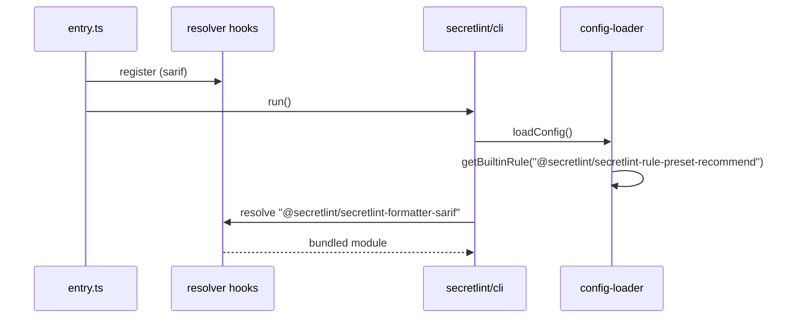

# 単一実行ファイルの設計

[English](design.md)

## このドキュメントについて

このドキュメントでは、[単一実行ファイル](requirements.ja.md)のビルド方法と、組み込みのルールとフォーマッターを提供する仕組みを説明します。
親のProductは[Secretlint](../../product.ja.md)です。

### 対象読者

実行ファイル、組み込みのルールとフォーマッター、実行ファイルのリリースを変更する人とエージェント。

### 前提知識

`bun build --compile`と、[設定の読み込み](../config-loading/requirements.ja.md)で説明している`@secretlint/resolver`のフック。

### このドキュメントで扱わないこと

実行ファイルが実行するCLIそのもの（`secretlint/cli`）。

## 実装方針

実行ファイルは、`secretlint`のCLIをBunで1つの実行ファイルにコンパイルしたものです。SARIFのフォーマッターを`node_modules`ではなく実行ファイルから提供するために、resolverのフックを使います。組み込みルールは`@secretlint/core`に含まれており、BunはCLIの一部として`@secretlint/core`をバンドルします。
ソースは`publish/binary-compiler/`にあります。

### エントリーポイント

`src/entry.ts`は、最初に`src/secretlint-resolver-hooks.ts`をimportします。そのうえで`--init`と`--version`は自身で処理し、それ以外は`secretlint/cli`の`run()`を実行します。

`--init`は、recommendプリセットとpatternルールを含む固定の`.secretlintrc.json`を書き込みます。Node.jsの`--init`は`package.json`に書かれたルールのパッケージを読みますが、実行ファイルの利用者は`package.json`を持っていないためです。
`--cwd`の扱いと既存の設定ファイルの確認はNode.jsのCLIと同じです。同時に作られたファイルを上書きしないように、`wx`フラグで書き込みます。
`--version`は、`build-binary.sh`がコンパイル時に埋め込んだ`SECRETLINT_VERSION`を表示します。

### 組み込みのルールとフォーマッター

組み込みルールにはフックは必要ありません。設定の読み込みは、パッケージを解決する前に`@secretlint/core`の組み込みの対応表からルールを見つけます。また、Bunは`@secretlint/core`をCLIと一緒にバンドルします。
そのため、すべての組み込みのルールとプリセット、およびその短い形のIDは、npmパッケージと同じように実行ファイルでも使えます。

`src/secretlint-resolver-hooks.ts`は`@secretlint/secretlint-formatter-sarif`を静的にimportするため、Bunはこのフォーマッターを実行ファイルにバンドルします。
このパッケージ名に対して、パッケージ名そのものをURLとして返すresolveフックと、importしたモジュールを返すimportフックを登録します。
フォーマッターの読み込みは`@secretlint/resolver`を通してパッケージ名を解決・importするため、このパッケージ名でファイルシステムを探すことはありません。ほかのパッケージ名は通常どおり解決されます。

### ビルドとリリース

`build-binary.sh`は、`linux-x64`、`linux-arm64`、`windows-x64`、`darwin-x64`、`darwin-arm64`のそれぞれについて`bun build --compile`を実行し、`secretlint-<version>-sha256sum.txt`を書き出します。
リリースワークフローの`publish-binary`ジョブは、npmパッケージの公開後に実行ファイルをビルドし、GitHubのリリースにアップロードします。
`test.sh`は、`--init`、設定ファイルがすでにある場合と`--cwd`を付けた場合の`--init`、`--version`、`--help`、`**/*`のlint、および`mask-result`フォーマッターの大きな出力が最後まで書き出されることを確認します。

## アーキテクチャ・シーケンス図

## データモデル・ER 図

なし。フックは、`@secretlint/secretlint-formatter-sarif`という1つのパッケージ名をそのモジュールに対応させます。

## API・インターフェース

インターフェースは`secretlint`のコマンドラインと、上で説明した`--init`と`--version`です。

## 外部サービスとの連携方式

リリースワークフローを通じてGitHub Releasesに公開します。

## データの取り扱い設計

CLIと同じです。`--init`は作業ディレクトリにファイルを1つ書き込みます。

## 認証認可に関する特記事項

なし。

## セキュリティ上の留意事項

実行ファイルはコード署名されていません。利用者は、チェックサムファイルを使ってダウンロードしたファイルを確認できます。

## デプロイに関する特記事項

`@secretlint/core`とフォーマッターのバージョンはビルド時のworkspaceのバージョンになるため、同じリリースの実行ファイルとnpmパッケージには同じルールが含まれます。

## 検討した代替手段

組み込みルールを`@secretlint/core`に移す前は、recommendプリセットとpatternルールもresolverのフックで提供していました。この方法ではフックに登録したパッケージしか使えないため、canaryプリセットや、ルールを個別のIDで指定する設定は使えませんでした。`@secretlint/core`からルールを見つける方法にしたことで、npmパッケージとの違いがなくなりました。

## 未決事項

なし。
