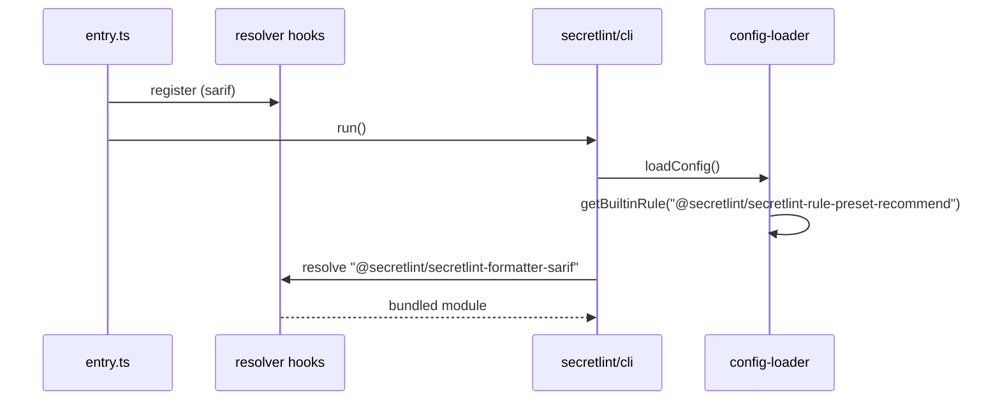

# 単一実行ファイルの設計

[English](design.md)

## この文書について

この文書は、[単一実行ファイル](requirements.ja.md)の実行ファイルをどうビルドし、組み込みのルールとフォーマッターをどう提供するかを説明します。
親のProductは[Secretlint](../../product.ja.md)です。

### 読者

実行ファイル、その組み込みのルールとフォーマッター、そのリリースを変える人とエージェント。

### 前提

`bun build --compile`と、[設定の読み込み](../config-loading/requirements.ja.md)が説明する`@secretlint/resolver`のresolverのフック。

### スコープ外

実行ファイルが動かすCLIそのもの（`secretlint/cli`）。

## 実装方針

実行ファイルは、`secretlint`のCLIをBunで1つの実行ファイルにコンパイルしたもので、SARIFのフォーマッターを`node_modules`ではなく実行ファイルから提供するresolverのフックを持ちます。組み込みルールは、BunがCLIの一部としてバンドルする`@secretlint/core`に含まれます。
ソースは`publish/binary-compiler/`にあります。

### エントリーポイント

`src/entry.ts`はまず`src/secretlint-resolver-hooks.ts`をimportし、`--init`と`--version`を自分で処理し、それ以外は`secretlint/cli`の`run()`を実行します。

`--init`はrecommendプリセットとpatternルールを持つ決まった`.secretlintrc.json`を書きます。Node.jsの`--init`は`package.json`のルールのパッケージを読みますが、実行ファイルの利用者はそれを持たないためです。
Node.jsのCLIの`--cwd`の扱いと既存の設定の確認を保ち、同時に作られたファイルを上書きしないよう`wx`フラグで書きます。
`--version`は、`build-binary.sh`がコンパイル時に埋め込んだ`SECRETLINT_VERSION`を表示します。

### 組み込みのルールとフォーマッター

組み込みルールにフックはいりません。設定の読み込みはパッケージを解決する前に`@secretlint/core`の組み込みの表から見つけ、Bunは`@secretlint/core`をCLIとともにバンドルします。
そのため、すべての組み込みのルールとプリセット、その短い形は、npmパッケージと同じように実行ファイルで動きます。

`src/secretlint-resolver-hooks.ts`は`@secretlint/secretlint-formatter-sarif`を静的にimportするので、Bunはそれを実行ファイルにバンドルします。
この名前について、パッケージ名そのものをURLとして返すresolveフックと、importしたモジュールを返すimportフックを登録します。
フォーマッターの読み込みは`@secretlint/resolver`を通して名前を解決・importするので、この名前はファイルシステムに届きません。ほかの名前は通常の解決に進みます。

### ビルドとリリース

`build-binary.sh`は`linux-x64`、`linux-arm64`、`windows-x64`、`darwin-x64`、`darwin-arm64`のそれぞれについて`bun build --compile`を実行し、`secretlint-<version>-sha256sum.txt`を書きます。
リリースのワークフローの`publish-binary`ジョブは、npmパッケージの公開のあとでそれらをビルドし、GitHubのリリースにアップロードします。
`test.sh`は、`--init`、設定がすでにある場合と`--cwd`付きの`--init`、`--version`、`--help`、`**/*`のlint、大きなJSONの出力が最後まで書かれることを確かめます。

## 構成図とシーケンス図

## データモデルとER図

なし。フックは3つのパッケージ名をモジュールに対応させます。

## APIとインターフェース

インターフェースは`secretlint`のコマンドラインと、上で説明した`--init`と`--version`です。

## 外部サービスとの連携

リリースのワークフローを通したGitHub Releases。

## データの扱い

CLIと同じです。`--init`は作業ディレクトリに1つのファイルを書きます。

## 認証と認可

なし。

## セキュリティの考慮

実行ファイルはコード署名されていません。チェックサムファイルで、利用者はダウンロードしたものを確かめられます。

## デプロイの注意

`@secretlint/core`とフォーマッターのバージョンはビルド時のworkspaceのバージョンなので、同じリリースの実行ファイルとnpmパッケージは同じルールを持ちます。

## 検討した代替案

組み込みルールが`@secretlint/core`に移る前は、実行ファイルはrecommendプリセットとpatternルールもresolverのフックで提供していました。フックにあるパッケージしか使えないので、canaryプリセットやルールを単独のIDで書いたものは使えませんでした。`@secretlint/core`からルールを見つけることで、その違いがなくなります。

## 未解決事項

なし。
