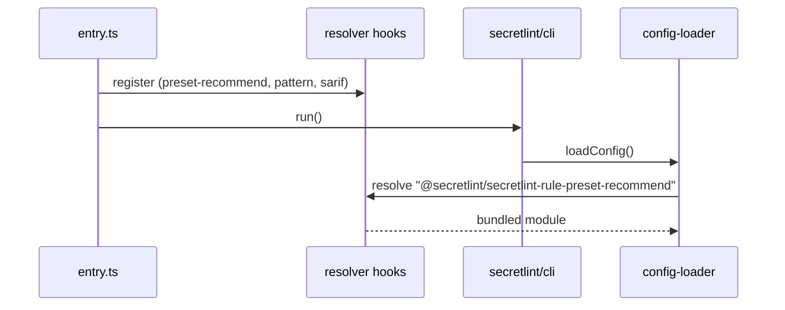

# Single-executable binary design

[日本語](design.ja.md)

## About this document

This document describes how the binary of [Single-executable binary](requirements.md) is built and how it provides its built-in packages.
The parent Product is [Secretlint](../../product.md).

### Audience

People and agents who change the binary, its built-in packages, or its release.

### Prerequisites

`bun build --compile`, and the resolver hooks of `@secretlint/resolver` described in [Configuration loading](../config-loading/requirements.md).

### Outside this document

The CLI itself (`secretlint/cli`), which the binary runs.

## Implementation approach

The binary is the `secretlint` CLI compiled by Bun into one executable, with resolver hooks that serve the built-in packages from the executable instead of `node_modules`.
The sources are in `publish/binary-compiler/`.

### Entry point

`src/entry.ts` first imports `src/secretlint-resolver-hooks.ts`, then handles `--init` and `--version` itself, and runs `run()` of `secretlint/cli` for everything else.

`--init` writes a fixed `.secretlintrc.json` with the recommended preset and the pattern rule, because the Node.js `--init` reads the rule packages of `package.json`, which a binary user does not have.
It keeps the `--cwd` handling and the existing-config check of the Node.js CLI, and writes with the `wx` flag so that a file created at the same moment is not overwritten.
`--version` prints `SECRETLINT_VERSION`, which `build-binary.sh` inlines at compile time.

### Built-in packages

`src/secretlint-resolver-hooks.ts` imports `@secretlint/secretlint-rule-preset-recommend`, `@secretlint/secretlint-rule-pattern`, and `@secretlint/secretlint-formatter-sarif` statically, so Bun bundles them into the executable.
It registers a resolve hook that returns the package name itself as the URL for these three names, and an import hook that returns the imported module for them.
The configuration loader and the formatter loader resolve and import names through `@secretlint/resolver`, so these names never reach the file system. Other names fall through to the normal resolution.

Because the hooks match exact package names, a rule id is built in only when its full package name is one of the three. The short form works because the configuration loader makes the full package name before it resolves.

### Build and release

`build-binary.sh` runs `bun build --compile` for each of `linux-x64`, `linux-arm64`, `windows-x64`, `darwin-x64`, and `darwin-arm64`, and writes `secretlint-<version>-sha256sum.txt`.
The `publish-binary` job of the release workflow builds and uploads them to the GitHub release after the npm packages are published.
`test.sh` checks `--init`, `--init` with an existing configuration and with `--cwd`, `--version`, `--help`, linting `**/*`, and that a large JSON output is written completely.

## Architecture and sequence diagrams

## Data model and ER diagrams

None. The hooks map three package names to modules.

## APIs and interfaces

The interface is the command line of `secretlint`, plus `--init` and `--version` as described above.

## External service integration

GitHub Releases, through the release workflow.

## Data handling

Same as the CLI. `--init` writes one file in the working directory.

## Authentication and authorization notes

None.

## Security considerations

The binaries are not code-signed. The checksum file lets a user verify a download.

## Deployment notes

The version of the built-in packages is the version in the workspace at build time, so the binary and the npm packages of the same release have the same rules.

## Alternatives considered

There is no record of alternatives to resolver hooks for the built-in packages.

## Open questions

None.
